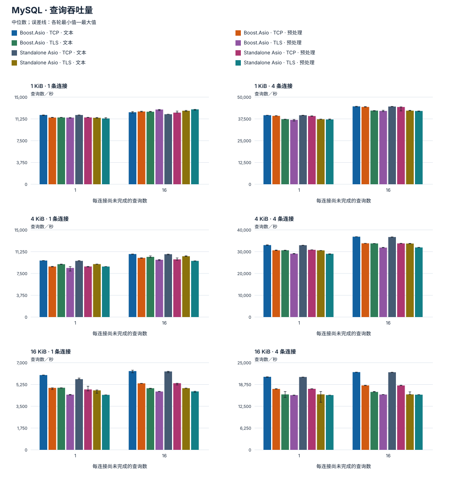
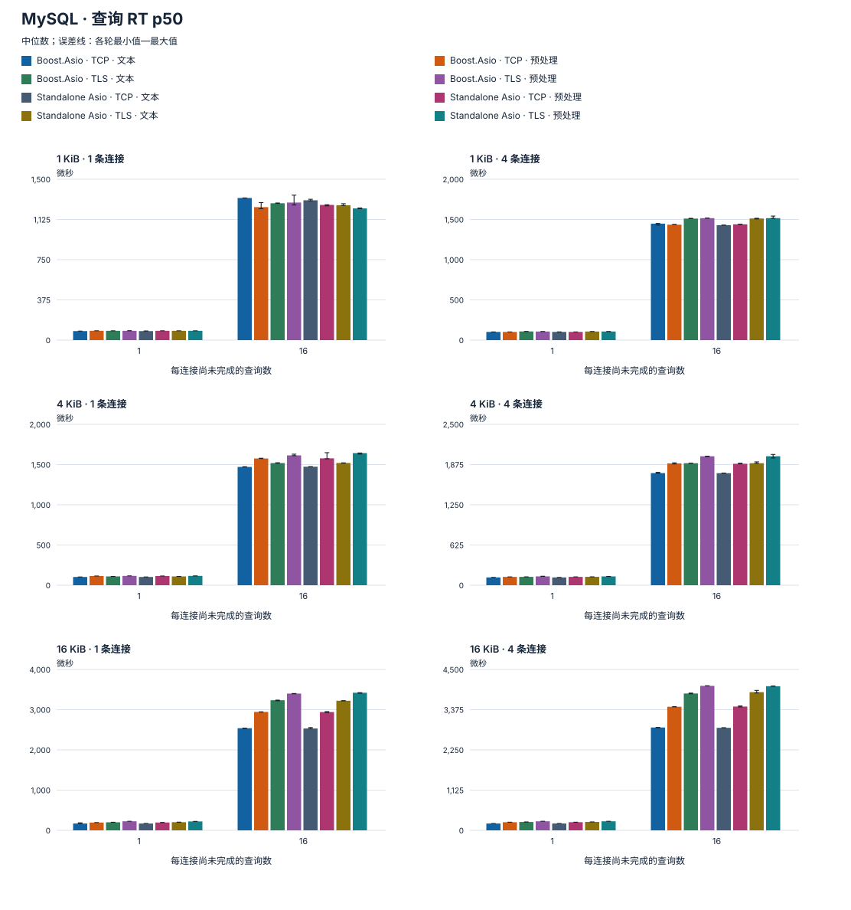
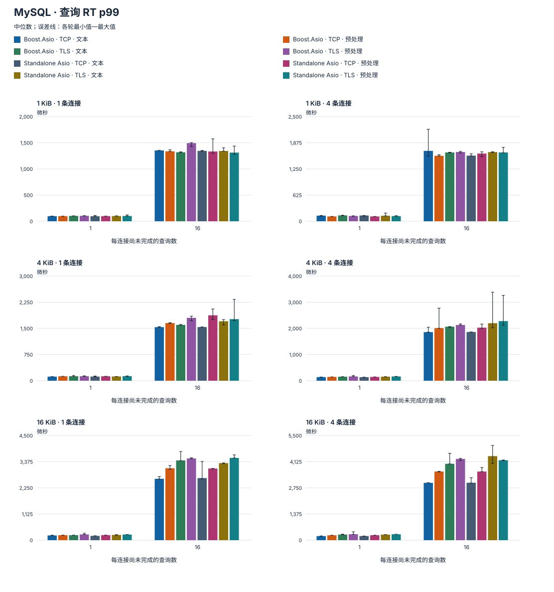
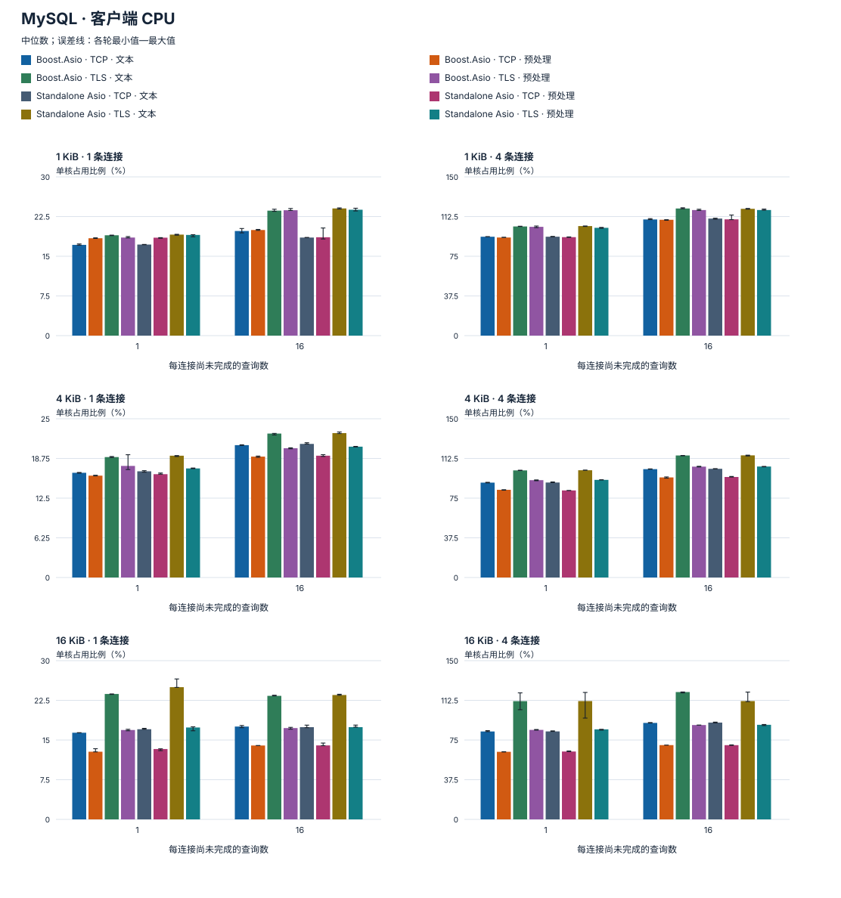
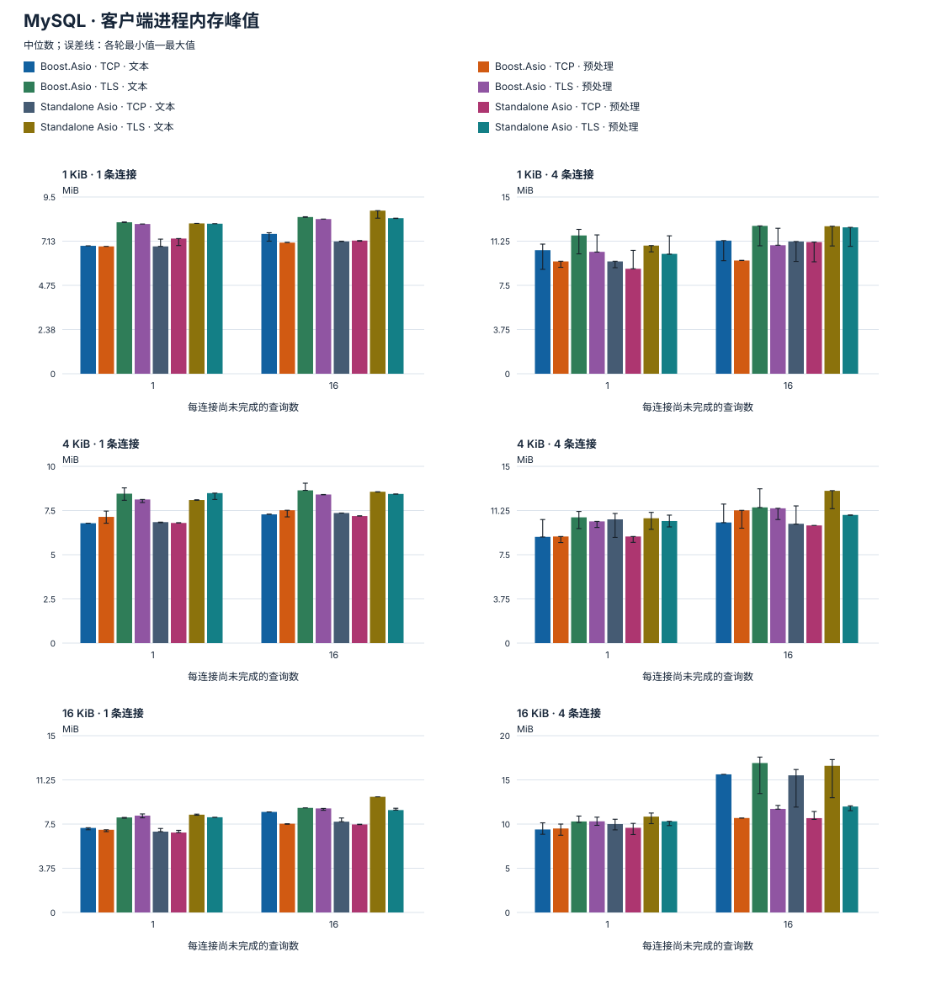

# MySQL 性能

柱为各轮中位数，误差线表示最小值到最大值；图中分位数是每轮分位数的中位数。

## 测试环境

| 项目 | 配置 |
| --- | --- |
| 测量时间（UTC） | 2026-10-15 14:13:27–14:18:32 |
| 机器 | Mac16,11 · Apple M4 Pro · arm64 |
| CPU（物理核／逻辑核） | 14 / 14 |
| 内存 | 48 GiB |
| 操作系统 | macOS 27.0.1 (26A434) |
| 编译器 | Apple Clang 21.0.0 (clang-2100.3.34.2) |
| 构建 | Release · -O3 -DNDEBUG · C++20 |
| 服务端 | MySQL Community Server 8.4.11 |
| 依赖库 | Boost 1.90.0 / Standalone Asio 1.38.2 / OpenSSL 3.6.4 |
| 认证 | caching_sha2_password |
| 服务端配置 | max_allowed_packet=64 MiB; max_connections=32; charset=utf8mb4; autocommit=ON |
| 连接数 | 1 / 4 |
| 包体 | 1 / 4 / 16 KiB |
| 每连接在途查询数 | 1 / 16 |
| 查询接口 | COM_QUERY / COM_STMT_EXECUTE |
| 传输方式 | TCP / TLS |
| 源码提交 | 9b02217b1405aafbc218f9857e0470a3b9b9e673 |
| 预热／每轮目标时长／轮数 | 0.15 s / 1 s / 3 |
| 负载组合 | 96 |

客户端与 MySQL 服务端在本机通过 IPv4 回环通信，TLS 证书链与 IP 身份验证保持启用。准备阶段先通过 TLS 认证并预热 caching_sha2_password 认证缓存，后续普通连接测量也使用该缓存。测量区间不包含建连、认证和语句准备。测量期间暂停其他编译和测试。

## 测量范围

只读文本／预处理 SELECT，验证二进制结果；回调接口，每条连接一个 IO context 和线程。查询 RT 包含客户端排队，同一条连接依次执行命令。

CPU 为客户端进程占用比例，以一个核心 100% 为基准，可超过 100%，不包含数据库服务端。RSS 是进程启动以来的内存峰值，包含预热及之前轮次，不是本轮新增内存。

每组至少保留 4405 个延迟样本；有上限的采样用于估计分位数。本地结果不等同于生产部署容量。

## 查询吞吐量

## 查询 RT p50

## 查询 RT p99

## 客户端 CPU

## 客户端进程内存峰值

## 详细结果

展开中位数表

| 依赖库／传输／模式 | 包体 B | 连接 | 每连接在途查询 | 查询数／秒 | 查询 p50 µs | 查询 p99 µs | CPU % | RSS MiB | 轮数 |
| --- | ---: | ---: | --- | ---: | ---: | ---: | ---: | ---: | ---: |
| Boost.Asio · TCP · 预处理 | 1024 | 1 | 1 | 11,477.82 | 86.67 | 98.33 | 18.4 | 6.84 | 3 |
| Boost.Asio · TCP · 文本 | 1024 | 1 | 1 | 11,925.4 | 83.96 | 95.92 | 17.15 | 6.88 | 3 |
| Boost.Asio · TLS · 预处理 | 1024 | 1 | 1 | 11,465.99 | 86.67 | 101.75 | 18.54 | 8.05 | 3 |
| Boost.Asio · TLS · 文本 | 1024 | 1 | 1 | 11,492.48 | 86.63 | 99.75 | 18.96 | 8.14 | 3 |
| Standalone Asio · TCP · 预处理 | 1024 | 1 | 1 | 11,500.95 | 86.79 | 97.38 | 18.51 | 7.27 | 3 |
| Standalone Asio · TCP · 文本 | 1024 | 1 | 1 | 11,917.36 | 83.92 | 96.21 | 17.21 | 6.84 | 3 |
| Standalone Asio · TLS · 预处理 | 1024 | 1 | 1 | 11,326.18 | 86.67 | 110.21 | 19.03 | 8.06 | 3 |
| Standalone Asio · TLS · 文本 | 1024 | 1 | 1 | 11,440.29 | 86.67 | 101.96 | 19.09 | 8.08 | 3 |
| Boost.Asio · TCP · 预处理 | 1024 | 1 | 16 | 12,521.49 | 1,277.33 | 1,326.67 | 19.96 | 7.05 | 3 |
| Boost.Asio · TCP · 文本 | 1024 | 1 | 16 | 12,393.89 | 1,296.04 | 1,357.33 | 19.77 | 7.52 | 3 |
| Boost.Asio · TLS · 预处理 | 1024 | 1 | 16 | 12,862.18 | 1,242.63 | 1,343.46 | 23.7 | 8.31 | 3 |
| Boost.Asio · TLS · 文本 | 1024 | 1 | 16 | 12,480.34 | 1,274.54 | 1,370.58 | 23.62 | 8.42 | 3 |
| Standalone Asio · TCP · 预处理 | 1024 | 1 | 16 | 12,326.21 | 1,302.58 | 1,335.96 | 18.59 | 7.16 | 3 |
| Standalone Asio · TCP · 文本 | 1024 | 1 | 16 | 12,051.37 | 1,328 | 1,356.04 | 18.53 | 7.11 | 3 |
| Standalone Asio · TLS · 预处理 | 1024 | 1 | 16 | 12,890.51 | 1,237.33 | 1,356.79 | 23.79 | 8.36 | 3 |
| Standalone Asio · TLS · 文本 | 1024 | 1 | 16 | 12,651.38 | 1,258.63 | 1,373.29 | 24.04 | 8.77 | 3 |
| Boost.Asio · TCP · 预处理 | 1024 | 4 | 1 | 39,235.03 | 101.46 | 114.92 | 92.72 | 9.53 | 3 |
| Boost.Asio · TCP · 文本 | 1024 | 4 | 1 | 39,609.73 | 100.58 | 115.17 | 93.44 | 10.48 | 3 |
| Boost.Asio · TLS · 预处理 | 1024 | 4 | 1 | 36,923.32 | 107.17 | 139.17 | 102.8 | 10.34 | 3 |
| Boost.Asio · TLS · 文本 | 1024 | 4 | 1 | 37,334.83 | 106.46 | 128.13 | 103.15 | 11.73 | 3 |
| Standalone Asio · TCP · 预处理 | 1024 | 4 | 1 | 39,141.81 | 101.67 | 117.92 | 93.06 | 8.91 | 3 |
| Standalone Asio · TCP · 文本 | 1024 | 4 | 1 | 39,606.57 | 100.63 | 115 | 93.46 | 9.53 | 3 |
| Standalone Asio · TLS · 预处理 | 1024 | 4 | 1 | 37,184.23 | 106.96 | 125.67 | 101.86 | 10.17 | 3 |
| Standalone Asio · TLS · 文本 | 1024 | 4 | 1 | 37,298.3 | 106.63 | 124.54 | 103.52 | 10.88 | 3 |
| Boost.Asio · TCP · 预处理 | 1024 | 4 | 16 | 44,368.3 | 1,436.92 | 1,555.71 | 109.46 | 9.61 | 3 |
| Boost.Asio · TCP · 文本 | 1024 | 4 | 16 | 44,678.19 | 1,424.96 | 1,576.46 | 109.77 | 11.3 | 3 |
| Boost.Asio · TLS · 预处理 | 1024 | 4 | 16 | 42,081.29 | 1,515.13 | 1,670.92 | 118.66 | 10.91 | 3 |
| Boost.Asio · TLS · 文本 | 1024 | 4 | 16 | 42,261.07 | 1,508.25 | 1,633.71 | 120.13 | 12.55 | 3 |
| Standalone Asio · TCP · 预处理 | 1024 | 4 | 16 | 44,328.95 | 1,435.63 | 1,588.25 | 109.87 | 11.17 | 3 |
| Standalone Asio · TCP · 文本 | 1024 | 4 | 16 | 44,597.46 | 1,429.17 | 1,550.63 | 110.62 | 11.22 | 3 |
| Standalone Asio · TLS · 预处理 | 1024 | 4 | 16 | 42,045.57 | 1,516.54 | 1,643.63 | 118.69 | 12.42 | 3 |
| Standalone Asio · TLS · 文本 | 1024 | 4 | 16 | 42,228.72 | 1,509.54 | 1,631.5 | 119.82 | 12.52 | 3 |
| Boost.Asio · TCP · 预处理 | 4096 | 1 | 1 | 8,694.62 | 114.63 | 128.54 | 16.04 | 7.14 | 3 |
| Boost.Asio · TCP · 文本 | 4096 | 1 | 1 | 9,725.14 | 102.58 | 117.75 | 16.49 | 6.78 | 3 |
| Boost.Asio · TLS · 预处理 | 4096 | 1 | 1 | 8,452.39 | 116 | 147 | 17.57 | 8.13 | 3 |
| Boost.Asio · TLS · 文本 | 4096 | 1 | 1 | 9,097.82 | 109.29 | 122.63 | 18.97 | 8.45 | 3 |
| Standalone Asio · TCP · 预处理 | 4096 | 1 | 1 | 8,703.26 | 114.63 | 127.92 | 16.27 | 6.8 | 3 |
| Standalone Asio · TCP · 文本 | 4096 | 1 | 1 | 9,669.13 | 102.63 | 118.42 | 16.73 | 6.84 | 3 |
| Standalone Asio · TLS · 预处理 | 4096 | 1 | 1 | 8,690.27 | 114.71 | 130.75 | 17.18 | 8.48 | 3 |
| Standalone Asio · TLS · 文本 | 4096 | 1 | 1 | 9,110.18 | 109.29 | 122.63 | 19.18 | 8.09 | 3 |
| Boost.Asio · TCP · 预处理 | 4096 | 1 | 16 | 10,180.92 | 1,569.29 | 1,674.63 | 19.04 | 7.52 | 3 |
| Boost.Asio · TCP · 文本 | 4096 | 1 | 16 | 10,844.28 | 1,471.92 | 1,564.33 | 20.85 | 7.28 | 3 |
| Boost.Asio · TLS · 预处理 | 4096 | 1 | 16 | 9,860.24 | 1,614.67 | 1,789.58 | 20.36 | 8.41 | 3 |
| Boost.Asio · TLS · 文本 | 4096 | 1 | 16 | 10,354.92 | 1,532.75 | 1,707.67 | 22.67 | 8.64 | 3 |
| Standalone Asio · TCP · 预处理 | 4096 | 1 | 16 | 9,926.76 | 1,573.54 | 1,738.58 | 19.18 | 7.19 | 3 |
| Standalone Asio · TCP · 文本 | 4096 | 1 | 16 | 10,814.59 | 1,477.04 | 1,558.46 | 21.04 | 7.36 | 3 |
| Standalone Asio · TLS · 预处理 | 4096 | 1 | 16 | 9,667.21 | 1,650.71 | 1,759.42 | 20.61 | 8.44 | 3 |
| Standalone Asio · TLS · 文本 | 4096 | 1 | 16 | 10,467.26 | 1,519.71 | 1,661.29 | 22.74 | 8.56 | 3 |
| Boost.Asio · TCP · 预处理 | 4096 | 4 | 1 | 30,620.88 | 129.63 | 156.67 | 82.87 | 9.05 | 3 |
| Boost.Asio · TCP · 文本 | 4096 | 4 | 1 | 33,024.93 | 120.67 | 134.71 | 89.66 | 9.02 | 3 |
| Boost.Asio · TLS · 预处理 | 4096 | 4 | 1 | 29,070.37 | 136.71 | 164.38 | 91.99 | 10.33 | 3 |
| Boost.Asio · TLS · 文本 | 4096 | 4 | 1 | 30,640.73 | 129.96 | 150.67 | 101.22 | 10.67 | 3 |
| Standalone Asio · TCP · 预处理 | 4096 | 4 | 1 | 30,855.87 | 129.17 | 147.13 | 82.27 | 9.05 | 3 |
| Standalone Asio · TCP · 文本 | 4096 | 4 | 1 | 32,962.09 | 120.88 | 135.42 | 89.77 | 10.5 | 3 |
| Standalone Asio · TLS · 预处理 | 4096 | 4 | 1 | 29,021.16 | 136.96 | 164.88 | 92.26 | 10.36 | 3 |
| Standalone Asio · TLS · 文本 | 4096 | 4 | 1 | 30,580.88 | 130.13 | 154.92 | 101.35 | 10.59 | 3 |
| Boost.Asio · TCP · 预处理 | 4096 | 4 | 16 | 33,831.74 | 1,888.25 | 2,010.13 | 94.58 | 11.27 | 3 |
| Boost.Asio · TCP · 文本 | 4096 | 4 | 16 | 36,873.01 | 1,730.83 | 1,843.5 | 102.4 | 10.23 | 3 |
| Boost.Asio · TLS · 预处理 | 4096 | 4 | 16 | 31,872.15 | 2,002.29 | 2,170.29 | 104.77 | 11.44 | 3 |
| Boost.Asio · TLS · 文本 | 4096 | 4 | 16 | 33,783.48 | 1,890.58 | 2,023.17 | 115.32 | 11.52 | 3 |
| Standalone Asio · TCP · 预处理 | 4096 | 4 | 16 | 33,804.04 | 1,887.25 | 2,020.92 | 94.99 | 9.98 | 3 |
| Standalone Asio · TCP · 文本 | 4096 | 4 | 16 | 36,726.85 | 1,737.17 | 1,850.42 | 102.71 | 10.13 | 3 |
| Standalone Asio · TLS · 预处理 | 4096 | 4 | 16 | 31,943.26 | 2,000 | 2,161.29 | 104.87 | 10.88 | 3 |
| Standalone Asio · TLS · 文本 | 4096 | 4 | 16 | 33,734.36 | 1,891.42 | 2,014.13 | 115.43 | 12.92 | 3 |
| Boost.Asio · TCP · 预处理 | 16384 | 1 | 1 | 4,977.85 | 198.67 | 218.58 | 12.79 | 7.02 | 3 |
| Boost.Asio · TCP · 文本 | 16384 | 1 | 1 | 6,006.38 | 165.33 | 184.25 | 16.38 | 7.17 | 3 |
| Boost.Asio · TLS · 预处理 | 16384 | 1 | 1 | 4,432.97 | 224.04 | 242.42 | 16.89 | 8.22 | 3 |
| Boost.Asio · TLS · 文本 | 16384 | 1 | 1 | 4,986.4 | 201.29 | 219.96 | 23.7 | 8.06 | 3 |
| Standalone Asio · TCP · 预处理 | 16384 | 1 | 1 | 4,853.75 | 205.63 | 226.25 | 13.3 | 6.78 | 3 |
| Standalone Asio · TCP · 文本 | 16384 | 1 | 1 | 5,676.9 | 177.33 | 197.92 | 17.04 | 6.86 | 3 |
| Standalone Asio · TLS · 预处理 | 16384 | 1 | 1 | 4,415.12 | 225.29 | 249.25 | 17.37 | 8.08 | 3 |
| Standalone Asio · TLS · 文本 | 16384 | 1 | 1 | 4,776.8 | 207.08 | 253.75 | 24.99 | 8.3 | 3 |
| Boost.Asio · TCP · 预处理 | 16384 | 1 | 16 | 5,341.87 | 2,987.96 | 3,177.88 | 13.96 | 7.53 | 3 |
| Boost.Asio · TCP · 文本 | 16384 | 1 | 16 | 6,325.37 | 2,526.58 | 2,703.58 | 17.55 | 8.53 | 3 |
| Boost.Asio · TLS · 预处理 | 16384 | 1 | 16 | 4,683.51 | 3,413.33 | 3,523.92 | 17.26 | 8.83 | 3 |
| Boost.Asio · TLS · 文本 | 16384 | 1 | 16 | 4,947.7 | 3,233.33 | 3,353.83 | 23.35 | 8.88 | 3 |
| Standalone Asio · TCP · 预处理 | 16384 | 1 | 16 | 5,351.24 | 2,987.88 | 3,131.58 | 13.98 | 7.47 | 3 |
| Standalone Asio · TCP · 文本 | 16384 | 1 | 16 | 6,295.41 | 2,538.58 | 2,671.08 | 17.43 | 7.7 | 3 |
| Standalone Asio · TLS · 预处理 | 16384 | 1 | 16 | 4,691.74 | 3,404.04 | 3,569.33 | 17.44 | 8.69 | 3 |
| Standalone Asio · TLS · 文本 | 16384 | 1 | 16 | 4,951.64 | 3,220.88 | 3,414.21 | 23.51 | 9.81 | 3 |
| Boost.Asio · TCP · 预处理 | 16384 | 4 | 1 | 17,475.36 | 227.79 | 263.54 | 63.85 | 9.5 | 3 |
| Boost.Asio · TCP · 文本 | 16384 | 4 | 1 | 20,948.01 | 190.42 | 214.46 | 83.08 | 9.39 | 3 |
| Boost.Asio · TLS · 预处理 | 16384 | 4 | 1 | 15,695.19 | 252.54 | 309.29 | 84.58 | 10.31 | 3 |
| Boost.Asio · TLS · 文本 | 16384 | 4 | 1 | 15,903.63 | 234.29 | 296 | 111.74 | 10.3 | 3 |
| Standalone Asio · TCP · 预处理 | 16384 | 4 | 1 | 17,504.62 | 227.46 | 263.79 | 64.14 | 9.58 | 3 |
| Standalone Asio · TCP · 文本 | 16384 | 4 | 1 | 20,895.41 | 190.75 | 223.42 | 83.14 | 10 | 3 |
| Standalone Asio · TLS · 预处理 | 16384 | 4 | 1 | 15,702.08 | 252.42 | 309.83 | 85.08 | 10.31 | 3 |
| Standalone Asio · TLS · 文本 | 16384 | 4 | 1 | 15,916.37 | 234.21 | 298.63 | 111.81 | 10.84 | 3 |
| Boost.Asio · TCP · 预处理 | 16384 | 4 | 16 | 18,485.74 | 3,458.42 | 3,582.67 | 70.19 | 10.69 | 3 |
| Boost.Asio · TCP · 文本 | 16384 | 4 | 16 | 22,297.37 | 2,864.29 | 3,001.79 | 91.17 | 15.63 | 3 |
| Boost.Asio · TLS · 预处理 | 16384 | 4 | 16 | 15,862.27 | 4,030.92 | 4,190.25 | 89.16 | 11.72 | 3 |
| Boost.Asio · TLS · 文本 | 16384 | 4 | 16 | 16,617.67 | 3,841.42 | 4,113.71 | 120.33 | 16.91 | 3 |
| Standalone Asio · TCP · 预处理 | 16384 | 4 | 16 | 18,466.38 | 3,460.79 | 3,591.17 | 70.14 | 10.67 | 3 |
| Standalone Asio · TCP · 文本 | 16384 | 4 | 16 | 22,252.18 | 2,870.71 | 3,016 | 91.48 | 15.52 | 3 |
| Standalone Asio · TLS · 预处理 | 16384 | 4 | 16 | 15,822.66 | 4,039.79 | 4,214.13 | 89.38 | 11.98 | 3 |
| Standalone Asio · TLS · 文本 | 16384 | 4 | 16 | 15,901.89 | 3,812.71 | 4,030.04 | 111.81 | 16.59 | 3 |

## 复现与来源

[编译并运行基准程序](../../../benchmarks/mysql_CN.md) · [接口使用](usage_CN.md)

[下载原始测量数据与元数据](<https://github.com/OpenArkStudio/arknet/releases/download/v0.2.0/arknet-0.2.0-benchmark-data.tar.gz>)

原始数据集合 SHA-256: `c956a158708acf3d577d49d48d96358723d8886e0b82c856769f09589623bb1c`

| 测量源码 | SHA-256 |
| --- | --- |
| benchmarks/mysql.cpp | `badd0dfa01bb4c61de94893f8ad7a003eb48e146060651c8ad2f455e01a07d5c` |
| benchmarks/resources.hpp | `d6056569c5c660e6bc22adce7a3a583d87f8b6ec514770cc7dcf16f416fc8054` |
| include/arknet/base/detail/deadline.hpp | `767f8456a5961a6264e7c49aef4adc3438f63d0eaf5d15793a0d24c9224d4c0d` |
| include/arknet/base/detail/future.hpp | `f890053100ef610a60d9be7cfa41378c09895d37ff42d9b5cd01bd23418663ee` |
| include/arknet/base/error.hpp | `688e20d0ff4d3166316c11379d0001ba7fd0a80ff99d6c3b347f4fccf97d1d05` |
| include/arknet/base/io_pool.hpp | `8ee8e6eae6c715c65179101de849b95c2ce16873d8e361c1b279556cf2641dc1` |
| include/arknet/config.hpp | `62065289aefbd845ae8c9f3562f6e2872b6ff92f72b2add4ca7be75e696e3f27` |
| include/arknet/external/asio.hpp | `910980772d975b219e001d718af75e9a70d1a30ecd73fd38073051e78b339f8a` |
| include/arknet/external/assert.hpp | `e387a797d5b315bc8d94e280bfe4a0ac7527efabb41b0ffa6ed854f30b21a018` |
| include/arknet/mysql/connection.hpp | `8e88c222abe98b7cc1e5e1aa27053cef8c080ea5c8b9ef01852372e4dca7d1c0` |
| include/arknet/mysql/detail/auth.hpp | `867c9f2a0d842405ce88d0513e58d8fe3ea76bc2bee89fe9438d15cde4b0933c` |
| include/arknet/mysql/detail/command.hpp | `8b93a09c5003622b9f52aefbb781feb0ec642df96b4513af464acb6d61d21aba` |
| include/arknet/mysql/detail/handshake.hpp | `f6c94b4f6fe9ee6645fa6b728fb1b59b480e1390f0c3525ebfb34426f15b44cf` |
| include/arknet/mysql/detail/wire.hpp | `b432b1c488772d05da58e80e9ceadd09151feeb4724bfe4e92ab83359d58a317` |
| include/arknet/mysql/pool.hpp | `44e56ac33457dad19dcd80fccef10cd657acddb35a10ca9d7035435aeeb419bb` |
| tests/certs/ca.pem | `83237c5bc8bece54c98bba65c58a13a086ad9b0139a941df390d34836c7febd7` |
