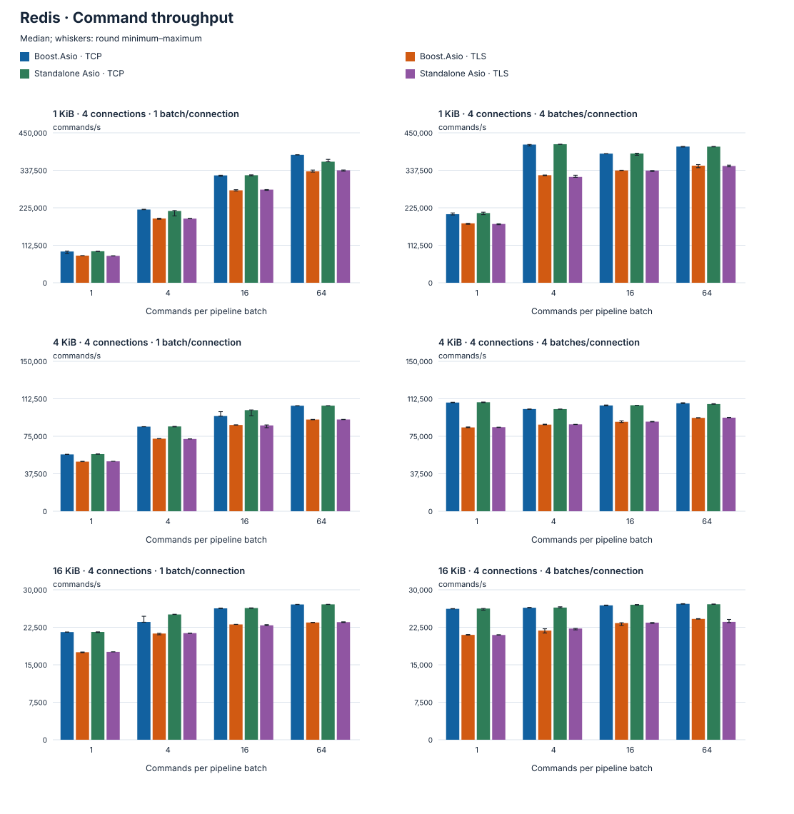
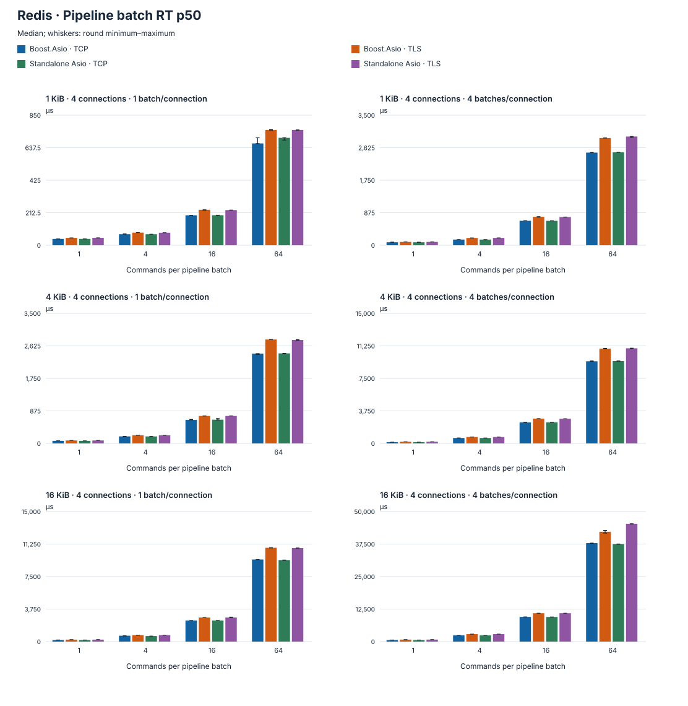
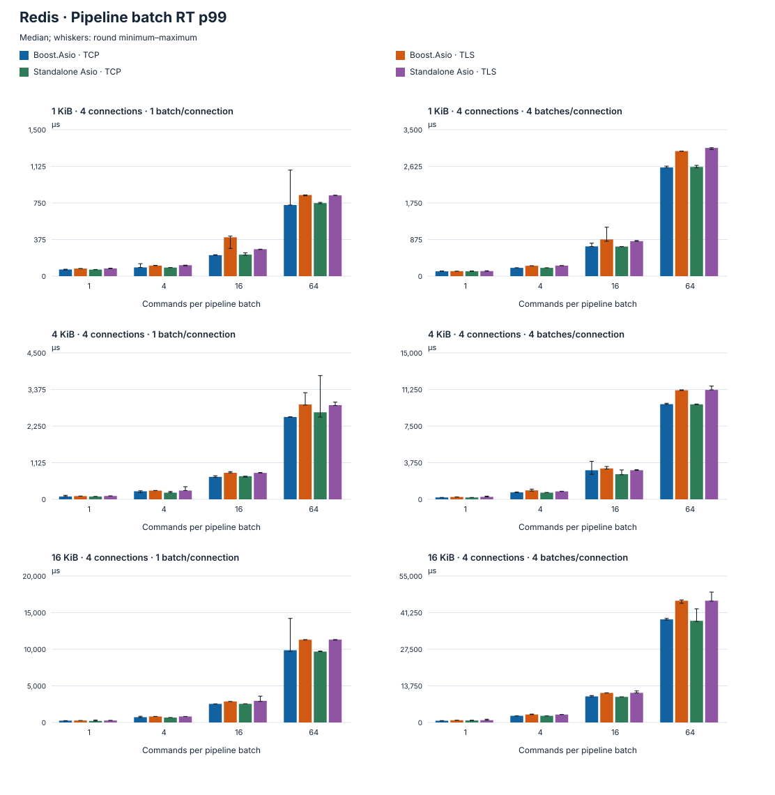
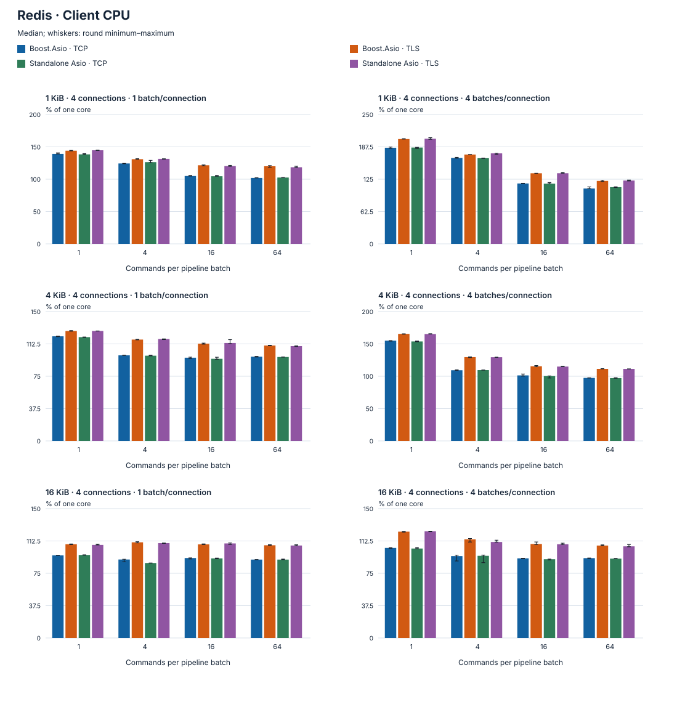
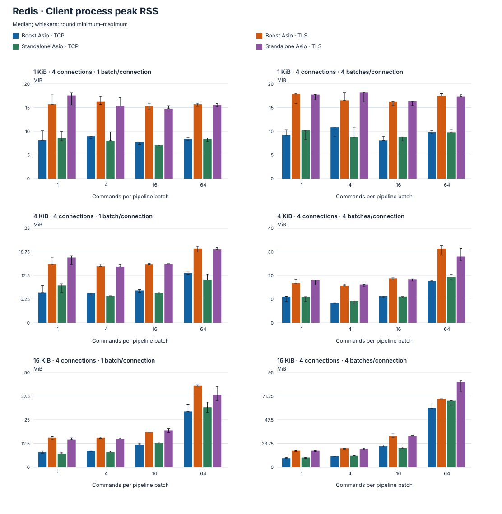

# Redis Performance

Bars show round medians; whiskers show minimum–maximum. Latency summaries are medians of the per-round percentiles.

## Test environment

| Item | Configuration |
| --- | --- |
| Measurement (UTC) | 2026-10-15 12:40:58–12:46:04 |
| Machine | Mac16,11 · Apple M4 Pro · arm64 |
| CPU (physical / logical cores) | 14 / 14 |
| Memory | 48 GiB |
| Operating system | macOS 27.0.1 (26A434) |
| Compiler | Apple Clang 21.0.0 (clang-2100.3.34.2) |
| Build | Release · -O3 -DNDEBUG · C++20 |
| Server | Valkey 8.0.11 · RESP3 · AUTH=ON · AOF/RDB=OFF |
| Dependencies | Boost 1.90.0 / Standalone Asio 1.38.2 / OpenSSL 3.6.4 |
| Connections | 4 |
| Payload | 1 / 4 / 16 KiB |
| Commands per batch | 1 / 4 / 16 / 64 |
| Batches in flight per connection | 1 / 4 |
| Transport | TCP / TLS · RESP3 · ECHO |
| Source commit | a806399f70d741c7a9d6bb9a296c0a9a7f920aa3 |
| Official server source SHA-256 | e4ee4ad51c2e9cb75c5fac8865d34792482a597bf3b136b42b296c9933bd31f8 |
| Warmup / target duration / rounds | 0.15 s / 1 s / 3 |
| Workload combinations | 96 |

Client and Valkey server run on this machine over IPv4 loopback. TLS certificate-chain and IP identity verification are enabled. Client CPU excludes the server process. Other local builds and tests were paused during measurement.

## Measurement scope

Binary ECHO with every reply verified; callback API, one IO context/thread per connection. RT measures the entire pipeline batch including client queueing, not individual command latency.

CPU is client process usage with one full core at 100%; it can exceed 100% and excludes the database server. RSS is the process lifetime peak, including warmup and earlier rounds, not newly allocated memory in that round.

Every group retains at least 371 latency samples per round. Bounded sampling estimates percentiles. Local results do not establish production deployment capacity.

## Command throughput

## Pipeline batch RT p50

## Pipeline batch RT p99

## Client CPU

## Client process peak RSS

## Detailed results

Expand median results

| Dependency / transport / mode | Payload B | Clients | Commands/batch / batches in-flight | Commands/s | Batch p50 µs | Batch p99 µs | CPU % | RSS MiB | Rounds |
| --- | ---: | ---: | --- | ---: | ---: | ---: | ---: | ---: | ---: |
| Boost.Asio · TCP | 1024 | 4 | 1 / 1 | 94,977.1 | 41.33 | 68.33 | 138.79 | 8.11 | 3 |
| Boost.Asio · TLS | 1024 | 4 | 1 / 1 | 81,070.11 | 48.25 | 77.88 | 144.91 | 15.7 | 3 |
| Standalone Asio · TCP | 1024 | 4 | 1 / 1 | 94,774.71 | 41.33 | 67.04 | 137.95 | 8.53 | 3 |
| Standalone Asio · TLS | 1024 | 4 | 1 / 1 | 80,505.19 | 48.54 | 78.63 | 143.49 | 17.56 | 3 |
| Boost.Asio · TCP | 1024 | 4 | 4 / 1 | 219,712.78 | 72.04 | 89.58 | 124.98 | 8.94 | 3 |
| Boost.Asio · TLS | 1024 | 4 | 4 / 1 | 191,330.54 | 82.5 | 108.21 | 130.59 | 16.22 | 3 |
| Standalone Asio · TCP | 1024 | 4 | 4 / 1 | 219,889.55 | 72 | 88.13 | 125.08 | 8 | 3 |
| Standalone Asio · TLS | 1024 | 4 | 4 / 1 | 192,803.77 | 81.83 | 112.13 | 131.6 | 15.38 | 3 |
| Boost.Asio · TCP | 1024 | 4 | 16 / 1 | 325,920.02 | 195.75 | 215.13 | 104.12 | 7.72 | 3 |
| Boost.Asio · TLS | 1024 | 4 | 16 / 1 | 269,583.55 | 231.63 | 397.96 | 124.15 | 15.3 | 3 |
| Standalone Asio · TCP | 1024 | 4 | 16 / 1 | 324,552.7 | 196.29 | 220.58 | 104.48 | 7.06 | 3 |
| Standalone Asio · TLS | 1024 | 4 | 16 / 1 | 277,364.92 | 229.75 | 276 | 121.19 | 14.77 | 3 |
| Boost.Asio · TCP | 1024 | 4 | 64 / 1 | 383,186.47 | 665.58 | 728.38 | 101.87 | 8.36 | 3 |
| Boost.Asio · TLS | 1024 | 4 | 64 / 1 | 338,837.85 | 753.29 | 831.13 | 117.89 | 15.7 | 3 |
| Standalone Asio · TCP | 1024 | 4 | 64 / 1 | 364,317.39 | 701.96 | 748.42 | 101.9 | 8.34 | 3 |
| Standalone Asio · TLS | 1024 | 4 | 64 / 1 | 338,855.57 | 753.33 | 827.54 | 118.01 | 15.56 | 3 |
| Boost.Asio · TCP | 1024 | 4 | 1 / 4 | 206,816.36 | 80.25 | 115.71 | 186.13 | 9.23 | 3 |
| Boost.Asio · TLS | 1024 | 4 | 1 / 4 | 178,512.05 | 89.46 | 119.25 | 205.21 | 17.89 | 3 |
| Standalone Asio · TCP | 1024 | 4 | 1 / 4 | 205,711.08 | 80.21 | 116.71 | 186.33 | 10.22 | 3 |
| Standalone Asio · TLS | 1024 | 4 | 1 / 4 | 176,903.92 | 89.79 | 120.83 | 202.81 | 17.75 | 3 |
| Boost.Asio · TCP | 1024 | 4 | 4 / 4 | 414,580.57 | 153 | 198.63 | 166.08 | 10.84 | 3 |
| Boost.Asio · TLS | 1024 | 4 | 4 / 4 | 324,073.67 | 196.5 | 247.71 | 173.45 | 16.53 | 3 |
| Standalone Asio · TCP | 1024 | 4 | 4 / 4 | 414,964.74 | 152.79 | 198.38 | 165.98 | 8.8 | 3 |
| Standalone Asio · TLS | 1024 | 4 | 4 / 4 | 321,598.56 | 197.92 | 252.5 | 173.41 | 18.16 | 3 |
| Boost.Asio · TCP | 1024 | 4 | 16 / 4 | 388,626.66 | 657.67 | 711.5 | 116.46 | 8.06 | 3 |
| Boost.Asio · TLS | 1024 | 4 | 16 / 4 | 330,166.9 | 764.75 | 878.13 | 139.41 | 16.2 | 3 |
| Standalone Asio · TCP | 1024 | 4 | 16 / 4 | 389,401 | 656.54 | 707.38 | 115.91 | 8.81 | 3 |
| Standalone Asio · TLS | 1024 | 4 | 16 / 4 | 336,083.67 | 758.54 | 837.08 | 137 | 16.3 | 3 |
| Boost.Asio · TCP | 1024 | 4 | 64 / 4 | 410,193.69 | 2,492.92 | 2,598 | 104.25 | 9.81 | 3 |
| Boost.Asio · TLS | 1024 | 4 | 64 / 4 | 354,704.41 | 2,886.04 | 2,988.92 | 121.01 | 17.44 | 3 |
| Standalone Asio · TCP | 1024 | 4 | 64 / 4 | 408,541.53 | 2,502.54 | 2,611.42 | 110.57 | 9.78 | 3 |
| Standalone Asio · TLS | 1024 | 4 | 64 / 4 | 349,469.93 | 2,926.08 | 3,064.75 | 121.67 | 17.28 | 3 |
| Boost.Asio · TCP | 4096 | 4 | 1 / 1 | 57,143.87 | 69.25 | 86.25 | 121.04 | 8.02 | 3 |
| Boost.Asio · TLS | 4096 | 4 | 1 / 1 | 49,987.56 | 79.29 | 99.21 | 127.91 | 15.53 | 3 |
| Standalone Asio · TCP | 4096 | 4 | 1 / 1 | 57,220.26 | 69.17 | 84.71 | 120.39 | 9.84 | 3 |
| Standalone Asio · TLS | 4096 | 4 | 1 / 1 | 49,699.48 | 79.67 | 102.58 | 127.51 | 17.2 | 3 |
| Boost.Asio · TCP | 4096 | 4 | 4 / 1 | 83,476.78 | 189.04 | 246.67 | 100.7 | 7.88 | 3 |
| Boost.Asio · TLS | 4096 | 4 | 4 / 1 | 72,420.58 | 219.79 | 267.33 | 118.1 | 14.86 | 3 |
| Standalone Asio · TCP | 4096 | 4 | 4 / 1 | 84,782.46 | 188.33 | 204.08 | 99.21 | 7.06 | 3 |
| Standalone Asio · TLS | 4096 | 4 | 4 / 1 | 72,440.66 | 219.79 | 269 | 118.37 | 14.77 | 3 |
| Boost.Asio · TCP | 4096 | 4 | 16 / 1 | 101,082.01 | 632.42 | 690.08 | 95.29 | 8.52 | 3 |
| Boost.Asio · TLS | 4096 | 4 | 16 / 1 | 86,352.19 | 739.08 | 814.04 | 112.53 | 15.45 | 3 |
| Standalone Asio · TCP | 4096 | 4 | 16 / 1 | 99,420.9 | 638.88 | 709.71 | 95.46 | 7.95 | 3 |
| Standalone Asio · TLS | 4096 | 4 | 16 / 1 | 86,369.82 | 738.79 | 812.21 | 112.66 | 15.55 | 3 |
| Boost.Asio · TCP | 4096 | 4 | 64 / 1 | 105,742.53 | 2,417.25 | 2,529.33 | 97.64 | 13.14 | 3 |
| Boost.Asio · TLS | 4096 | 4 | 64 / 1 | 91,444.07 | 2,796.63 | 2,914 | 110.71 | 19.55 | 3 |
| Standalone Asio · TCP | 4096 | 4 | 64 / 1 | 105,254.71 | 2,422.96 | 2,674.17 | 97.55 | 11.41 | 3 |
| Standalone Asio · TLS | 4096 | 4 | 64 / 1 | 91,928.83 | 2,783.42 | 2,893.08 | 110.48 | 19.39 | 3 |
| Boost.Asio · TCP | 4096 | 4 | 1 / 4 | 108,917.95 | 145.46 | 191.63 | 154.54 | 11.06 | 3 |
| Boost.Asio · TLS | 4096 | 4 | 1 / 4 | 84,200.3 | 188.67 | 239.92 | 166.34 | 16.78 | 3 |
| Standalone Asio · TCP | 4096 | 4 | 1 / 4 | 108,915.21 | 145.58 | 190.17 | 154.87 | 11 | 3 |
| Standalone Asio · TLS | 4096 | 4 | 1 / 4 | 83,012.67 | 190.29 | 251.83 | 166.7 | 18.11 | 3 |
| Boost.Asio · TCP | 4096 | 4 | 4 / 4 | 101,965.84 | 626.08 | 712.38 | 109.68 | 8.41 | 3 |
| Boost.Asio · TLS | 4096 | 4 | 4 / 4 | 85,728.62 | 737.08 | 916.42 | 130.57 | 15.61 | 3 |
| Standalone Asio · TCP | 4096 | 4 | 4 / 4 | 102,036.67 | 626.67 | 684.25 | 109.74 | 9.19 | 3 |
| Standalone Asio · TLS | 4096 | 4 | 4 / 4 | 86,635.25 | 736.21 | 812.38 | 130.12 | 16.27 | 3 |
| Boost.Asio · TCP | 4096 | 4 | 16 / 4 | 104,731.23 | 2,417.71 | 2,974.88 | 103.43 | 11.28 | 3 |
| Boost.Asio · TLS | 4096 | 4 | 16 / 4 | 89,481.97 | 2,854.42 | 3,165.25 | 116.48 | 18.8 | 3 |
| Standalone Asio · TCP | 4096 | 4 | 16 / 4 | 105,152.61 | 2,422.29 | 2,574.79 | 101.53 | 11.08 | 3 |
| Standalone Asio · TLS | 4096 | 4 | 16 / 4 | 89,829.49 | 2,843.5 | 2,981.13 | 115.35 | 18.42 | 3 |
| Boost.Asio · TCP | 4096 | 4 | 64 / 4 | 107,788.12 | 9,475 | 9,745.96 | 97.56 | 17.58 | 3 |
| Boost.Asio · TLS | 4096 | 4 | 64 / 4 | 93,600.39 | 10,933.79 | 11,174.58 | 110.59 | 31.25 | 3 |
| Standalone Asio · TCP | 4096 | 4 | 64 / 4 | 107,513.5 | 9,503.54 | 9,728.75 | 97.89 | 19.33 | 3 |
| Standalone Asio · TLS | 4096 | 4 | 64 / 4 | 93,191.59 | 10,970.5 | 11,206.75 | 111.27 | 28.09 | 3 |
| Boost.Asio · TCP | 16384 | 4 | 1 / 1 | 21,279.54 | 185.33 | 246.83 | 96.23 | 7.92 | 3 |
| Boost.Asio · TLS | 16384 | 4 | 1 / 1 | 17,583.66 | 226.08 | 269.92 | 108.98 | 15.53 | 3 |
| Standalone Asio · TCP | 16384 | 4 | 1 / 1 | 21,492.23 | 185.25 | 212.54 | 96.26 | 7.09 | 3 |
| Standalone Asio · TLS | 16384 | 4 | 1 / 1 | 17,601.62 | 226.04 | 270.08 | 108.65 | 14.59 | 3 |
| Boost.Asio · TCP | 16384 | 4 | 4 / 1 | 23,776.72 | 675.46 | 721.13 | 90.68 | 8.55 | 3 |
| Boost.Asio · TLS | 16384 | 4 | 4 / 1 | 21,316.58 | 748.71 | 817.38 | 109.73 | 15.52 | 3 |
| Standalone Asio · TCP | 16384 | 4 | 4 / 1 | 25,077.75 | 637.54 | 671.5 | 86.93 | 7.98 | 3 |
| Standalone Asio · TLS | 16384 | 4 | 4 / 1 | 21,292.72 | 749.83 | 818.38 | 110.29 | 14.98 | 3 |
| Boost.Asio · TCP | 16384 | 4 | 16 / 1 | 26,268.01 | 2,434.04 | 2,536.13 | 92.4 | 11.84 | 3 |
| Boost.Asio · TLS | 16384 | 4 | 16 / 1 | 23,069.03 | 2,772.38 | 2,870.83 | 108.63 | 18.44 | 3 |
| Standalone Asio · TCP | 16384 | 4 | 16 / 1 | 26,257.47 | 2,434.08 | 2,544.25 | 92.79 | 12.78 | 3 |
| Standalone Asio · TLS | 16384 | 4 | 16 / 1 | 22,984.02 | 2,776.58 | 2,952.96 | 109 | 19.42 | 3 |
| Boost.Asio · TCP | 16384 | 4 | 64 / 1 | 26,907.89 | 9,467.42 | 9,865.17 | 91.26 | 29.42 | 3 |
| Boost.Asio · TLS | 16384 | 4 | 64 / 1 | 23,569.49 | 10,819.33 | 11,303.58 | 107.26 | 43.14 | 3 |
| Standalone Asio · TCP | 16384 | 4 | 64 / 1 | 27,156.07 | 9,406.17 | 9,681.79 | 90.49 | 31.63 | 3 |
| Standalone Asio · TLS | 16384 | 4 | 64 / 1 | 23,640.31 | 10,787.33 | 11,319.71 | 107.25 | 38.31 | 3 |
| Boost.Asio · TCP | 16384 | 4 | 1 / 4 | 26,232.09 | 609.67 | 654.42 | 104.19 | 8.95 | 3 |
| Boost.Asio · TLS | 16384 | 4 | 1 / 4 | 20,996.67 | 761.25 | 840.13 | 123.26 | 16.44 | 3 |
| Standalone Asio · TCP | 16384 | 4 | 1 / 4 | 25,786.37 | 615.04 | 761.46 | 106.08 | 9.72 | 3 |
| Standalone Asio · TLS | 16384 | 4 | 1 / 4 | 20,933.96 | 762.54 | 858.13 | 123.56 | 16.44 | 3 |
| Boost.Asio · TCP | 16384 | 4 | 4 / 4 | 26,411.64 | 2,421.63 | 2,506.75 | 96.06 | 10.89 | 3 |
| Boost.Asio · TLS | 16384 | 4 | 4 / 4 | 22,306.1 | 2,871.58 | 2,998.21 | 111.51 | 18.89 | 3 |
| Standalone Asio · TCP | 16384 | 4 | 4 / 4 | 26,557.35 | 2,408.08 | 2,489.54 | 87.4 | 11.41 | 3 |
| Standalone Asio · TLS | 16384 | 4 | 4 / 4 | 22,338.12 | 2,865.67 | 2,977.46 | 111.41 | 18.06 | 3 |
| Boost.Asio · TCP | 16384 | 4 | 16 / 4 | 26,927.56 | 9,493.67 | 9,795.13 | 91.47 | 20.77 | 3 |
| Boost.Asio · TLS | 16384 | 4 | 16 / 4 | 23,436.2 | 10,907.17 | 11,107.67 | 108.46 | 31.09 | 3 |
| Standalone Asio · TCP | 16384 | 4 | 16 / 4 | 27,032.13 | 9,463.38 | 9,619.92 | 91.61 | 19.03 | 3 |
| Standalone Asio · TLS | 16384 | 4 | 16 / 4 | 23,438.81 | 10,910.25 | 11,132.92 | 108.42 | 31 | 3 |
| Boost.Asio · TCP | 16384 | 4 | 64 / 4 | 26,964.13 | 37,850.5 | 38,719.21 | 93.49 | 59.36 | 3 |
| Boost.Asio · TLS | 16384 | 4 | 64 / 4 | 23,821.88 | 42,192.54 | 45,721.08 | 106.16 | 68.52 | 3 |
| Standalone Asio · TCP | 16384 | 4 | 64 / 4 | 27,235.93 | 37,515.29 | 38,175.04 | 91.85 | 66.66 | 3 |
| Standalone Asio · TLS | 16384 | 4 | 64 / 4 | 23,092.44 | 45,274.08 | 45,735.17 | 103.86 | 85.3 | 3 |

## Reproduction and provenance

[Build and run the benchmark](../../../benchmarks/redis.md) · [API usage](usage.md)

Raw dataset SHA-256: `3c2a91e3ed660ec968d19eaa4624f2b16815ad6280d6b11974c4e8edf3d63c2f`

| Measured source | SHA-256 |
| --- | --- |
| benchmarks/redis.cpp | `9de41f49ae449a1f3be1b2015d9224340a7f87f5414be7ef3e50e2148ef6cdbc` |
| include/arknet/base/detail/deadline.hpp | `767f8456a5961a6264e7c49aef4adc3438f63d0eaf5d15793a0d24c9224d4c0d` |
| include/arknet/base/io_pool.hpp | `8ee8e6eae6c715c65179101de849b95c2ce16873d8e361c1b279556cf2641dc1` |
| include/arknet/external/asio.hpp | `5445edf31fe7adf7ceebb89a194d5a5609fada00cfeb76b6e2107189bda4fc9d` |
| include/arknet/redis/client.hpp | `38e4f77fa0ff8262a52d5a5775d3bfce53efc0f989e314446069803b6809414c` |
| include/arknet/redis/pool.hpp | `8cf76f81a872efb477861541580f57a0bb97cb2174cd77995308a6353ae63a47` |
