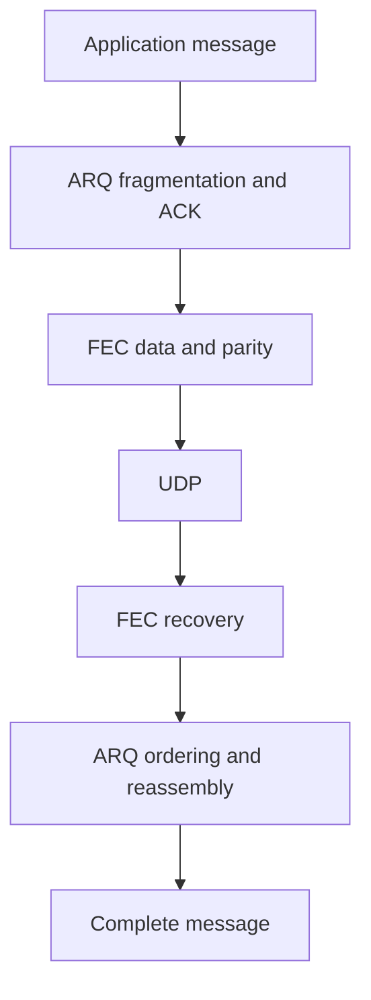

# FEC Policies

RUDP uses ARQ alone by default. Optional Reed–Solomon FEC adds parity shards to
outgoing datagrams, allowing recovery before a retransmission arrives. ARQ still
retransmits anything FEC cannot recover. The bundled header-only engine requires
neither Python nor an additional linked library.



## Choose a Policy

| Policy | Setting | Use when |
| --- | --- | --- |
| ARQ only, default | `fec::options{}` | Loss is low and extra CPU/bandwidth matters |
| Fixed FEC | `fec::options::fixed()` | Measured link characteristics justify predictable redundancy |
| Adaptive FEC | `fec::options::adaptive()` | Link conditions vary and preset thresholds should adjust redundancy |

Choose by recovery latency, observed loss, message density and resource budgets.
The same policies work for games, control messages and service communication.
Sparse groups do not emit parity when they cannot meet the minimum useful group size.

```cpp
#include <arknet/rudp/rudp_client.hpp>
#include <arknet/rudp/rudp_server.hpp>

arknet::rudp_server server;
arknet::rudp_client client;
auto settings = arknet::fec::options::adaptive();
settings.max_redundancy_percent = 50;
server.set_fec_options(settings);
client.set_fec_options(settings);
```

Configure both endpoints while stopped. Fixed and adaptive senders interoperate:
each group carries its actual parameters. An FEC-enabled server also accepts an
ARQ-only client. Requesting FEC from an arknet server with FEC disabled fails with
`operation_not_supported`. An older server that ignores the new handshake causes
a connection timeout; the client does not silently downgrade.

## Coding and Buffer Limits

| Parameter | Default | Behavior |
| --- | ---: | --- |
| `data_shards` | 8 | Maximum data datagrams per group; range 1–32 |
| `parity_shards` | 2 | Requested parity count for fixed policy |
| `max_parity_shards` | 4 | Adaptive upper bound; range 1–16 |
| `min_data_shards` | 2 | Smaller groups emit no parity |
| `group_wait_ms` | 2 ms | Maximum grouping wait; ACK/window-control datagrams bypass grouping |
| `max_redundancy_percent` | 50% | Per-group parity wire bytes divided by data wire bytes, including framing and padding |
| `group_lifetime_ms` | 1000 ms | Retention deadline for incomplete receive groups |
| `max_groups` | 128 | Maximum incomplete receive groups |
| `max_buffer_bytes` | 1 MiB | Combined retention budget for pending send data and receive groups |

With 8 data and 2 parity shards, any 8 received shards reconstruct the data. This
is a per-group count guarantee, not a guarantee for an arbitrary loss percentage.
A burst removing more than 2 shards still needs ARQ. Byte budgets and the minimum
group size can reduce the actual parity count below the configured value.

Complete groups release immediately; incomplete groups expire. When retention is
full, valid systematic data still reaches ARQ while additional FEC buffering is
skipped. Duplicate filtering has a fixed 4096-group window. Coding scratch space
is bounded by shard count and MTU, separately from the retention budget.

`arq::options::mtu` remains the UDP payload limit. The handshake selects the smaller
endpoint value and deducts **26 bytes** for FEC, so a 1200-byte wire MTU yields a
1174-byte ARQ datagram. Messages still have a 256-fragment limit. A larger configured
MTU does not prove path support; see [buffer configuration](../../guides/socket-buffers.md).

## Adaptive Thresholds

| Parameter | Default | Behavior |
| --- | ---: | --- |
| `sample_window_ms` | 1000 ms | Window for retransmission samples and peer feedback |
| `min_samples` | 64 | Keep parameters unchanged below this sample count |
| `enable_loss_percent` | 3% | Increase parity at or above this threshold |
| `disable_loss_percent` | 1% | Count healthy windows at or below this threshold |
| `stable_windows` | 3 | Healthy windows before reducing parity by one shard |
| `cooldown_ms` | 2000 ms | Minimum interval between ordinary adjustments |
| `overload_queue_percent` | 75% | Disable parity at this queue occupancy, bypassing cooldown |

Adaptive mode starts with zero parity. It uses the larger observed local
retransmission or peer missing-shard ratio, derives a parity count from that
ratio, and applies both count and byte caps. RTT above twice the observed minimum
with a growing queue also disables parity. ARQ congestion control remains active.

<Aside type="caution" title="Redundancy cannot fix overload">

Address growing send queues, receive-buffer overflow and slow application
consumers before adding parity. Missing-at-recovery counters may include reordered
late originals; feedback alone does not identify the cause of loss.

</Aside>

## Read Statistics

```cpp
// Wait outside endpoint callbacks while its IO context is still running.
auto pending = client.get_rudp_statistics();
auto stats = pending.get();
auto restored = stats.fec.recovered_shards;
auto retries = stats.retransmissions;
auto parity = stats.fec.current_parity_shards;
auto reason = arknet::fec::reason_name(stats.fec.last_change);
```

Client and Session provide an asynchronous snapshot while connected; querying
an unconnected endpoint throws `std::logic_error`. Keep the IO context running;
shutdown can cancel a pending query. Reconnect starts a new statistics period.
`last_change` is `configured`, `loss`,
`healthy` or `overload`; `policy_changes` counts adjustments.

`missing_shards` counts originals absent when a group recovers or expires,
including recovered shards and possibly originals that arrive later.
`recovered_shards` counts originals reconstructed from parity.
`retransmissions` counts ARQ segment retransmissions. These units differ; their
difference is not a final-loss metric. Check application contents, order and completion.

## Compatibility and Security

FEC uses version-1 negotiation and `AFEC` datagrams. ARQ-only retains the existing
KCP message-mode segments and ARK RDP control envelope. FEC requires compatible
arknet peers and cannot connect directly to bare KCP. CRC detects corruption;
it does not authenticate or encrypt a peer. Applications on untrusted networks
must provide identity verification and access control separately.

See [configuration](configuration.md) for admission/failure behavior and
[performance](performance.md) for measured scope.
