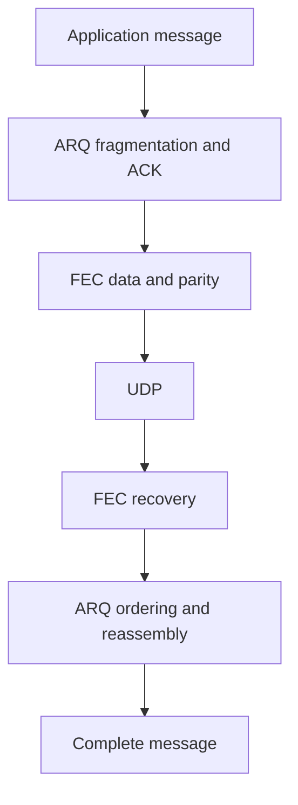

# FEC Policies

RUDP defaults to ARQ. Optional Reed–Solomon FEC adds parity to recover datagrams before
retransmission; ARQ retransmits anything unrecovered. The bundled header-only engine
needs neither Python nor an extra linked library.



## Choose a Policy

| Policy | Setting | Use when |
| --- | --- | --- |
| ARQ only, default | `fec::options{}` | Loss is low and extra CPU/bandwidth matters |
| Fixed FEC | `fec::options::fixed()` | Measured link characteristics justify predictable redundancy |
| Adaptive FEC | `fec::options::adaptive()` | Link conditions vary and preset thresholds should adjust redundancy |

For games, control messages and services alike, choose by recovery latency, observed
loss, message density and resource budgets. Groups below the minimum useful size emit no parity.

<Aside type="caution" title="Configure while stopped">

Configure both endpoints while stopped.

</Aside>

```cpp
#include <arknet/rudp/rudp_client.hpp>
#include <arknet/rudp/rudp_server.hpp>

arknet::rudp_server server;
arknet::rudp_client client;
auto settings = arknet::fec::options::adaptive();
settings.max_redundancy_percent = 50;
server.set_fec_options(settings);
client.set_fec_options(settings);
```

| Peer configuration | Negotiation result |
| --- | --- |
| Fixed and adaptive FEC | Interoperate with different sending policies; each group carries its actual parameters |
| FEC-enabled server, ARQ-only client | Accepted |
| FEC requested, arknet server FEC disabled | `operation_not_supported` |
| Older server ignores new handshake | Connection timeout; no silent downgrade |

## Coding and Buffer Limits

| Parameter | Default | Behavior |
| --- | ---: | --- |
| `data_shards` | 8 | Maximum data datagrams per group; range 1–32 |
| `parity_shards` | 2 | Requested parity count for fixed policy |
| `max_parity_shards` | 4 | Adaptive upper bound; range 1–16 |
| `min_data_shards` | 2 | Smaller groups emit no parity |
| `group_wait_ms` | 2 ms | Maximum grouping wait; ACK/window-control datagrams bypass grouping |
| `max_redundancy_percent` | 50% | Per-group parity wire bytes divided by data wire bytes, including framing and padding |
| `group_lifetime_ms` | 1000 ms | Retention deadline for incomplete receive groups |
| `max_groups` | 128 | Maximum incomplete receive groups |
| `max_buffer_bytes` | 1 MiB | Combined retention budget for pending send data and receive groups |

| Recovery and resource contract | Behavior |
| --- | --- |
| 8 data + 2 parity shards | Any 8 reconstruct the data; this is a per-group count guarantee, not an arbitrary loss-percentage guarantee |
| Burst removes more than 2 shards | ARQ is still required |
| Effective parity | Byte budgets and minimum group size may reduce it below configuration |
| Group retention | Complete groups release immediately; incomplete groups expire |
| Retention full | Skip extra FEC buffering; valid systematic data still reaches ARQ |
| Duplicate filtering | Fixed 4096-group window |
| Coding scratch space | Bounded by shard count and MTU, separate from retention budget |
| `arq::options::mtu` | UDP payload limit; negotiation takes the smaller endpoint value and deducts **26 bytes** for FEC: 1200-byte wire MTU → 1174-byte ARQ datagram |
| Message limit | 256 fragments; a larger configured MTU does not prove path support |

See [buffer configuration](../../guides/socket-buffers.md) for path and buffer limits.

## Adaptive Thresholds

| Parameter | Default | Behavior |
| --- | ---: | --- |
| `sample_window_ms` | 1000 ms | Window for retransmission samples and peer feedback |
| `min_samples` | 64 | Keep parameters unchanged below this sample count |
| `enable_loss_percent` | 3% | Increase parity at or above this threshold |
| `disable_loss_percent` | 1% | Count healthy windows at or below this threshold |
| `stable_windows` | 3 | Healthy windows before reducing parity by one shard |
| `cooldown_ms` | 2000 ms | Minimum interval between ordinary adjustments |
| `overload_queue_percent` | 75% | Disable parity at this queue occupancy, bypassing cooldown |

Adaptive mode starts with zero parity and keeps ARQ congestion control active.

| Adjustment | Rule |
| --- | --- |
| Parity count | Use the larger local retransmission/peer missing-shard ratio; apply count and byte caps |
| RTT above twice the observed minimum, queue growing | Disable parity |

<Aside type="caution" title="Redundancy cannot fix overload">

Address growing send queues, receive-buffer overflow and slow application
consumers before adding parity. Missing-at-recovery counters may include reordered
late originals; feedback alone does not identify the cause of loss.

</Aside>

## Read Statistics

```cpp
// Wait outside endpoint callbacks while its IO context is still running.
auto pending = client.get_rudp_statistics();
auto stats = pending.get();
auto restored = stats.fec.recovered_shards;
auto retries = stats.retransmissions;
auto parity = stats.fec.current_parity_shards;
auto reason = arknet::fec::reason_name(stats.fec.last_change);
```

| Statistics query | Contract |
| --- | --- |
| Client / Session | Asynchronous snapshot while connected; otherwise throws `std::logic_error` |
| Pending query | Keep IO running; shutdown can cancel it |
| Reconnect | Starts a new statistics period |
| `last_change` / `policy_changes` | Reason: `configured`, `loss`, `healthy` or `overload`; count: adjustments |

| Counter | Unit and scope |
| --- | --- |
| `missing_shards` | Original shards absent at group recovery/expiry, including recovered shards and possibly late originals |
| `recovered_shards` | Original shards reconstructed from parity |
| `retransmissions` | ARQ segment retransmissions |

These units differ; subtraction does not measure final loss. Verify application contents, order and completion.

## Compatibility and Security

| Wire/security scope | Contract |
| --- | --- |
| FEC | Version-1 negotiation and `AFEC` datagrams; requires compatible arknet peers, cannot connect directly to bare KCP |
| ARQ-only | Retains KCP message-mode segments and ARK RDP control envelope |
| CRC | Detects corruption; provides neither authentication nor encryption |

On untrusted networks, applications must supply identity verification and access control.

See [configuration](configuration.md) for admission/failure behavior and
[performance](performance.md) for measured scope.
