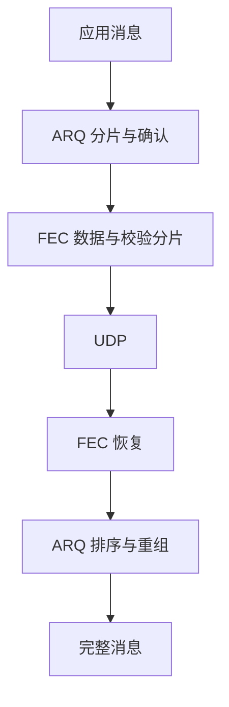

# FEC 策略

RUDP 默认仅用 ARQ。可选的 Reed–Solomon FEC 增加校验分片，先于重传恢复缺失数据报；
未恢复的数据仍由 ARQ 重传。编码引擎内置于头文件，无需 Python 或额外链接库。



## 选择策略

| 策略 | 设置 | 适用情况 |
| --- | --- | --- |
| 仅 ARQ，默认 | `fec::options{}` | 丢失较少，优先控制 CPU 和额外带宽 |
| 固定 FEC | `fec::options::fixed()` | 已测量链路特征，需要可预测的恢复能力 |
| 自适应 FEC | `fec::options::adaptive()` | 链路变化明显，按预设阈值增减冗余 |

游戏、控制消息和服务通信均按恢复延迟、实际丢失、消息密度与资源预算选型。
稀疏流量不足最小有效分组大小时，不发送校验。

<Aside type="caution" title="在停止状态配置">

在两端均停止时设置 FEC 选项。

</Aside>

```cpp
#include <arknet/rudp/rudp_client.hpp>
#include <arknet/rudp/rudp_server.hpp>

arknet::rudp_server server;
arknet::rudp_client client;
auto settings = arknet::fec::options::adaptive();
settings.max_redundancy_percent = 50;
server.set_fec_options(settings);
client.set_fec_options(settings);
```

| 对端配置 | 协商结果 |
| --- | --- |
| 固定与自适应 FEC | 发送策略可不同；每组携带实际参数，可互通 |
| 启用 FEC 的服务端与仅 ARQ 客户端 | 接受连接 |
| 客户端请求 FEC，arknet 服务端未启用 | `operation_not_supported` |
| 旧服务端忽略新握手 | 连接超时，不静默降级 |

## 编码与缓存

| 参数 | 默认值 | 行为 |
| --- | ---: | --- |
| `data_shards` | 8 | 每组最多 8 个数据报，可配置 1–32 |
| `parity_shards` | 2 | 固定策略的校验分片数 |
| `max_parity_shards` | 4 | 自适应校验上限，可配置 1–16 |
| `min_data_shards` | 2 | 小于此数量的组不生成校验 |
| `group_wait_ms` | 2 ms | 最长组包等待；ACK 和窗口控制数据报直接发送 |
| `max_redundancy_percent` | 50% | 每组校验报文字节相对数据报文字节的上限，包含 FEC 头部和填充 |
| `group_lifetime_ms` | 1000 ms | 未完成接收组的保留期限 |
| `max_groups` | 128 | 未完成接收组的数量上限 |
| `max_buffer_bytes` | 1 MiB | 发送待组包数据与接收组的合计保留预算 |

| 恢复与资源约定 | 行为 |
| --- | --- |
| 8 个数据 + 2 个校验分片 | 任意 8 个到达即可恢复；这是组内数量保证，不是任意丢包率保证 |
| 突发丢失超过 2 个分片 | 仍需 ARQ |
| 实际校验数 | 字节预算与最小分组大小可能使其低于配置值 |
| 组保留期限 | 完整组立即释放，未完成组到期释放 |
| 缓存不足 | 跳过额外 FEC 保留；合法原始数据继续进入 ARQ，可靠交付仍生效 |
| 重复过滤 | 固定 4096 组窗口 |
| 编解码临时空间 | 受分片数与 MTU 限制，在保留预算之外另计 |
| `arq::options::mtu` | UDP 载荷上限；握手取两端较小值并扣除 **26 字节** FEC 开销：1200 字节 → 1174 字节 ARQ 数据报 |
| 消息上限 | 256 个分片；较大 MTU 配置不代表路径支持 |

路径与缓冲限制见[缓冲配置](../../guides/socket-buffers_CN.md)。

## 自适应阈值

| 参数 | 默认值 | 行为 |
| --- | ---: | --- |
| `sample_window_ms` | 1000 ms | 本地重传与接收端反馈的统计周期 |
| `min_samples` | 64 | 样本不足时保持当前参数 |
| `enable_loss_percent` | 3% | 达到阈值时增加校验数 |
| `disable_loss_percent` | 1% | 低于阈值时累计稳定窗口 |
| `stable_windows` | 3 | 连续稳定窗口达到此数量后减少一个校验分片 |
| `cooldown_ms` | 2000 ms | 常规调整之间的最短间隔 |
| `overload_queue_percent` | 75% | 队列达到阈值时关闭冗余，不等待冷却结束 |

自适应策略从零校验开始，ARQ 拥塞控制持续生效。

| 调整 | 规则 |
| --- | --- |
| 校验数 | 取本地重传与对端缺失比例的较大值，受数量与字节预算共同限制 |
| RTT 超过已观察最小值两倍，且排队字节增长 | 关闭冗余 |

<Aside type="caution" title="增加冗余不能解决过载">

先处理持续增长的发送队列、接收缓冲溢出和应用处理积压，再评估 FEC。
组内缺失可能包含乱序造成的迟到，反馈不能单独确定丢包原因。

</Aside>

## 读取统计

```cpp
// 在仍运行的 IO context 外等待，不能在端点回调中阻塞。
auto pending = client.get_rudp_statistics();
auto stats = pending.get();
auto restored = stats.fec.recovered_shards;
auto retries = stats.retransmissions;
auto parity = stats.fec.current_parity_shards;
auto reason = arknet::fec::reason_name(stats.fec.last_change);
```

| 统计查询 | 约定 |
| --- | --- |
| Client / Session | 已连接时返回异步快照；否则抛出 `std::logic_error` |
| 查询未完成 | 保持 IO 运行；停止可能取消查询 |
| 重连 | 开始新统计周期 |
| `last_change` / `policy_changes` | 原因：`configured`、`loss`、`healthy` 或 `overload`；计数：调整次数 |

| 计数器 | 单位与范围 |
| --- | --- |
| `missing_shards` | 组恢复或到期时缺失的原始分片，包含已恢复分片及可能迟到的原始分片 |
| `recovered_shards` | 通过校验恢复的原始分片 |
| `retransmissions` | ARQ segment 重传次数 |

单位不同，不能相减得到最终丢失。应检查应用消息内容、顺序与完成情况。

## 兼容与安全

| 报文与安全范围 | 约定 |
| --- | --- |
| FEC | 版本 1 协商与 `AFEC` 数据报；要求兼容的 arknet 对端，不能直接连接裸 KCP |
| 仅 ARQ | 保持 KCP 消息模式 segment 与 ARK RDP 连接报文兼容 |
| CRC | 检测传输或恢复后的损坏，不提供认证、加密或恶意数据防护 |

不可信网络中的应用必须另行提供身份验证与访问控制。

查看[配置](configuration_CN.md)了解会话限额与失败行为，查看[性能](performance_CN.md)了解实测范围。
