# Native Asio execution comparison

Sixteen configurations run callback and coroutine modes in three fresh processes each: 96 measured rounds, with no errors, unfinished requests or warmup failures. Business computation and worker count are configured independently.

Direct raw-Asio callback/coroutine comparison bypasses arknet endpoints and the native tracker; it is not a public arknet coroutine endpoint benchmark. CPU combines client/server; window 16 RT is batch latency, window 1 RT is message latency.

| Environment | Recorded value |
| --- | --- |
| Machine | Mac mini (Mac16,11) · arm64 |
| CPU | Apple M4 Pro · 14 physical cores / 14 logical cores (system CPU count 14) |
| Memory | 48 GiB |
| OS | macOS 27.0.1 · build 26A434 |
| Compiler | Apple clang version 21.0.0 (clang-2100.3.34.2) · gnu++20 |
| Build flags | Release · -O3 -DNDEBUG |
| Dependencies | Boost 1.90 · Standalone Asio 1.38.2 · OpenSSL 3.6.4 25 Aug 2026 (Library: OpenSSL 3.6.4 25 Aug 2026) |
| Build tools | CMake 4.3.3 · Ninja 1.13.2 |
| Servers | Colocated raw-Asio TCP echo server |
| Measurement interval (UTC) | 2026-10-15T19:07:59Z → 2026-10-15T19:18:36Z |
| Warmup / measurement | 0.25 s / 1 s × 3 fresh processes |
| API / IO | Raw-Asio callback / coroutine · One io_context with 1 / 4 workers |
| CPU sampling | Colocated client + server, including warmup; one full core = 100% |

Measured candidate: `2aa5bc0ef7d383d8cfbc04520f3b952fa27c5fbd`

Raw-Asio callback versus coroutine, using the same library version. Driver `coroutine.cpp` SHA256: `604746e85e399148f6ccb832ae37b4718c40173988a26fd4d0b671ffc9b7932d`

## Raw Boost.Asio · iterations 0

Candidate only · 16 connections · 1024 B · 1 / 16 in flight · one io_context with 1 / 4 threads

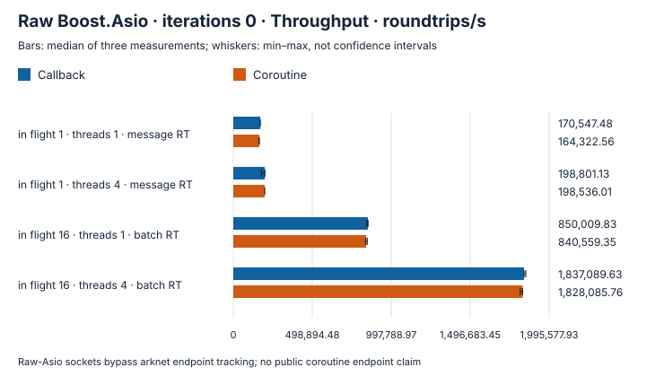

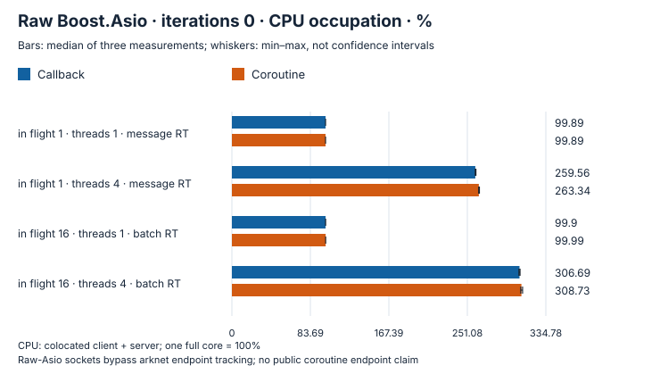

<details>
<summary>P50 and P99 response time</summary>

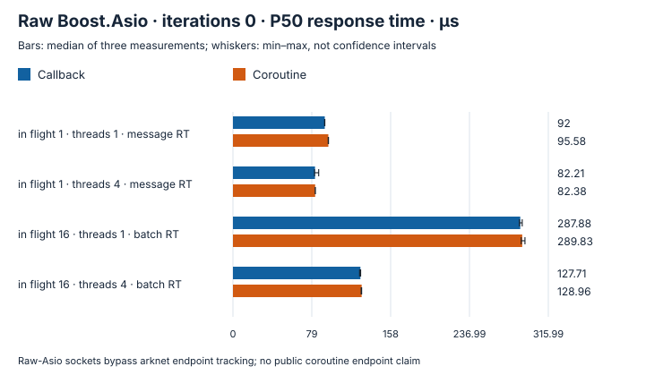


</details>

Shown 4 cases: median per-case throughput ratio change -0.8%.Each summary is a median of case ratios, not pooled throughput.

## Raw Boost.Asio · iterations 10000

Candidate only · 16 connections · 1024 B · 1 / 16 in flight · one io_context with 1 / 4 threads

<details>
<summary>Throughput, CPU and response time</summary>

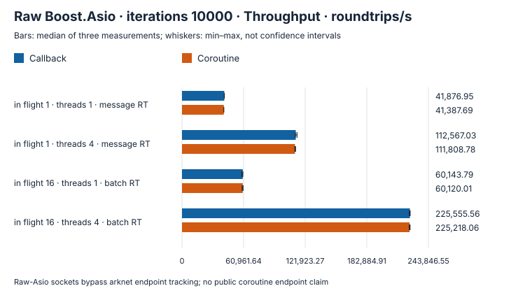

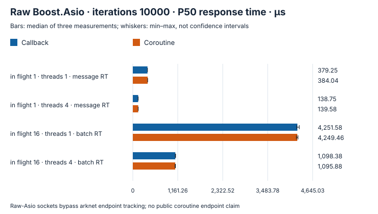

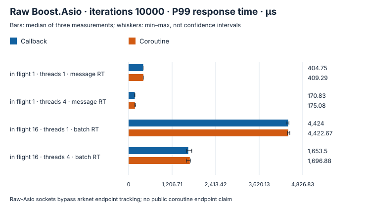

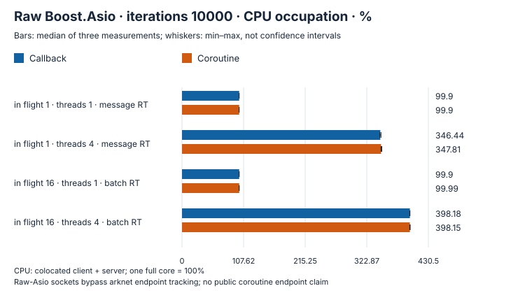

</details>

Shown 4 cases: median per-case throughput ratio change -0.41%.Each summary is a median of case ratios, not pooled throughput.

## Raw Standalone Asio · iterations 0

Candidate only · 16 connections · 1024 B · 1 / 16 in flight · one io_context with 1 / 4 threads

<details>
<summary>Throughput, CPU and response time</summary>


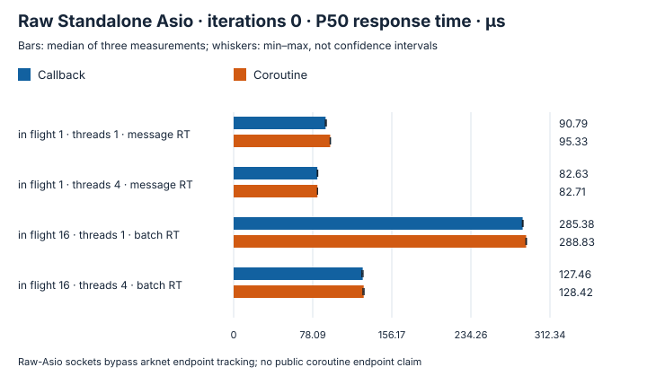

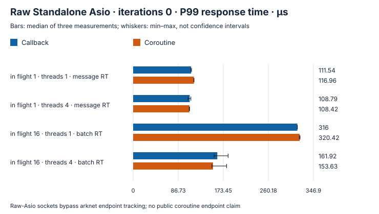

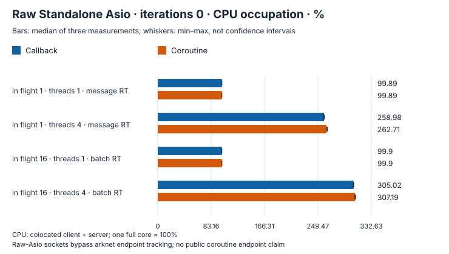

</details>

Shown 4 cases: median per-case throughput ratio change -0.95%.Each summary is a median of case ratios, not pooled throughput.

## Raw Standalone Asio · iterations 10000

Candidate only · 16 connections · 1024 B · 1 / 16 in flight · one io_context with 1 / 4 threads

<details>
<summary>Throughput, CPU and response time</summary>

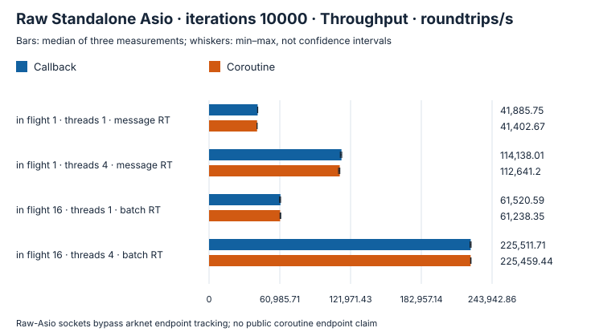


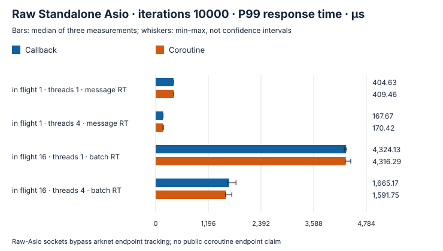

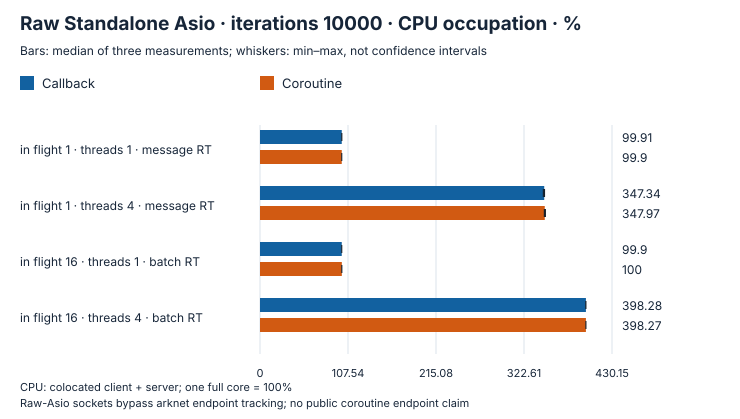

</details>

Shown 4 cases: median per-case throughput ratio change -0.81%.Each summary is a median of case ratios, not pooled throughput.

<details>
<summary>All data (median [min–max])</summary>

| Case | Throughput/s: callback → coroutine | P50 µs: callback → coroutine | P99 µs: callback → coroutine | CPU%: callback → coroutine | RSS MiB: callback → coroutine |
| --- | ---: | ---: | ---: | ---: | ---: |
| TCP · Boost.Asio · 16 connections · 1024 B · in flight 1 · threads 1 · compute iterations 0 · message RT | 170,547.48 [170,383.32–170,675.76] → 164,322.56 [162,691.62–164,564.88] | 92 [91.83–92.08] → 95.58 [95.46–95.75] | 112.75 [112.46–113.5] → 117.21 [116.75–155.33] | 99.89 [99.88–99.89] → 99.89 [99.87–99.89] | 7.14 [7.13–7.14] → 7.19 [7.17–7.2] |
| TCP · Boost.Asio · 16 connections · 1024 B · in flight 1 · threads 1 · compute iterations 10000 · message RT | 41,876.95 [41,868.07–41,911.37] → 41,387.69 [41,334.03–41,412.75] | 379.25 [379.21–379.46] → 384.04 [383.83–384.21] | 404.75 [404.33–404.79] → 409.29 [409.08–409.92] | 99.9 [99.9–99.91] → 99.9 [99.89–99.9] | 4.5 [4.48–4.52] → 4.56 [4.53–4.83] |
| TCP · Boost.Asio · 16 connections · 1024 B · in flight 1 · threads 4 · compute iterations 0 · message RT | 198,801.13 [177,260.11–200,152.53] → 198,536.01 [197,939.57–198,610.09] | 82.21 [81.71–85.92] → 82.38 [82.38–82.63] | 100.79 [100.5–152.75] → 101.67 [101.17–102.75] | 259.56 [259.47–260.25] → 263.34 [263.15–263.96] | 7.19 [7.17–7.2] → 7.23 [7.16–7.25] |
| TCP · Boost.Asio · 16 connections · 1024 B · in flight 1 · threads 4 · compute iterations 10000 · message RT | 112,567.03 [112,132.14–113,800.57] → 111,808.78 [111,682.26–112,365.19] | 138.75 [137.63–139.33] → 139.58 [139.54–140] | 170.83 [167.96–176.21] → 175.08 [173.79–196.17] | 346.44 [345.57–347.6] → 347.81 [347.75–348.98] | 6.69 [6.66–7.44] → 6.73 [6.66–6.75] |
| TCP · Boost.Asio · 16 connections · 1024 B · in flight 16 · threads 1 · compute iterations 0 · batch RT | 850,009.83 [844,188.64–851,440.67] → 840,559.35 [836,239.55–846,478.43] | 287.88 [287.04–289.83] → 289.83 [288.83–292.58] | 320.33 [318.79–345.67] → 323.13 [322.38–324.58] | 99.9 [99.89–99.97] → 99.99 [99.98–100] | 5.92 [5.89–5.94] → 5.59 [5.59–5.59] |
| TCP · Boost.Asio · 16 connections · 1024 B · in flight 16 · threads 1 · compute iterations 10000 · batch RT | 60,143.79 [59,174.4–60,221.74] → 60,120.01 [59,485.46–60,444.37] | 4,251.58 [4,235.17–4,300.96] → 4,249.46 [4,226.33–4,267.38] | 4,424 [4,367.04–4,446.67] → 4,422.67 [4,404.42–4,469.29] | 99.9 [99.9–99.97] → 99.99 [99.9–100] | 3.73 [3.7–3.73] → 3.75 [3.75–3.77] |
| TCP · Boost.Asio · 16 connections · 1024 B · in flight 16 · threads 4 · compute iterations 0 · batch RT | 1,837,089.63 [1,836,463.54–1,847,757.35] → 1,828,085.76 [1,812,937.3–1,828,113.94] | 127.71 [126.88–127.96] → 128.96 [128.46–128.96] | 153.79 [149.96–160] → 157.75 [149.13–182.79] | 306.69 [306.1–307.28] → 308.73 [307.98–309.98] | 7.67 [7.66–7.7] → 8.42 [7.64–8.53] |
| TCP · Boost.Asio · 16 connections · 1024 B · in flight 16 · threads 4 · compute iterations 10000 · batch RT | 225,555.56 [224,993.91–225,783.84] → 225,218.06 [224,852.22–225,683.25] | 1,098.38 [1,097.83–1,106.33] → 1,095.88 [1,091.54–1,101.96] | 1,653.5 [1,612.42–1,751.38] → 1,696.88 [1,602.42–1,715.54] | 398.18 [398.04–398.24] → 398.15 [397.94–398.61] | 4.19 [4.17–4.28] → 4.33 [4.33–4.36] |
| TCP · Standalone Asio · 16 connections · 1024 B · in flight 1 · threads 1 · compute iterations 0 · message RT | 172,669.4 [171,476.54–173,410.93] → 164,939.97 [164,295.79–164,945.6] | 90.79 [90.46–91.54] → 95.33 [95.25–95.67] | 111.54 [110.71–112.38] → 116.96 [116.58–117.13] | 99.89 [99.89–99.89] → 99.89 [99.89–99.9] | 7.05 [7.05–7.08] → 7.13 [7.13–7.13] |
| TCP · Standalone Asio · 16 connections · 1024 B · in flight 1 · threads 1 · compute iterations 10000 · message RT | 41,885.75 [41,819.82–41,968.28] → 41,402.67 [41,360.39–41,475.46] | 379.75 [378.92–380.04] → 383.92 [383.75–384.13] | 404.63 [404.33–405.83] → 409.46 [409.25–409.46] | 99.91 [99.91–100] → 99.9 [99.9–99.9] | 4.69 [4.44–4.72] → 4.48 [4.48–4.72] |
| TCP · Standalone Asio · 16 connections · 1024 B · in flight 1 · threads 4 · compute iterations 0 · message RT | 196,692.51 [195,681.92–197,001.57] → 196,540.99 [196,493.35–196,563.64] | 82.63 [82.5–83.08] → 82.71 [82.71–82.88] | 108.79 [105.5–111.04] → 108.42 [107.83–108.63] | 258.98 [258.14–259.33] → 262.71 [262.7–264.04] | 7.14 [7.11–7.16] → 7.19 [7.17–7.22] |
| TCP · Standalone Asio · 16 connections · 1024 B · in flight 1 · threads 4 · compute iterations 10000 · message RT | 114,138.01 [113,133.28–114,346.94] → 112,641.2 [111,661.2–112,728.88] | 137.21 [137.13–138.04] → 139.38 [139.04–140] | 167.67 [166.88–168.08] → 170.42 [166.67–175.96] | 347.34 [346.24–347.7] → 347.97 [347.46–348.77] | 6.66 [6.66–6.67] → 6.73 [6.72–6.73] |
| TCP · Standalone Asio · 16 connections · 1024 B · in flight 16 · threads 1 · compute iterations 0 · batch RT | 857,482.89 [855,409.84–861,275.6] → 846,130.26 [844,806.71–846,534.65] | 285.38 [285.04–285.83] → 288.83 [288.54–289.21] | 316 [315.79–316.04] → 320.42 [319.75–321.21] | 99.9 [99.9–99.91] → 99.9 [99.89–99.99] | 5.56 [5.55–5.83] → 5.94 [5.53–5.97] |
| TCP · Standalone Asio · 16 connections · 1024 B · in flight 16 · threads 1 · compute iterations 10000 · batch RT | 61,520.59 [60,724.5–61,654.93] → 61,238.35 [61,216.06–61,796.62] | 4,155.08 [4,114.17–4,210.54] → 4,148.04 [4,119.42–4,156.83] | 4,324.13 [4,280.25–4,341] → 4,316.29 [4,300.83–4,429.63] | 99.9 [99.9–99.91] → 100 [99.95–100] | 3.63 [3.63–3.64] → 3.69 [3.69–3.69] |
| TCP · Standalone Asio · 16 connections · 1024 B · in flight 16 · threads 4 · compute iterations 0 · batch RT | 1,839,877.8 [1,833,345.01–1,842,623.09] → 1,829,139.3 [1,823,523.18–1,842,521.87] | 127.46 [126.58–127.83] → 128.42 [127.63–128.83] | 161.92 [155.63–182.71] → 153.63 [151.38–179.83] | 305.02 [304.52–305.28] → 307.19 [306.92–307.99] | 8.31 [7.56–8.38] → 7.73 [7.64–8.41] |
| TCP · Standalone Asio · 16 connections · 1024 B · in flight 16 · threads 4 · compute iterations 10000 · batch RT | 225,511.71 [224,931.75–225,873.02] → 225,459.44 [225,445.26–225,794.32] | 1,102.88 [1,091.75–1,102.92] → 1,106.13 [1,086.67–1,107.46] | 1,665.17 [1,630.17–1,824.08] → 1,591.75 [1,585.29–1,728.92] | 398.28 [398.12–398.28] → 398.27 [398.22–398.29] | 4.14 [4.11–4.27] → 4.33 [4.19–4.33] |

</details>

## Reproduce

[Build both library revisions with the same benchmark drivers](../../benchmarks/comparison/README.md).

[Build configuration and parameters](methodology.md). Run the standalone C++ benchmark programs and keep measured output outside the source directory.

```sh
cmake -S . -B build/benchmark -DCMAKE_BUILD_TYPE=Release \
  -DARKNET_BUILD_TESTS=OFF -DARKNET_BUILD_EXAMPLES=OFF \
  -DARKNET_BUILD_BENCHMARKS=ON -DARKNET_USE_BOOST_ASIO=ON \
  -DARKNET_ENABLE_SSL=ON
cmake --build build/benchmark --target arknet_coroutine_benchmark
./build/benchmark/benchmarks/arknet_coroutine_benchmark --protocol tcp --execution coroutine \
  --payload 1024 --clients 16 --window 16 --io-model shared \
  --io-threads 4 --work 10000 --warmup 0.25 --seconds 1
```
