# Asio 回调、协程与线程模型

16 条 TCP 连接：三种 IO 模型、回调／协程、64 B / 4096 B 包体、每连接 1 / 16 条在途请求、每次回显 0 / 10,000 次迭代。两种依赖共 96 组，每组三个独立进程；288 次测量的内容校验与 IO 错误均为零。

<Aside type="note" title="测量范围">

使用原生 Asio TCP 回显，衡量执行方式与调度成本。客户端与服务端位于同一进程，共用配置的 IO 工作线程。arknet 公开端点的传输开销、跨机器容量和 10–20 万 PCU 验收需要分别测试。

</Aside>

## 测试环境

| 项目 | 配置 |
| --- | --- |
| 机器 | Mac mini (Mac16,11) · Apple M4 Pro · 14 物理核 / 14 逻辑核 · 48 GiB |
| 系统 | macOS 27.0.1 · 构建 26A434 · arm64 |
| 编译器与选项 | Apple clang 21.0.0 (clang-2100.3.34.2) · C++20 · Release · -O3 -DNDEBUG |
| 依赖 | Boost.Asio 1.90 / Standalone Asio 1.38.2；未启用 TLS |
| 源码 | arknet v0.2.2 · `c5432ca176edf9f4c06db03713f03764184c5cea` |
| 开始时间 | 2026-10-17 UTC · Standalone 14:26:42 · Boost 15:02:30 |
| 每次测量 | 0.5 秒预热 + 2 秒收发；同一配置重复三次 |

## IO 模型

| 图中标记 | io_context 数量 | 工作线程总数 | 调度方式 |
| --- | ---: | ---: | --- |
| 1 context / 1 thread | 1 | 1 | 单线程运行全部连接 |
| 1 context / 4 threads | 1 | 4 | 四个线程共同运行一个事件循环 |
| 4 contexts / 4 threads | 4 | 4 | 每个事件循环一个线程，连接按轮转分配 |

各连接使用 strand 串行执行自己的处理逻辑。单个事件循环、单个线程的配置只测一次，不重复计入「分片」对照。

## 吞吐量、CPU 与响应时间

柱高为三次独立进程测量的中位数，误差线为最小／最大值；吞吐量为每秒完成的 TCP 请求—回显往返数，每次计一次。点击可打开完整 SVG。

CPU 为同进程客户端与服务端的用户态和内核态合计，包含预热与测量，100% 表示一个逻辑核满载；吞吐量排除预热，按实际测量时长计算，包含最后一批在途请求的完成时间。

<Aside type="note" title="响应时间的范围">

在途数 1 测单消息 RTT；在途数 16 测整批 16 条请求 RTT，不能除以 16 作为单消息 RTT。每连接最多保留 8192 条样本，合并样本的 P99 是估计值；表中为三轮 P99 的中位数，不是全部请求的全局 P99。

</Aside>

### Boost.Asio 1.90

#### 无额外计算

[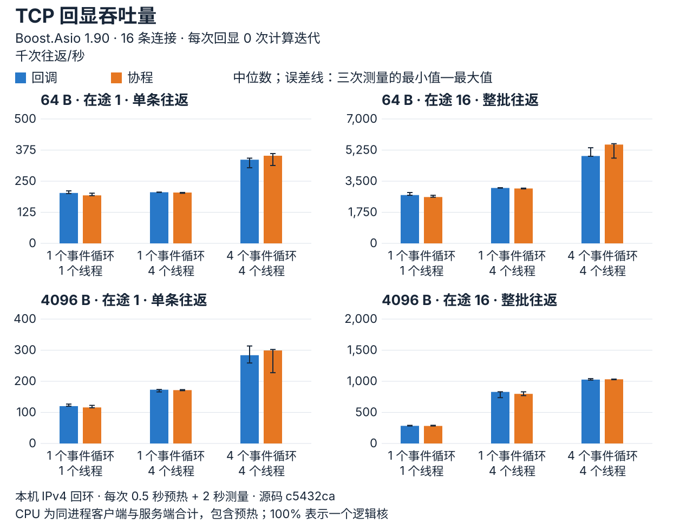](assets/asio-022-boost-work0-throughput_CN.svg)

[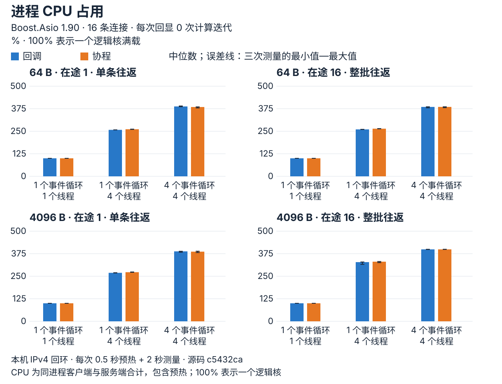](assets/asio-022-boost-work0-cpu_CN.svg)

**P99 响应时间**

[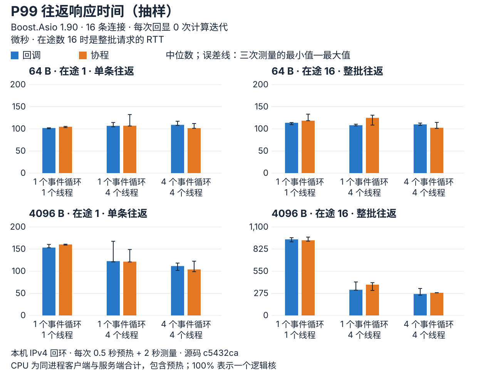](assets/asio-022-boost-work0-p99_CN.svg)


#### 每次回显增加 10,000 次计算迭代

[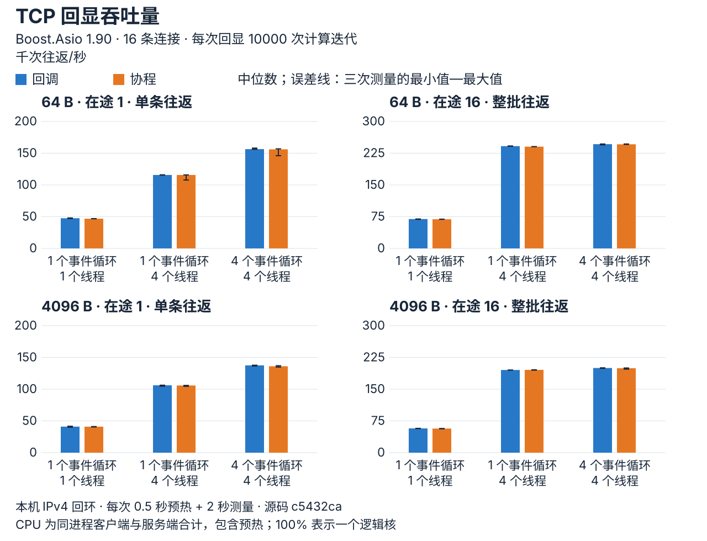](assets/asio-022-boost-work10000-throughput_CN.svg)

[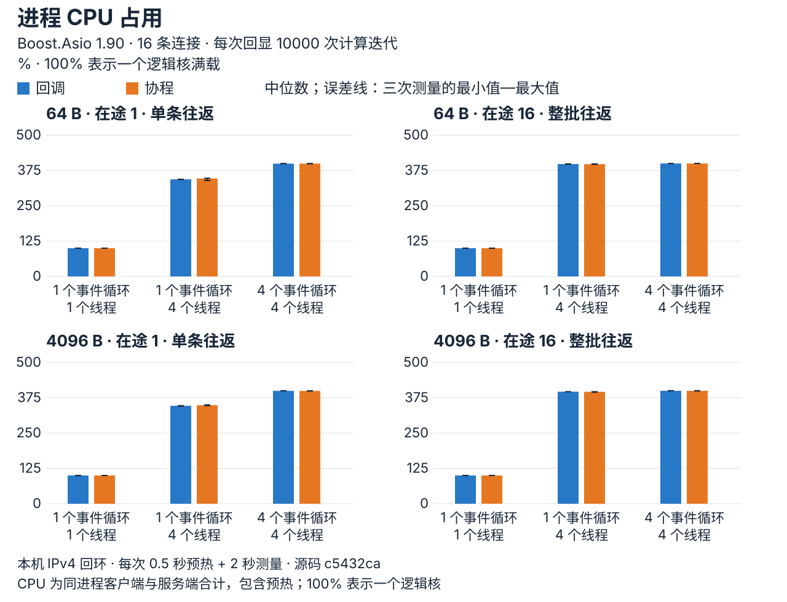](assets/asio-022-boost-work10000-cpu_CN.svg)

**P99 响应时间**

[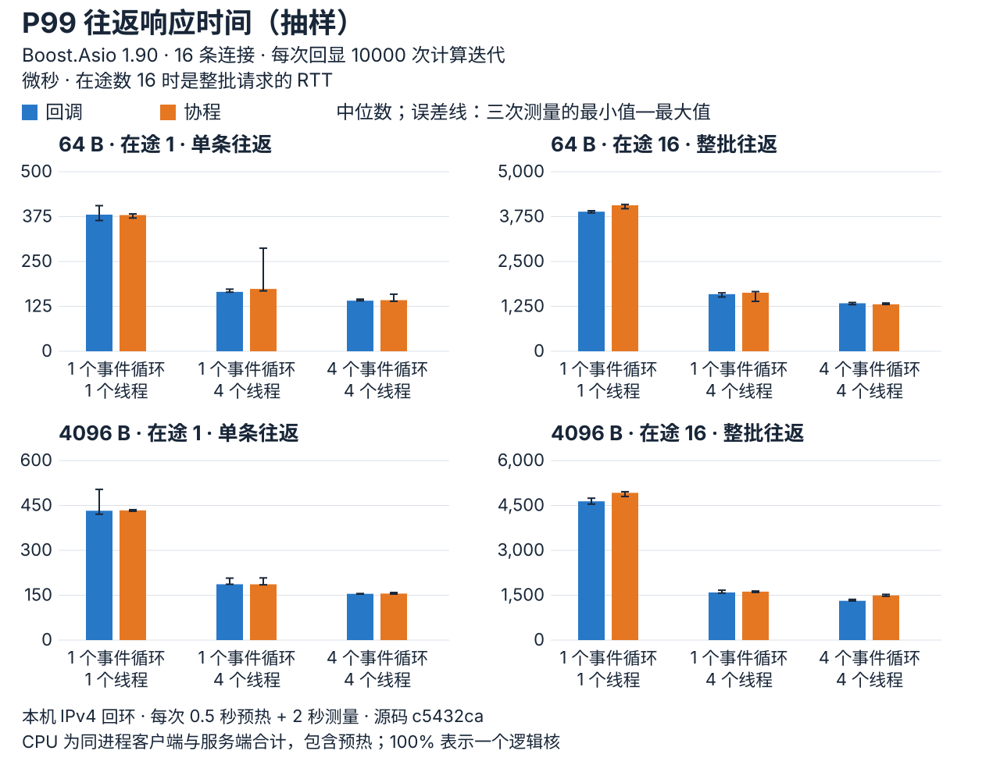](assets/asio-022-boost-work10000-p99_CN.svg)


### Standalone Asio 1.38.2

#### 无额外计算

[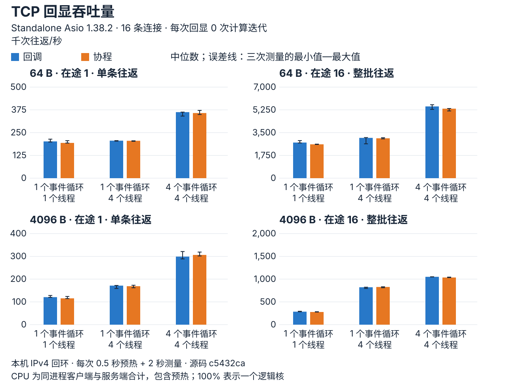](assets/asio-022-standalone-work0-throughput_CN.svg)

[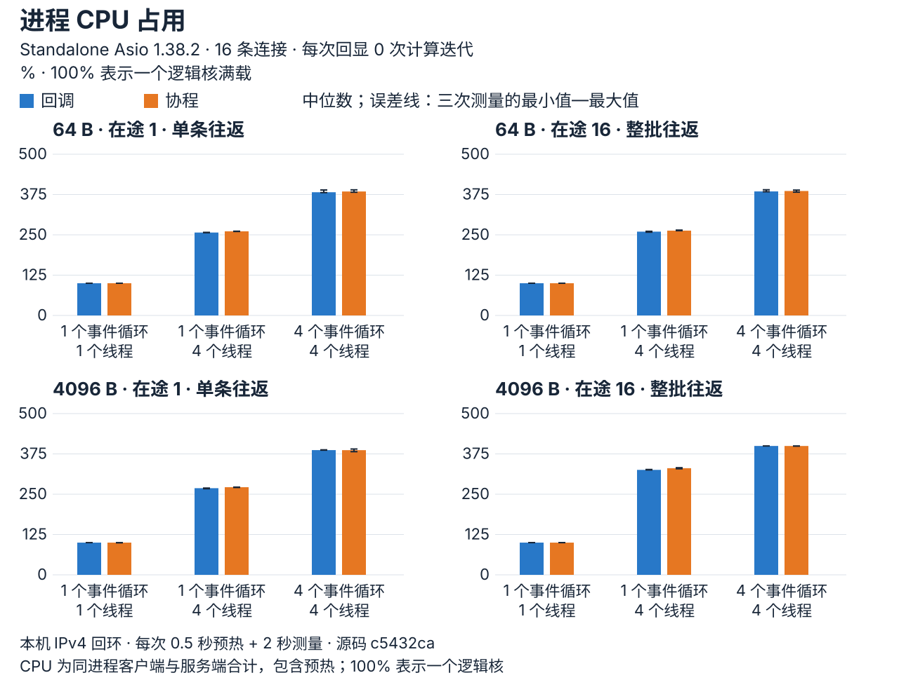](assets/asio-022-standalone-work0-cpu_CN.svg)

**P99 响应时间**

[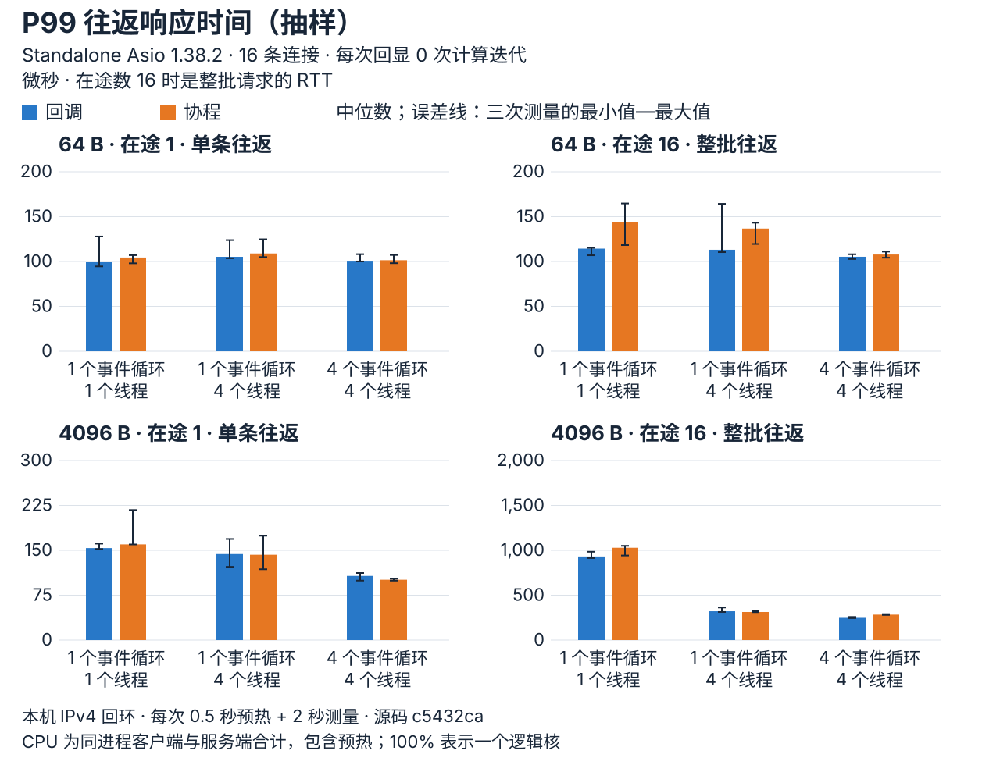](assets/asio-022-standalone-work0-p99_CN.svg)


#### 每次回显增加 10,000 次计算迭代

[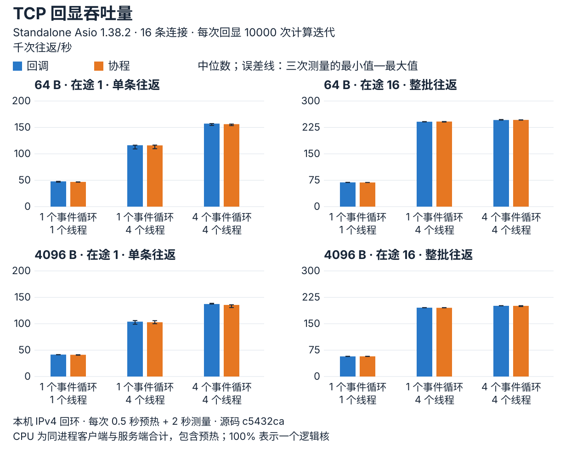](assets/asio-022-standalone-work10000-throughput_CN.svg)

[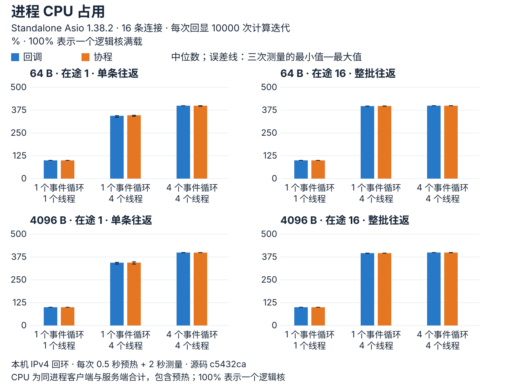](assets/asio-022-standalone-work10000-cpu_CN.svg)

**P99 响应时间**

[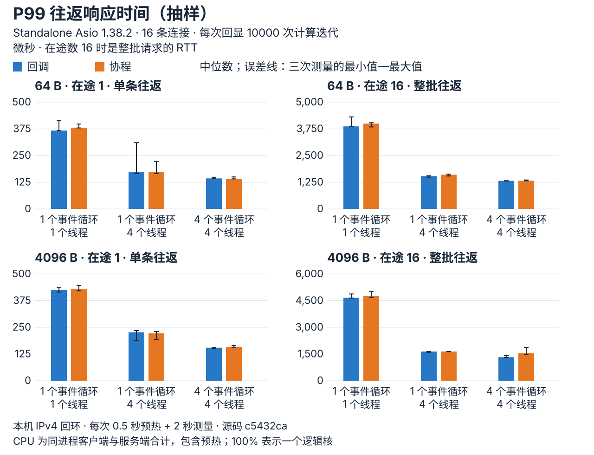](assets/asio-022-standalone-work10000-p99_CN.svg)


10,000 次迭代是在 IO 处理逻辑中执行的确定性计算，不是独立计算线程池，也不代表固定的业务耗时。

## 如何选择

同配置下，协程相对回调的吞吐量变化范围如下，每种依赖各比较 24 组配置。

| 依赖 | 吞吐量变化范围 |
| --- | ---: |
| Boost.Asio 1.90 | -4.76% 至 +13.08% |
| Standalone Asio 1.38.2 | -4.92% 至 +2.5% |

| 业务形态 | 可从哪种模型开始 | 需要关注 |
| --- | --- | --- |
| 连接数较少、IO 处理较轻 | 1 个事件循环、1 个线程 | CPU 满载后的吞吐量与尾延迟 |
| 连接负载不均，希望多个线程共同调度 | 1 个事件循环、多个线程 | strand 的串行范围与共享调度成本 |
| 连接可按实例或分片分配 | 多个事件循环、每个一个线程 | 分片负载是否均衡、跨分片消息成本 |
| 包含压缩、解析等耗时计算 | 在 IO 模型之外配置有容量限制的计算执行器 | 协程不会自动把计算转移到其他线程 |

<Aside type="caution" title="选型限制">

选型建议仅为起点：同机回环、16 条均衡连接、短时闭环负载不证明生产容量或普遍最优模型；三次测量的范围不是统计置信区间。

</Aside>

## 完整数据

**Boost.Asio 1.90 · 48 组配置：中位数 [最小值—最大值]**

| 包体 B | 在途数 | 计算迭代 | 事件循环 / 线程总数 | API | 往返/秒 | P50 µs | P99 µs | CPU% |
| ---: | ---: | ---: | --- | --- | ---: | ---: | ---: | ---: |
| 64 | 1 | 0 | 1 / 1 | 回调 | 202,549.03 [200,318.3–211,068.46] | 78.67 [74.08–79] | 101.92 [100.21–102.38] | 99.93 [99.91–99.93] |
| 64 | 1 | 0 | 1 / 1 | 协程 | 192,908.77 [191,813.92–201,684.79] | 82.38 [77.92–82.67] | 104.79 [102.88–105.58] | 99.93 [99.92–99.98] |
| 64 | 16 | 0 | 1 / 1 | 回调 | 2,718,624.66 [2,706,816.9–2,860,913.74] | 92.54 [87–92.88] | 113.79 [109.54–114.29] | 99.93 [99.93–99.97] |
| 64 | 16 | 0 | 1 / 1 | 协程 | 2,607,581.61 [2,599,330.86–2,704,442.47] | 96.5 [90.63–96.54] | 118.54 [118.46–133.29] | 99.94 [99.93–99.94] |
| 4096 | 1 | 0 | 1 / 1 | 回调 | 120,089.98 [119,862.87–126,603.94] | 128.75 [119.58–128.88] | 153.42 [153.13–160.54] | 99.93 [99.92–99.95] |
| 4096 | 1 | 0 | 1 / 1 | 协程 | 115,924.14 [114,777.34–122,488.67] | 133.67 [124.92–134.21] | 160.46 [159.04–161.08] | 99.93 [99.92–99.93] |
| 4096 | 16 | 0 | 1 / 1 | 回调 | 283,672.87 [281,819.77–291,110.62] | 856.42 [830.54–862.58] | 945.92 [915.67–966.96] | 99.94 [99.94–99.95] |
| 4096 | 16 | 0 | 1 / 1 | 协程 | 282,038.86 [281,657.55–291,921.09] | 861.83 [830.5–866.04] | 934.79 [923.71–974] | 99.98 [99.97–99.98] |
| 64 | 1 | 10000 | 1 / 1 | 回调 | 47,573.53 [47,067.1–47,980.19] | 332 [331.38–333.21] | 380.54 [364.13–405.54] | 99.93 [99.85–99.93] |
| 64 | 1 | 10000 | 1 / 1 | 协程 | 46,829.99 [46,725.21–46,959.32] | 339.25 [339–339.54] | 379.33 [371.08–382.63] | 99.92 [99.9–99.93] |
| 64 | 16 | 10000 | 1 / 1 | 回调 | 69,392.85 [68,731.6–69,570.31] | 3,661.42 [3,657.67–3,723.08] | 3,887.96 [3,854.25–3,913.67] | 99.94 [99.94–99.99] |
| 64 | 16 | 10000 | 1 / 1 | 协程 | 68,936.11 [68,835.69–69,123.92] | 3,700.88 [3,692.46–3,713.71] | 4,065.13 [3,970.83–4,089.67] | 99.96 [99.92–99.97] |
| 4096 | 1 | 10000 | 1 / 1 | 回调 | 41,029.93 [40,217.31–41,616.66] | 380.67 [379.58–383.63] | 432.33 [420.63–503.75] | 99.94 [99.71–99.96] |
| 4096 | 1 | 10000 | 1 / 1 | 协程 | 40,958.15 [40,542.15–41,118.95] | 385.42 [382.75–388.38] | 433.54 [430.58–435.83] | 99.94 [99.89–99.97] |
| 4096 | 16 | 10000 | 1 / 1 | 回调 | 57,347.67 [57,021.83–57,462.17] | 4,418 [4,400.46–4,440.71] | 4,638.33 [4,544.67–4,742.25] | 99.95 [99.95–99.99] |
| 4096 | 16 | 10000 | 1 / 1 | 协程 | 56,998.17 [56,469.49–57,151.63] | 4,424.83 [4,412.38–4,440.92] | 4,921.54 [4,798.71–4,957.96] | 99.99 [99.98–99.99] |
| 64 | 1 | 0 | 1 / 4 | 回调 | 205,487.16 [205,058.26–206,165.46] | 79.33 [78.67–79.42] | 106.83 [104.71–114.42] | 257.81 [257.78–257.94] |
| 64 | 1 | 0 | 1 / 4 | 协程 | 204,318.22 [201,388.89–204,587.27] | 79.75 [79.67–80] | 107.17 [106.54–132.42] | 261.24 [260.36–261.79] |
| 64 | 16 | 0 | 1 / 4 | 回调 | 3,118,378.94 [3,110,792.05–3,133,405.13] | 82.92 [82.63–83.08] | 108.25 [106.83–110.58] | 260.4 [260.09–260.77] |
| 64 | 16 | 0 | 1 / 4 | 协程 | 3,089,399.48 [3,066,930.55–3,108,741.04] | 83.5 [83.46–83.83] | 124.92 [108.58–130.88] | 264.28 [263.8–264.88] |
| 4096 | 1 | 0 | 1 / 4 | 回调 | 172,907.03 [165,751.29–173,587.72] | 90.25 [90.21–91.13] | 122.79 [121.08–167.63] | 268.98 [268.22–269.57] |
| 4096 | 1 | 0 | 1 / 4 | 协程 | 171,562.05 [169,816.64–173,099] | 90.83 [90.42–91] | 121.58 [121.04–149.08] | 272.54 [272–273.7] |
| 4096 | 16 | 0 | 1 / 4 | 回调 | 828,832.05 [736,977.59–831,222.44] | 279.29 [275.71–302.5] | 319.33 [314.5–416.42] | 328.34 [316.03–329.14] |
| 4096 | 16 | 0 | 1 / 4 | 协程 | 797,701.43 [769,596.39–830,535.34] | 278.08 [276.83–289.33] | 382.75 [310.79–407.79] | 330.81 [325.63–331.76] |
| 64 | 1 | 10000 | 1 / 4 | 回调 | 115,709.12 [115,495.81–115,924.79] | 135.08 [134.92–135.38] | 165.46 [164.67–172.96] | 343.76 [343.07–343.78] |
| 64 | 1 | 10000 | 1 / 4 | 协程 | 115,677.3 [107,739.62–115,819.79] | 135.79 [135.46–142.54] | 173.67 [168.08–287.17] | 346.61 [339.42–347.29] |
| 64 | 16 | 10000 | 1 / 4 | 回调 | 241,659.2 [241,355.26–242,094.99] | 1,056.17 [1,052.13–1,060.92] | 1,591.04 [1,511.17–1,626.67] | 397.73 [397.24–398.05] |
| 64 | 16 | 10000 | 1 / 4 | 协程 | 240,456.58 [240,347.5–240,589.02] | 1,060.83 [1,059–1,066.42] | 1,630.13 [1,389.92–1,661.13] | 397.35 [396.71–398.06] |
| 4096 | 1 | 10000 | 1 / 4 | 回调 | 106,133.6 [104,782.48–106,271.69] | 147 [146.88–147.83] | 186.63 [186.63–207.13] | 346.67 [345.21–346.76] |
| 4096 | 1 | 10000 | 1 / 4 | 协程 | 105,823.5 [104,541.87–105,916.83] | 147.71 [147.54–148.29] | 186.46 [184.83–207.83] | 348.69 [347.23–349.49] |
| 4096 | 16 | 10000 | 1 / 4 | 回调 | 195,346.95 [195,079.6–195,356.58] | 1,241.04 [1,236.46–1,241.79] | 1,592.63 [1,571.75–1,667.42] | 396.45 [396.24–396.52] |
| 4096 | 16 | 10000 | 1 / 4 | 协程 | 195,688.87 [195,070.06–195,873.92] | 1,236 [1,235.21–1,244.71] | 1,620.13 [1,593.71–1,639.75] | 396.1 [394.8–396.35] |
| 64 | 1 | 0 | 4 / 4 | 回调 | 336,353.3 [303,989.43–342,492.6] | 39.54 [39.13–40.92] | 109.08 [107.96–117.25] | 387.72 [386.45–390.23] |
| 64 | 1 | 0 | 4 / 4 | 协程 | 352,288.97 [313,011.27–360,948.57] | 39.25 [39–40.83] | 101.63 [101.29–112.17] | 384.52 [379.49–385.4] |
| 64 | 16 | 0 | 4 / 4 | 回调 | 4,916,757.2 [4,901,549.8–5,381,788.14] | 40.63 [39.67–40.88] | 110.13 [108–113.13] | 385.06 [380.09–385.93] |
| 64 | 16 | 0 | 4 / 4 | 协程 | 5,559,668.13 [4,797,376.5–5,608,827.35] | 40 [40–41.92] | 102.46 [101.13–114.63] | 385.13 [381.03–385.87] |
| 4096 | 1 | 0 | 4 / 4 | 回调 | 283,846.32 [258,814.36–313,521.59] | 44.88 [43.33–47.5] | 111.67 [101.71–118.42] | 388.07 [383.37–388.55] |
| 4096 | 1 | 0 | 4 / 4 | 协程 | 299,032.51 [227,628.56–302,278.13] | 44.33 [44.21–68] | 103.96 [98.96–122.67] | 386.41 [381.44–388.99] |
| 4096 | 16 | 0 | 4 / 4 | 回调 | 1,027,155.34 [1,019,387.36–1,042,506.1] | 203.63 [203.54–209.58] | 267.21 [252.17–335.29] | 399.13 [398.51–399.58] |
| 4096 | 16 | 0 | 4 / 4 | 协程 | 1,032,032.95 [1,025,657.56–1,035,007.83] | 205.54 [204.21–206.08] | 281.88 [281.42–283.46] | 399.1 [398.89–399.73] |
| 64 | 1 | 10000 | 4 / 4 | 回调 | 156,410.76 [156,200.88–158,004.83] | 100.46 [99.75–100.71] | 140.96 [140.58–145.13] | 399.28 [399.25–399.5] |
| 64 | 1 | 10000 | 4 / 4 | 协程 | 156,108.21 [146,057.84–156,862.76] | 100.79 [100.63–105.58] | 142.42 [139.21–158.96] | 399.26 [398.61–399.39] |
| 64 | 16 | 10000 | 4 / 4 | 回调 | 246,351.74 [244,755.84–246,709.61] | 1,040.71 [1,040.33–1,050.25] | 1,337.21 [1,299.83–1,358.17] | 399.64 [399.54–399.65] |
| 64 | 16 | 10000 | 4 / 4 | 协程 | 246,033.47 [245,798.89–246,727.23] | 1,043.38 [1,040.58–1,051.5] | 1,308.58 [1,302.92–1,343.46] | 399.76 [399.75–399.76] |
| 4096 | 1 | 10000 | 4 / 4 | 回调 | 137,508.9 [136,576.49–137,746.04] | 112.17 [112.17–112.58] | 154.75 [153.79–155.58] | 399.55 [399.55–399.72] |
| 4096 | 1 | 10000 | 4 / 4 | 协程 | 136,119.38 [134,870.45–136,977.93] | 113.5 [113–113.92] | 155.5 [153.83–158.96] | 399.29 [398.77–399.53] |
| 4096 | 16 | 10000 | 4 / 4 | 回调 | 200,057.67 [199,275.15–200,472.99] | 1,258.67 [1,258.21–1,259.42] | 1,313.21 [1,307.38–1,361.25] | 399.7 [399.62–399.78] |
| 4096 | 16 | 10000 | 4 / 4 | 协程 | 199,521.34 [197,414.18–200,107.95] | 1,257.54 [1,254.58–1,262.29] | 1,493.13 [1,465.75–1,527.92] | 399.59 [399.04–399.8] |


**Standalone Asio 1.38.2 · 48 组配置：中位数 [最小值—最大值]**

| 包体 B | 在途数 | 计算迭代 | 事件循环 / 线程总数 | API | 往返/秒 | P50 µs | P99 µs | CPU% |
| ---: | ---: | ---: | --- | --- | ---: | ---: | ---: | ---: |
| 64 | 1 | 0 | 1 / 1 | 回调 | 201,757.6 [198,643.05–214,086.01] | 78.71 [73.96–78.96] | 99.79 [94.54–127.88] | 99.89 [99.86–99.92] |
| 64 | 1 | 0 | 1 / 1 | 协程 | 193,624.79 [192,769.81–206,003.3] | 82.17 [76.67–82.29] | 104.42 [97.96–107.04] | 99.92 [99.9–99.93] |
| 64 | 16 | 0 | 1 / 1 | 回调 | 2,737,303.88 [2,707,938.25–2,887,186.83] | 91.75 [86.46–92.67] | 114.33 [106.92–115.17] | 99.93 [99.91–99.96] |
| 64 | 16 | 0 | 1 / 1 | 协程 | 2,602,612.74 [2,591,138.38–2,617,045.91] | 95.46 [91.17–96.46] | 144.29 [118.25–164.71] | 99.91 [99.88–99.93] |
| 4096 | 1 | 0 | 1 / 1 | 回调 | 120,833.42 [119,906.53–128,097.21] | 127.88 [118.04–128.5] | 153.75 [152.17–161.17] | 99.92 [99.91–99.93] |
| 4096 | 1 | 0 | 1 / 1 | 协程 | 115,615.38 [114,373.21–123,795.83] | 131.46 [123.04–133.29] | 159.92 [159.79–217.38] | 99.92 [99.31–99.93] |
| 4096 | 16 | 0 | 1 / 1 | 回调 | 285,068.49 [283,841.74–293,585.58] | 852.79 [819.71–858.58] | 931.5 [913.75–984.33] | 99.95 [99.81–99.98] |
| 4096 | 16 | 0 | 1 / 1 | 协程 | 278,109.32 [276,886.54–284,101.01] | 859.04 [856.5–870.04] | 1,028.42 [942.46–1,050.17] | 99.91 [99.81–99.99] |
| 64 | 1 | 10000 | 1 / 1 | 回调 | 47,825.41 [46,291.47–47,851.21] | 332.21 [331.88–337.63] | 366.83 [366.71–414.08] | 99.94 [99.83–99.98] |
| 64 | 1 | 10000 | 1 / 1 | 协程 | 46,844.11 [46,410.92–46,900.88] | 338.75 [338.46–339] | 380.46 [379.21–397.42] | 99.93 [99.91–99.93] |
| 64 | 16 | 10000 | 1 / 1 | 回调 | 68,864.38 [68,581.97–69,144.93] | 3,714 [3,669.92–3,735.79] | 3,864.21 [3,856.21–4,308.79] | 99.94 [99.9–99.99] |
| 64 | 16 | 10000 | 1 / 1 | 协程 | 68,614.14 [68,578.59–68,758.03] | 3,732.29 [3,728.79–3,734.25] | 3,995.38 [3,839.83–4,036.29] | 99.98 [99.98–99.99] |
| 4096 | 1 | 10000 | 1 / 1 | 回调 | 41,551.54 [41,223.88–41,594.86] | 379.29 [379.21–379.92] | 425.63 [415.08–435.92] | 99.97 [99.91–99.97] |
| 4096 | 1 | 10000 | 1 / 1 | 协程 | 41,194.68 [40,447.15–41,286.38] | 383.29 [382.29–388.08] | 428.13 [420.92–446] | 99.98 [99.96–99.98] |
| 4096 | 16 | 10000 | 1 / 1 | 回调 | 57,161.07 [56,910.36–57,618.63] | 4,422.04 [4,399.54–4,452.63] | 4,660.38 [4,647.21–4,874.04] | 99.95 [99.91–99.98] |
| 4096 | 16 | 10000 | 1 / 1 | 协程 | 57,317.81 [56,990.89–57,597.06] | 4,408.54 [4,392.83–4,444.54] | 4,767 [4,677.46–5,023] | 99.98 [99.98–99.98] |
| 64 | 1 | 0 | 1 / 4 | 回调 | 205,879.62 [203,359.41–206,216.68] | 79.08 [79–79.5] | 105.21 [103.58–123.83] | 257.16 [256.66–257.69] |
| 64 | 1 | 0 | 1 / 4 | 协程 | 205,223.88 [202,356.67–205,285.2] | 79.58 [79.42–80] | 108.92 [104.92–124.75] | 260.89 [260.43–261.26] |
| 64 | 16 | 0 | 1 / 4 | 回调 | 3,096,862.51 [2,640,214.18–3,120,151.33] | 83.33 [82.83–89.58] | 113.08 [110.42–164.29] | 259.93 [258.24–261.02] |
| 64 | 16 | 0 | 1 / 4 | 协程 | 3,064,338.2 [3,022,524–3,109,969.31] | 83.5 [83.08–84.04] | 136.71 [119.54–143.21] | 263.08 [262.85–264.74] |
| 4096 | 1 | 0 | 1 / 4 | 回调 | 171,416.46 [158,950.18–172,228.67] | 90.92 [89.83–92.46] | 143.79 [122.42–168.96] | 268.72 [267.11–269.07] |
| 4096 | 1 | 0 | 1 / 4 | 协程 | 168,985.47 [162,136.28–173,049.81] | 91.5 [90.42–92] | 142.63 [118.38–174.46] | 271.78 [270.85–272.04] |
| 4096 | 16 | 0 | 1 / 4 | 回调 | 821,564.08 [796,175.45–822,369.88] | 283.83 [282.75–286.92] | 321.42 [313.46–363.04] | 325.49 [325.27–326.7] |
| 4096 | 16 | 0 | 1 / 4 | 协程 | 827,711.91 [811,171.51–832,033.78] | 279.83 [276.71–280.83] | 313.08 [311.25–323.71] | 330.71 [328.9–332.21] |
| 64 | 1 | 10000 | 1 / 4 | 回调 | 116,277.55 [109,282.07–116,417.22] | 134.5 [134.46–138.75] | 172.92 [166.13–310.33] | 344.08 [335.82–344.78] |
| 64 | 1 | 10000 | 1 / 4 | 协程 | 116,005.41 [109,714.62–116,579.5] | 135.42 [134.58–139.83] | 172.21 [166.71–222.79] | 347 [341.28–347.26] |
| 64 | 16 | 10000 | 1 / 4 | 回调 | 241,200.22 [240,746.04–241,630.9] | 1,058.21 [1,056.08–1,064] | 1,536.08 [1,487.58–1,554.46] | 397.2 [397.17–397.75] |
| 64 | 16 | 10000 | 1 / 4 | 协程 | 241,731.67 [240,331.95–241,747.76] | 1,054.96 [1,052.54–1,064.38] | 1,604.58 [1,542.67–1,630.67] | 397.85 [396.92–398.18] |
| 4096 | 1 | 10000 | 1 / 4 | 回调 | 103,909.86 [99,020.99–106,099.45] | 148.58 [146.96–154.33] | 226.58 [187.08–235.25] | 343.94 [335.91–345.93] |
| 4096 | 1 | 10000 | 1 / 4 | 协程 | 102,808.97 [99,984.56–105,827.4] | 149.67 [147.46–152.83] | 221.79 [193.71–230.88] | 344.66 [336.03–348.91] |
| 4096 | 16 | 10000 | 1 / 4 | 回调 | 195,588.46 [195,351.32–195,862.35] | 1,239.71 [1,233.58–1,244.42] | 1,637.54 [1,596–1,641.13] | 396.23 [394.99–396.25] |
| 4096 | 16 | 10000 | 1 / 4 | 协程 | 195,251.99 [195,223.67–195,822.7] | 1,237.29 [1,235.46–1,239] | 1,637.79 [1,629.25–1,644.54] | 396.3 [395.55–396.34] |
| 64 | 1 | 0 | 4 / 4 | 回调 | 362,569.85 [340,929.06–362,675.12] | 39.04 [38.54–39.46] | 100.79 [100.04–108.13] | 382.13 [381.05–389.13] |
| 64 | 1 | 0 | 4 / 4 | 协程 | 357,514.25 [349,431.87–371,997.33] | 39.08 [38.79–39.5] | 101.42 [98.08–107.25] | 384.46 [382.15–389.52] |
| 64 | 16 | 0 | 4 / 4 | 回调 | 5,515,096.23 [5,288,557.92–5,645,962.84] | 39.83 [39.71–40.29] | 105.25 [102.75–108.04] | 384.65 [383.69–389.76] |
| 64 | 16 | 0 | 4 / 4 | 协程 | 5,341,884.43 [5,166,499.51–5,353,263.72] | 40.54 [40.54–41.33] | 107.75 [104.21–111] | 385.97 [382.45–388.78] |
| 4096 | 1 | 0 | 4 / 4 | 回调 | 298,801.44 [288,770.76–321,225.93] | 43.79 [42.88–44.25] | 107.29 [99.46–112.17] | 386.8 [386.63–387.65] |
| 4096 | 1 | 0 | 4 / 4 | 协程 | 306,280.25 [301,725.41–318,831.36] | 44.29 [44.04–44.33] | 100.92 [99.42–102.71] | 386.64 [381.96–390.2] |
| 4096 | 16 | 0 | 4 / 4 | 回调 | 1,050,625.55 [1,048,673.66–1,051,600.7] | 202.54 [202.29–202.75] | 247.92 [244.71–258] | 399.67 [399.6–399.72] |
| 4096 | 16 | 0 | 4 / 4 | 协程 | 1,035,727.28 [1,033,586.06–1,044,536.73] | 204.33 [202.83–205.42] | 283.67 [280.04–289.5] | 399.61 [399.17–399.66] |
| 64 | 1 | 10000 | 4 / 4 | 回调 | 157,225.97 [153,783.79–157,303.86] | 100.17 [100.13–101.54] | 142.92 [141.04–148.25] | 399.37 [399.3–399.39] |
| 64 | 1 | 10000 | 4 / 4 | 协程 | 156,194.05 [153,475.58–156,335.04] | 101.17 [101–101.71] | 140.79 [140.75–149.83] | 399.37 [396.46–399.56] |
| 64 | 16 | 10000 | 4 / 4 | 回调 | 246,062.41 [245,927.05–247,416.06] | 1,044.88 [1,038.96–1,048.33] | 1,316.38 [1,309.83–1,321.33] | 399.55 [399.52–399.55] |
| 64 | 16 | 10000 | 4 / 4 | 协程 | 246,338.94 [245,931.04–246,510.54] | 1,049.13 [1,040.5–1,051.5] | 1,319.88 [1,317.25–1,353.71] | 399.36 [399.34–399.75] |
| 4096 | 1 | 10000 | 4 / 4 | 回调 | 137,318.5 [137,275.42–138,656.51] | 112.29 [111.63–112.38] | 154.79 [149.63–156.42] | 399.47 [398.42–399.51] |
| 4096 | 1 | 10000 | 4 / 4 | 协程 | 135,581.78 [130,649.39–135,932.83] | 113.67 [113.58–116.79] | 158.88 [156.96–164.83] | 399.27 [399.19–399.59] |
| 4096 | 16 | 10000 | 4 / 4 | 回调 | 200,877.78 [200,853.23–201,365.33] | 1,255.54 [1,255.21–1,256.79] | 1,321.63 [1,306.17–1,418.79] | 399.59 [399.56–399.64] |
| 4096 | 16 | 10000 | 4 / 4 | 协程 | 200,758.38 [198,967.33–201,314.41] | 1,255.58 [1,252.96–1,260.71] | 1,541.13 [1,482.96–1,876.13] | 399.58 [398.55–399.7] |


## 复现

<Steps>

<Step title="运行单项基准">

直接编译运行仓库 C++ 基准，不需要 Python、Ruby 或 Node.js；以下默认使用 Boost。

```sh
cmake -S . -B build/benchmark -DCMAKE_BUILD_TYPE=Release \
  -DCMAKE_CXX_EXTENSIONS=OFF -DARKNET_BUILD_TESTS=OFF \
  -DARKNET_BUILD_EXAMPLES=OFF -DARKNET_BUILD_BENCHMARKS=ON \
  -DARKNET_USE_BOOST_ASIO=ON -DARKNET_ENABLE_SSL=OFF
cmake --build build/benchmark --target arknet_coroutine_benchmark

./build/benchmark/benchmarks/arknet_coroutine_benchmark \
  --protocol tcp --execution coroutine --payload 4096 --clients 16 --window 16 \
  --io-model shared --io-threads 4 --work 10000 --warmup 0.5 --seconds 2
```

Standalone Asio 使用独立构建目录，并设置以下选项：

```sh
-DARKNET_USE_BOOST_ASIO=OFF -DARKNET_ASIO_INCLUDE_DIR=/path/to/asio/include
```

</Step>

<Step title="运行批量矩阵">

批量复现可使用维护脚本，另需 jq 与 GNU timeout。将 `--executable` 指向对应依赖的程序，并为 Standalone Asio 设置 `--backend standalone`。

```sh
bash scripts/benchmark_matrix.sh \
  --executable build/benchmark/benchmarks/arknet_coroutine_benchmark \
  --certs tests/certs --output /tmp/arknet-asio-thread-models-boost.json \
  --backend boost --address-family ipv4 --protocols tcp --clients 16 \
  --payloads 64 4096 --windows 1 16 --io-models shared sharded --io-threads 1 4 \
  --execution-modes callback coroutine --work-values 0 10000 \
  --repetitions 3 --seconds 2 --warmup 0.5
```

</Step>

<Step title="保留环境与本地记录">

macOS 测量使用 Command Line Tools 的 AppleClang，并显式设置 SDK：`-DCMAKE_CXX_COMPILER=/Library/Developer/CommandLineTools/usr/bin/clang++ -DCMAKE_OSX_SYSROOT="$(xcrun --show-sdk-path)"`。未固定 CPU 核或频率。这些结果不代表 Homebrew LLVM 22 的验证。

原始测量和构建日志仅保存在本地验收记录中，不纳入源码或提供公开下载。本报告使用的测量文件 SHA256：

- Boost.Asio 1.90: `1e46085250ecf82d5eec992948cad094ecc4a0512060b9d03249822ba3683f53`
- Standalone Asio 1.38.2: `fe40cc8f647d3b3f877751456dae2c45df60331f02063448eba92afabf971a7c`

基准源码：[coroutine.cpp](https://github.com/OpenArkStudio/arknet/blob/c5432ca176edf9f4c06db03713f03764184c5cea/benchmarks/coroutine.cpp) · [runtime.hpp](https://github.com/OpenArkStudio/arknet/blob/c5432ca176edf9f4c06db03713f03764184c5cea/benchmarks/runtime.hpp)。[指标定义与其他协议测试](methodology_CN.md)。

</Step>

</Steps>
