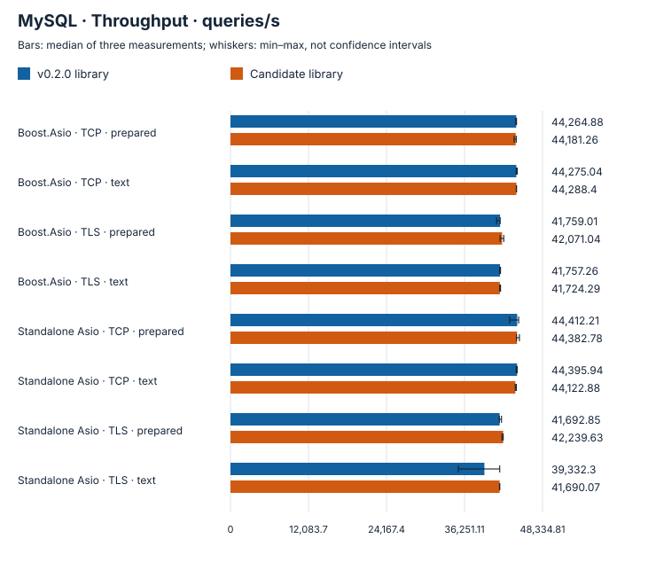
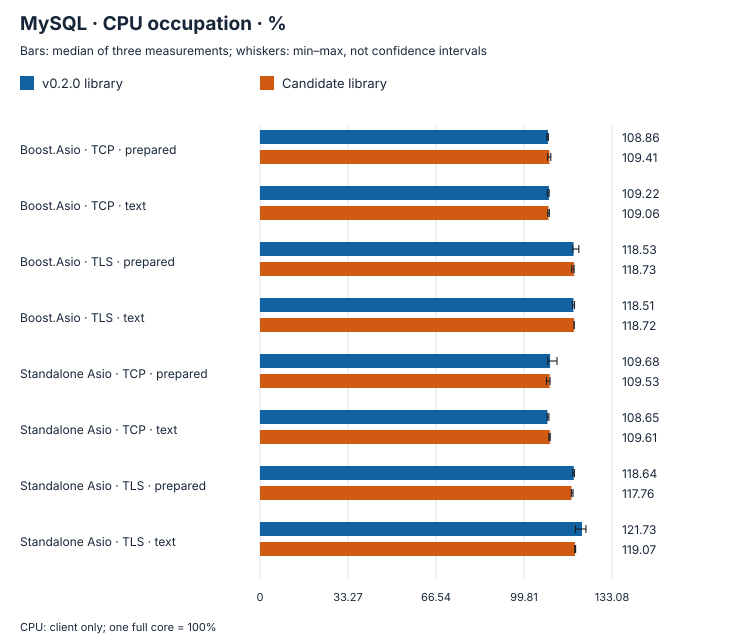
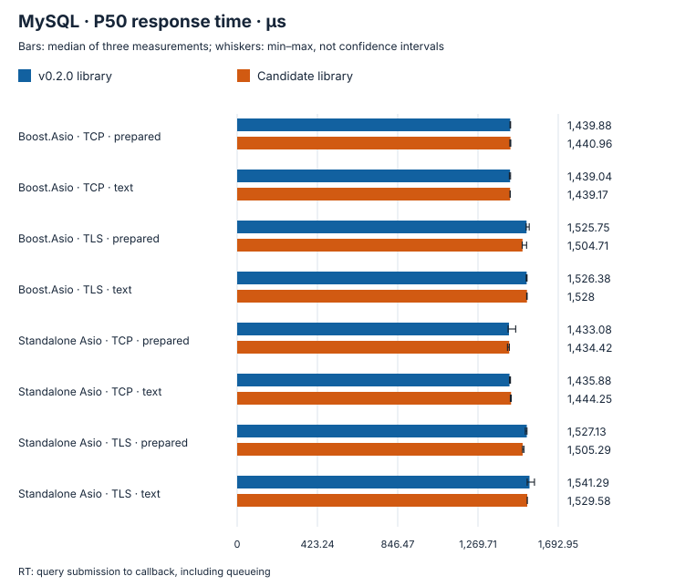
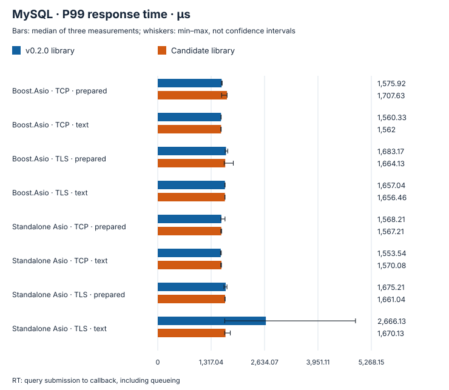
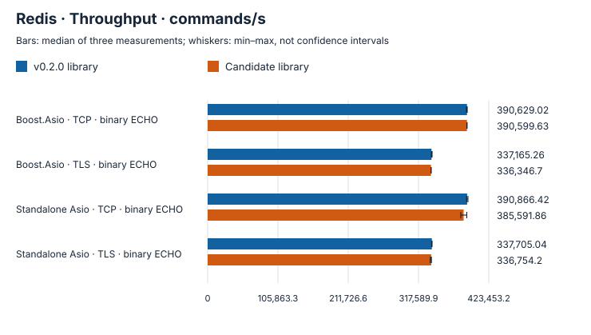
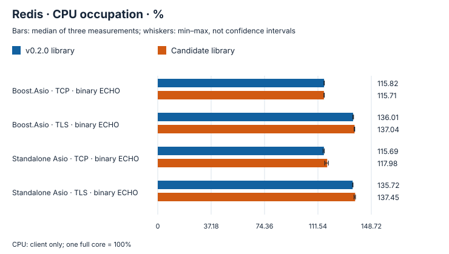
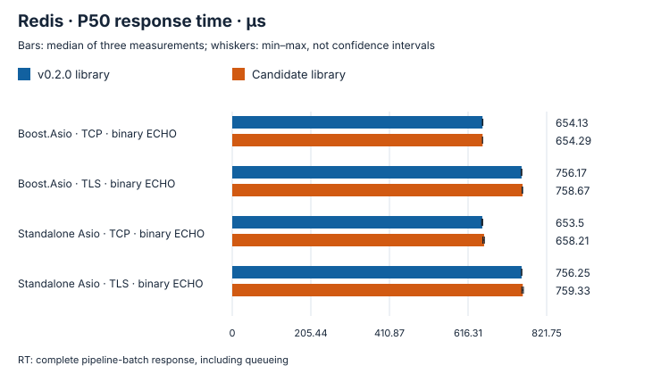
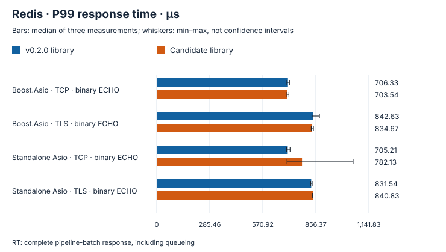

# Database client performance comparison

Compare v0.2.0 with the implementation that adds complete shutdown waits, measuring ordinary request paths. Each of 192 configurations runs three rounds per version: 1,152 measured rounds, with no failed requests or content errors. Connection pools, coroutines and shutdown duration are outside this scope.

The [five-second workload comparison](steady-workloads.md) includes independent five-run Redis measurements.

CPU covers the client process only; one full core is 100%. MySQL RT includes client queueing; Redis RT covers the complete pipeline batch.

| Environment | Recorded value |
| --- | --- |
| Machine | Mac mini (Mac16,11) · arm64 |
| CPU | Apple M4 Pro · 14 physical cores / 14 logical cores (system CPU count 14) |
| Memory | 48 GiB |
| OS | macOS 27.0.1 · build 26A434 |
| Compiler | Apple clang version 21.0.0 (clang-2100.3.34.2) · gnu++20 |
| Build flags | Release · -O3 -DNDEBUG |
| Dependencies | Boost 1.90 · Standalone Asio 1.38.2 · OpenSSL 3.6.4 25 Aug 2026 (Library: OpenSSL 3.6.4 25 Aug 2026) |
| Build tools | CMake 4.3.3 · Ninja 1.13.2 |
| Servers | MySQL 8.4.11 · Valkey 8.0.11 |
| Measurement interval (UTC) | 2026-10-15T18:45:50Z → 2026-10-15T19:06:15Z |
| Warmup / measurement | 0.15 s / 1 s × 3 rounds |
| API / IO | Native connection callback API · One io_context and worker per connection |
| CPU sampling | Client process only; one full core = 100% |

v0.2.0 library: `25fe2e5fac4e09edee597f312d58b0362b9e0681` · Candidate: `2aa5bc0ef7d383d8cfbc04520f3b952fa27c5fbd`

MySQL `mysql.cpp` SHA256: `badd0dfa01bb4c61de94893f8ad7a003eb48e146060651c8ad2f455e01a07d5c`

Redis `redis.cpp` SHA256: `9de41f49ae449a1f3be1b2015d9224340a7f87f5414be7ef3e50e2148ef6cdbc`

## MySQL

4 connections · 1 KiB · 16 in-flight requests per connection

P50 and P99 response time

Shown 8 cases: median per-case throughput ratio change -0.02%.All 96 cases: corresponding median -0.02%.Each summary is a median of case ratios, not pooled throughput.

## Redis

4 connections · 1 KiB · 16 commands per batch · 4 in-flight batches per connection. The grid has no 16-in-flight-batch cell.

P50 and P99 response time

Shown 4 cases: median per-case throughput ratio change -0.26%.All 96 cases: corresponding median -0.3%.Each summary is a median of case ratios, not pooled throughput.

All data (median [min–max])

| Case | Throughput/s: reference library → candidate library | P50 µs: reference library → candidate library | P99 µs: reference library → candidate library | CPU%: reference library → candidate library | RSS MiB: reference library → candidate library |
| --- | ---: | ---: | ---: | ---: | ---: |
| MySQL · Boost.Asio · TCP · prepared · 1 connections · 1024 B · in flight 1 | 11,716.09 [11,669.14–11,744.75] → 11,709.99 [11,689.06–11,714.95] | 85.13 [85.04–85.29] → 85.46 [85.46–85.5] | 97.42 [97.08–100.25] → 97.21 [97–97.42] | 17.3 [17.12–17.42] → 17.47 [17.42–17.53] | 7.28 [6.91–7.28] → 6.73 [6.73–6.75] |
| MySQL · Boost.Asio · TCP · prepared · 1 connections · 4096 B · in flight 1 | 8,786.47 [8,783.67–8,852.57] → 8,890.42 [8,866.63–8,901.16] | 113.25 [111.96–113.29] → 111.67 [110.71–111.96] | 127.42 [125.88–129] → 126.17 [125.25–126.25] | 15.15 [15.12–15.29] → 15.23 [15.11–15.27] | 6.8 [6.8–7.17] → 6.81 [6.81–6.81] |
| MySQL · Boost.Asio · TCP · prepared · 1 connections · 16384 B · in flight 1 | 5,045.83 [5,028.04–5,096.18] → 5,101.15 [5,098.86–5,131.79] | 197.29 [194.71–197.29] → 194.63 [194.54–194.67] | 219.33 [217.25–221.25] → 219.96 [214.04–221.25] | 12.72 [12.72–12.83] → 12.87 [12.81–12.88] | 6.88 [6.88–6.88] → 6.81 [6.8–6.81] |
| MySQL · Boost.Asio · TCP · prepared · 1 connections · 1024 B · in flight 16 | 13,027.42 [13,009.9–13,057.07] → 13,014.48 [12,584.98–13,147.4] | 1,227.83 [1,222.67–1,227.92] → 1,222.92 [1,211.92–1,278.29] | 1,280.42 [1,277.17–1,285.75] → 1,335.63 [1,283.46–1,340.67] | 20.26 [19.87–20.39] → 20.99 [20–21.25] | 7.11 [7.09–7.55] → 7.13 [7.13–7.14] |
| MySQL · Boost.Asio · TCP · prepared · 1 connections · 4096 B · in flight 16 | 10,259.23 [10,241.86–10,273.92] → 10,308.48 [10,259.74–10,317.77] | 1,553.38 [1,552–1,557.67] → 1,549.29 [1,548–1,554.63] | 1,675.88 [1,669.08–1,693.92] → 1,633.5 [1,618.63–1,683.83] | 18.07 [18.06–18.11] → 18.13 [18.11–18.16] | 7.19 [7.17–7.19] → 7.19 [7.19–7.19] |
| MySQL · Boost.Asio · TCP · prepared · 1 connections · 16384 B · in flight 16 | 5,309.77 [5,306.45–5,310.37] → 5,348.14 [5,325.15–5,361.53] | 3,011.92 [3,011.92–3,012] → 2,991.42 [2,985–3,003.96] | 3,141.46 [3,140–3,161.25] → 3,115.04 [3,096.92–3,123.96] | 13.87 [13.85–13.88] → 13.98 [13.9–13.98] | 7.55 [7.52–7.55] → 7.48 [7.47–7.48] |
| MySQL · Boost.Asio · TCP · prepared · 4 connections · 1024 B · in flight 1 | 39,015.19 [38,688.99–39,119.72] → 39,036.22 [38,905.21–39,118.23] | 102.04 [101.83–102.08] → 102 [101.92–102.21] | 117.75 [117.08–134.21] → 116.5 [115.88–120.46] | 92.93 [92.45–93.44] → 92.41 [92.3–92.65] | 10.47 [8.89–10.98] → 10.42 [8.83–10.92] |
| MySQL · Boost.Asio · TCP · prepared · 4 connections · 4096 B · in flight 1 | 30,682.13 [30,606.59–30,703.37] → 30,750.94 [30,726.99–30,862.04] | 129.79 [129.75–130.04] → 129.54 [129.46–129.58] | 148.21 [147.04–155.17] → 148.54 [145.67–151.63] | 82.4 [82.4–82.72] → 82.27 [82.19–82.28] | 9.08 [8.58–9.08] → 9 [8.47–9] |
| MySQL · Boost.Asio · TCP · prepared · 4 connections · 16384 B · in flight 1 | 17,446.58 [17,434.42–17,456.45] → 17,499.02 [17,393.63–17,543.06] | 228.17 [228–228.25] → 227.46 [227.17–228.63] | 265.29 [264.58–265.54] → 262.46 [261.79–273.75] | 63.75 [63.59–63.85] → 64.01 [63.98–64.61] | 9.7 [8.97–10.2] → 9.56 [8.81–10.06] |
| MySQL · Boost.Asio · TCP · prepared · 4 connections · 1024 B · in flight 16 | 44,264.88 [44,189.38–44,306.53] → 44,181.26 [43,934.49–44,266.05] | 1,439.88 [1,438.79–1,441.75] → 1,440.96 [1,437.88–1,442.67] | 1,575.92 [1,571.58–1,589.5] → 1,707.63 [1,574.54–1,710.46] | 108.86 [108.44–109.02] → 109.41 [108.76–109.94] | 11.17 [9.53–11.17] → 9.64 [9.64–9.64] |
| MySQL · Boost.Asio · TCP · prepared · 4 connections · 4096 B · in flight 16 | 33,673.94 [33,632.21–33,727.15] → 33,587.91 [33,585.42–33,722.04] | 1,897.13 [1,891.42–1,898.04] → 1,901.46 [1,895.38–1,901.71] | 2,013.75 [2,012.42–2,015.38] → 2,009.46 [2,006.33–2,180.58] | 94.37 [93.93–95.01] → 94.54 [94.18–94.9] | 11.23 [9.75–11.25] → 11.17 [9.69–11.17] |
| MySQL · Boost.Asio · TCP · prepared · 4 connections · 16384 B · in flight 16 | 18,560.33 [18,549.14–18,578.87] → 18,545.05 [18,539.33–18,552.73] | 3,443 [3,441–3,444.46] → 3,446.67 [3,443.88–3,446.75] | 3,584.08 [3,583.92–3,594.08] → 3,584.83 [3,579.42–3,591.96] | 69.47 [69.45–69.51] → 70.16 [70.09–70.21] | 10.77 [10.77–11.45] → 10.69 [10.66–11.5] |
| MySQL · Boost.Asio · TCP · text · 1 connections · 1024 B · in flight 1 | 11,652.17 [11,647.01–11,721.49] → 11,914.37 [11,907.71–11,971.76] | 86.63 [86.46–86.79] → 82.67 [82.67–82.67] | 97.29 [97.25–97.5] → 97.71 [96.04–99.33] | 18.02 [18.02–18.14] → 16.85 [16.83–16.93] | 6.92 [6.91–6.92] → 6.83 [6.83–6.84] |
| MySQL · Boost.Asio · TCP · text · 1 connections · 4096 B · in flight 1 | 9,651.27 [9,641.29–9,699.99] → 9,665.23 [9,606.75–9,710.62] | 102.67 [102.63–102.67] → 102.63 [102.63–102.67] | 118.54 [117.33–119.71] → 118.42 [116.79–122.79] | 16.47 [16.45–16.61] → 16.44 [16.25–16.62] | 6.83 [6.83–6.83] → 6.84 [6.84–7.2] |
| MySQL · Boost.Asio · TCP · text · 1 connections · 16384 B · in flight 1 | 5,994.36 [5,988.56–5,999.59] → 5,975.91 [5,972.82–5,978.97] | 166.63 [166.63–166.63] → 166.63 [166.63–166.63] | 185.33 [184.83–186.33] → 185.33 [185.29–185.33] | 16.34 [16.31–16.38] → 16.3 [16.3–16.33] | 6.92 [6.92–6.92] → 7.14 [6.88–7.3] |
| MySQL · Boost.Asio · TCP · text · 1 connections · 1024 B · in flight 16 | 12,166.39 [12,157.35–12,274.4] → 12,173.68 [12,158.27–12,174.44] | 1,317.33 [1,313.33–1,318.58] → 1,314.67 [1,314.63–1,317.29] | 1,346.63 [1,345.25–1,351.92] → 1,344.04 [1,343.54–1,455] | 17.78 [17.78–18.32] → 17.82 [17.66–18.56] | 7.17 [7.16–7.2] → 7.09 [7.09–7.48] |
| MySQL · Boost.Asio · TCP · text · 1 connections · 4096 B · in flight 16 | 10,853.89 [10,848.17–10,860.99] → 10,833.79 [10,827.06–10,843.63] | 1,472.29 [1,472–1,473.63] → 1,475 [1,474.33–1,475.92] | 1,528 [1,525.38–1,534.67] → 1,533.29 [1,524.5–1,540.29] | 20.08 [20.06–20.09] → 20.18 [20.13–20.2] | 7.34 [7.33–7.36] → 7.25 [7.25–7.27] |
| MySQL · Boost.Asio · TCP · text · 1 connections · 16384 B · in flight 16 | 6,275.63 [6,250.41–6,287.77] → 6,299.46 [6,276.82–6,310.9] | 2,555.92 [2,546.58–2,558.63] → 2,538.63 [2,535.92–2,546.67] | 2,696.25 [2,663.63–2,696.75] → 2,655.96 [2,633.25–2,671.63] | 17.36 [17.31–17.51] → 17.34 [17.31–17.4] | 7.7 [7.7–7.83] → 7.7 [7.7–7.7] |
| MySQL · Boost.Asio · TCP · text · 4 connections · 1024 B · in flight 1 | 39,017.24 [38,899.89–39,120.19] → 39,075.01 [39,020.47–39,146.55] | 102 [101.88–102.04] → 101.92 [101.83–101.96] | 116.96 [115.67–125.42] → 115.79 [115.33–117.71] | 93.03 [92.96–93.25] → 92.85 [92.74–93.13] | 8.84 [8.83–10.39] → 8.89 [8.88–10.48] |
| MySQL · Boost.Asio · TCP · text · 4 connections · 4096 B · in flight 1 | 32,710.3 [32,701.96–32,721.39] → 32,650.89 [32,616.07–32,658.79] | 121.79 [121.75–121.79] → 121.96 [121.88–122.04] | 137.46 [136.75–137.83] → 139.46 [137.67–139.67] | 89.05 [88.89–89.11] → 89.16 [89.16–89.23] | 8.59 [8.59–9.47] → 8.3 [8.3–9.27] |
| MySQL · Boost.Asio · TCP · text · 4 connections · 16384 B · in flight 1 | 20,781.03 [20,411.07–20,791.54] → 20,809.4 [20,773.29–20,817.9] | 191.83 [191.71–192.08] → 191.67 [191.5–191.75] | 226.88 [221.13–316.25] → 217.42 [215.92–218.13] | 83.47 [82.74–84.92] → 83.1 [82.95–83.24] | 9.45 [9.45–10.03] → 9.8 [8.84–10.36] |
| MySQL · Boost.Asio · TCP · text · 4 connections · 1024 B · in flight 16 | 44,275.04 [44,251.93–44,412.66] → 44,288.4 [44,274.78–44,315.04] | 1,439.04 [1,435.13–1,441.54] → 1,439.17 [1,438.67–1,439.96] | 1,560.33 [1,559.29–1,565] → 1,562 [1,555.79–1,564.92] | 109.22 [108.63–109.32] → 109.06 [108.79–109.4] | 9.63 [9.61–11.27] → 9.61 [9.58–11.25] |
| MySQL · Boost.Asio · TCP · text · 4 connections · 4096 B · in flight 16 | 36,350.23 [36,343.34–36,365.98] → 36,297.37 [36,252.08–36,339.18] | 1,753.83 [1,750.88–1,757.79] → 1,758 [1,757–1,759.13] | 2,002.33 [1,876.83–2,046.79] → 1,892.17 [1,867.67–1,910.46] | 102 [101.85–102.51] → 102.05 [101.88–102.1] | 11.73 [10.2–11.73] → 10.22 [10.22–10.22] |
| MySQL · Boost.Asio · TCP · text · 4 connections · 16384 B · in flight 16 | 22,191.53 [22,168.11–22,205.46] → 22,137.86 [22,126.02–22,138.24] | 2,879.04 [2,876.79–2,879.92] → 2,887.13 [2,883.83–2,889.04] | 3,009.96 [3,002.96–3,043.29] → 3,026.63 [3,003.71–3,027.25] | 90.76 [90.66–90.78] → 91.66 [91.54–91.93] | 15 [15–15.25] → 12.39 [12.3–15.66] |
| MySQL · Boost.Asio · TLS · prepared · 1 connections · 1024 B · in flight 1 | 11,552.41 [11,520.73–11,577.46] → 11,547.52 [11,515.41–11,557.85] | 86.67 [86.67–86.67] → 86.67 [86.67–86.67] | 100.54 [99.83–100.83] → 101.08 [100.5–102] | 18.53 [18.5–18.6] → 18.59 [18.53–18.66] | 8.53 [8.13–8.53] → 7.97 [7.97–7.97] |
| MySQL · Boost.Asio · TLS · prepared · 1 connections · 4096 B · in flight 1 | 8,558.89 [8,522.94–8,659.21] → 8,534.95 [8,518.95–8,558.71] | 116 [114.67–116.29] → 117.29 [117.29–117.29] | 131 [129.13–133.04] → 134.46 [130.63–134.54] | 16.79 [16.76–16.9] → 16.96 [16.87–16.97] | 8.47 [8.13–8.8] → 8.14 [8.13–8.14] |
| MySQL · Boost.Asio · TLS · prepared · 1 connections · 16384 B · in flight 1 | 4,352.3 [4,333.17–4,418.3] → 4,450.93 [4,389.76–4,466.93] | 225.33 [225.33–229.25] → 223.96 [222.67–227.92] | 277.08 [246.67–321.29] → 244 [242.63–247.54] | 16.85 [16.41–16.92] → 16.42 [16.32–16.54] | 8.09 [8.08–8.09] → 8.11 [7.97–8.13] |
| MySQL · Boost.Asio · TLS · prepared · 1 connections · 1024 B · in flight 16 | 12,749.04 [12,621.46–12,855.09] → 12,676.85 [12,589.16–12,845.36] | 1,247.96 [1,243.96–1,263.96] → 1,258.63 [1,243.96–1,265.42] | 1,353.29 [1,302.38–1,404.25] → 1,343.92 [1,333.38–1,372.46] | 23.53 [23.39–23.71] → 23.5 [23.24–23.55] | 8.33 [8.33–8.34] → 8.66 [8.25–8.66] |
| MySQL · Boost.Asio · TLS · prepared · 1 connections · 4096 B · in flight 16 | 9,762.67 [9,339.58–9,779.91] → 9,830.14 [9,682.48–9,859.25] | 1,630.46 [1,625.33–1,681.33] → 1,622.63 [1,619.92–1,647.96] | 2,071.83 [1,752.79–2,232.29] → 1,725.29 [1,697–1,833.5] | 20.41 [20.33–20.53] → 20.2 [20.19–20.53] | 8.45 [8.45–8.47] → 8.41 [8.41–8.8] |
| MySQL · Boost.Asio · TLS · prepared · 1 connections · 16384 B · in flight 16 | 4,653.64 [4,651.96–4,655.58] → 4,673.54 [4,665.44–4,679.3] | 3,436.79 [3,436.04–3,439] → 3,417.25 [3,413.33–3,420] | 3,517.29 [3,511.25–3,525.88] → 3,707.5 [3,519.63–3,734.33] | 17.33 [17.29–17.38] → 17.57 [17.56–17.68] | 8.69 [8.69–8.69] → 8.7 [8.7–8.73] |
| MySQL · Boost.Asio · TLS · prepared · 4 connections · 1024 B · in flight 1 | 37,097.58 [37,079.14–37,173.87] → 36,868.38 [36,639.9–36,871.94] | 107.13 [106.96–107.25] → 107.83 [107.67–107.92] | 127.33 [127.29–133.5] → 131.13 [126.88–139.38] | 101.12 [100.9–101.14] → 101.76 [101.36–101.99] | 10.92 [10.42–10.97] → 11.55 [10–12.05] |
| MySQL · Boost.Asio · TLS · prepared · 4 connections · 4096 B · in flight 1 | 28,860.41 [28,187.02–28,970.74] → 28,834.01 [28,815.11–28,892.51] | 137.63 [137.25–138.04] → 137.71 [137.5–137.79] | 175.58 [170.08–242.25] → 169.21 [165.96–169.96] | 92.22 [91.89–93.82] → 92.48 [92.22–92.52] | 9.64 [9.63–10.58] → 9.88 [9.84–10.73] |
| MySQL · Boost.Asio · TLS · prepared · 4 connections · 16384 B · in flight 1 | 15,705.47 [15,687.25–15,708.34] → 15,691.85 [15,687.01–15,694.18] | 252.42 [252.42–252.75] → 252.54 [252.5–252.79] | 311.08 [308.54–312.58] → 310.96 [309.75–314.04] | 84.72 [84.54–85.04] → 84.56 [84.48–84.96] | 10.14 [9.66–10.47] → 10.3 [9.72–10.77] |
| MySQL · Boost.Asio · TLS · prepared · 4 connections · 1024 B · in flight 16 | 41,759.01 [41,225.47–41,772.42] → 42,071.04 [41,758.85–42,330.18] | 1,525.75 [1,523.79–1,539.83] → 1,504.71 [1,503.13–1,526.13] | 1,683.17 [1,662.79–1,726.25] → 1,664.13 [1,638.75–1,863.54] | 118.53 [118.24–120.53] → 118.73 [117.85–118.75] | 10.97 [10.97–10.97] → 12.31 [10.72–12.33] |
| MySQL · Boost.Asio · TLS · prepared · 4 connections · 4096 B · in flight 16 | 31,767.67 [31,725.76–31,796.08] → 31,643.35 [31,572.59–31,708.48] | 2,008.54 [2,006.67–2,009.71] → 2,012.54 [2,007.88–2,013.54] | 2,130.25 [2,124.38–2,288.83] → 2,273.5 [2,184–2,313.92] | 104.22 [104.15–104.48] → 104.9 [104.09–104.98] | 10.77 [10.75–11.56] → 10.81 [10.81–10.81] |
| MySQL · Boost.Asio · TLS · prepared · 4 connections · 16384 B · in flight 16 | 15,813.05 [15,811.11–15,869.21] → 15,857.78 [15,815.45–15,862.69] | 4,036.13 [4,034.75–4,044.25] → 4,032.54 [4,029.88–4,040.71] | 4,459.04 [4,219.08–4,548.63] → 4,203.5 [4,198.88–4,259.17] | 88.97 [88.83–89.46] → 89.2 [89.19–89.5] | 11.88 [11.75–11.88] → 12.23 [11.69–12.23] |
| MySQL · Boost.Asio · TLS · text · 1 connections · 1024 B · in flight 1 | 11,541.89 [11,532.6–11,565.7] → 11,483.96 [11,209.81–11,538.75] | 86.63 [86.63–86.63] → 86.67 [86.63–87.63] | 101.33 [100.63–101.79] → 103.04 [100.58–124.29] | 18.91 [18.88–18.94] → 19.07 [18.94–19.65] | 8.11 [8.09–8.11] → 8 [7.98–8.02] |
| MySQL · Boost.Asio · TLS · text · 1 connections · 4096 B · in flight 1 | 9,024.9 [9,017.95–9,036.46] → 9,007.61 [8,977.07–9,013.99] | 110.63 [110.63–110.67] → 110.67 [110.63–110.67] | 122.54 [121.63–122.54] → 123.13 [123.04–123.83] | 18.95 [18.89–18.98] → 18.85 [18.85–18.92] | 8.14 [8.13–8.14] → 8.03 [8.03–8.03] |
| MySQL · Boost.Asio · TLS · text · 1 connections · 16384 B · in flight 1 | 4,920.7 [4,899.45–4,933.55] → 4,929.41 [4,919.18–4,941.29] | 203.96 [203.92–204] → 203.96 [203.88–204] | 221.58 [220.63–228.75] → 222.67 [221.33–222.67] | 23.45 [23.44–23.64] → 23.61 [23.57–23.65] | 8.22 [8.22–8.22] → 8.05 [8.03–8.05] |
| MySQL · Boost.Asio · TLS · text · 1 connections · 1024 B · in flight 16 | 12,758.53 [12,757.32–12,805.52] → 12,688.67 [12,671.07–12,751.18] | 1,253.29 [1,249.54–1,254.58] → 1,260.04 [1,254.63–1,260.58] | 1,309.33 [1,298.58–1,318.67] → 1,324 [1,310.67–1,330.67] | 23.62 [23.61–23.71] → 23.81 [23.75–24.01] | 8.33 [8.31–8.33] → 8.25 [8.25–8.27] |
| MySQL · Boost.Asio · TLS · text · 1 connections · 4096 B · in flight 16 | 10,451.58 [10,414.36–10,512.84] → 10,527.12 [10,501.34–10,529.12] | 1,526.67 [1,520–1,529.29] → 1,517.33 [1,516.04–1,519.96] | 1,618.17 [1,598.71–1,757.33] → 1,619.13 [1,615.92–1,645.33] | 22.08 [22.04–22.23] → 21.99 [21.98–22.01] | 8.61 [8.61–8.63] → 8.67 [8.66–8.67] |
| MySQL · Boost.Asio · TLS · text · 1 connections · 16384 B · in flight 16 | 4,951.47 [4,938.24–4,952.22] → 4,985.37 [4,959.57–4,986.06] | 3,230.67 [3,230.58–3,237.29] → 3,207.96 [3,207.96–3,225.29] | 3,333.04 [3,322.63–3,349.25] → 3,310.92 [3,296–3,329.46] | 23.15 [23.11–23.19] → 23.25 [23.24–23.26] | 8.94 [8.92–8.95] → 9.8 [9.78–9.8] |
| MySQL · Boost.Asio · TLS · text · 4 connections · 1024 B · in flight 1 | 36,895.92 [36,885.1–36,929.83] → 36,956.08 [36,907.47–36,983.84] | 107.71 [107.67–107.79] → 107.58 [107.5–107.79] | 130.08 [127–138.25] → 127.29 [126.63–127.46] | 102.36 [102.28–102.62] → 102.26 [102.11–102.43] | 11.81 [10.22–12.34] → 11.72 [10.13–12.23] |
| MySQL · Boost.Asio · TLS · text · 4 connections · 4096 B · in flight 1 | 30,216.32 [30,149.39–30,304.12] → 30,281.33 [30,257.99–30,286.11] | 131.5 [131.17–131.83] → 131.42 [131.38–131.46] | 159.17 [157.63–160.29] → 157.08 [154.67–158.54] | 101.03 [100.67–101.39] → 101.05 [100.99–101.16] | 10.64 [9.69–11.14] → 9.77 [9.73–10.72] |
| MySQL · Boost.Asio · TLS · text · 4 connections · 16384 B · in flight 1 | 14,129.03 [14,003.84–15,922.23] → 15,849.92 [15,077.24–15,908.46] | 234.5 [233.63–235.67] → 234.38 [232.04–235.46] | 290.5 [289.38–293.96] → 291.71 [290.58–292.58] | 98.71 [97.78–110.8] → 110.92 [102.76–111.5] | 10.72 [10.09–11.38] → 10.53 [9.89–11.2] |
| MySQL · Boost.Asio · TLS · text · 4 connections · 1024 B · in flight 16 | 41,757.26 [41,703.12–41,825.69] → 41,724.29 [41,696–41,830.81] | 1,526.38 [1,523.88–1,528.46] → 1,528 [1,526.46–1,529.04] | 1,657.04 [1,652.71–1,661.08] → 1,656.46 [1,654.46–1,659.21] | 118.51 [118.12–118.9] → 118.72 [118.72–118.84] | 12.44 [10.77–12.45] → 12.42 [10.77–12.42] |
| MySQL · Boost.Asio · TLS · text · 4 connections · 4096 B · in flight 16 | 33,416.74 [33,413.61–33,572.92] → 33,521.54 [33,518.05–33,522.18] | 1,905.88 [1,902.88–1,910.04] → 1,904 [1,903.13–1,904.67] | 2,040.33 [2,030.29–2,043.08] → 2,028.33 [2,022.67–2,051] | 114.37 [113.9–114.45] → 114.22 [114.01–114.25] | 11.69 [11.69–11.7] → 11.69 [11.66–11.69] |
| MySQL · Boost.Asio · TLS · text · 4 connections · 16384 B · in flight 16 | 15,605.84 [13,450.14–15,776.78] → 16,586.91 [15,791.5–16,596.04] | 3,836.21 [3,833.38–3,840.13] → 3,845.38 [3,830.33–3,848.67] | 4,081.08 [4,011.29–5,494.29] → 4,141.83 [4,028.96–4,296.04] | 111.39 [96.21–111.47] → 119.13 [111.19–120.04] | 17.7 [16.28–19.2] → 16.77 [13.97–16.77] |
| MySQL · Standalone Asio · TCP · prepared · 1 connections · 1024 B · in flight 1 | 11,667.59 [11,656.91–11,675.75] → 11,709.54 [11,709.02–11,714.15] | 85.5 [85.42–85.5] → 85.29 [85.25–85.29] | 96.83 [96.63–97.21] → 97 [96.96–97.17] | 17.31 [17.29–17.32] → 17.42 [17.37–17.42] | 6.86 [6.84–6.86] → 6.75 [6.72–6.75] |
| MySQL · Standalone Asio · TCP · prepared · 1 connections · 4096 B · in flight 1 | 8,838.93 [8,828.41–8,840.57] → 8,819.86 [8,819.11–8,837.66] | 112 [111.96–112] → 112 [112–112.13] | 126.33 [125.67–126.63] → 126.46 [125.54–126.88] | 15.21 [15.2–15.22] → 15.27 [15.25–15.31] | 6.81 [6.8–6.81] → 6.78 [6.78–6.8] |
| MySQL · Standalone Asio · TCP · prepared · 1 connections · 16384 B · in flight 1 | 5,094.78 [5,074.16–5,102.5] → 5,055.65 [5,054.31–5,076.97] | 194.67 [194.63–195.96] → 196 [195.96–197.29] | 218.54 [215.75–221.29] → 217.25 [217.08–220.04] | 12.85 [12.8–12.88] → 12.82 [12.77–12.87] | 7.02 [6.81–7.16] → 6.83 [6.83–6.84] |
| MySQL · Standalone Asio · TCP · prepared · 1 connections · 1024 B · in flight 16 | 12,343.39 [12,340.92–12,607.31] → 12,337.2 [12,270.84–12,368.41] | 1,302.67 [1,274.63–1,303.96] → 1,304 [1,300.04–1,308] | 1,334.83 [1,327.96–1,335.96] → 1,338.63 [1,338.63–1,338.63] | 18.55 [18.52–19.44] → 18.53 [18.16–18.93] | 7.63 [7.16–7.63] → 7.09 [7.09–7.11] |
| MySQL · Standalone Asio · TCP · prepared · 1 connections · 4096 B · in flight 16 | 10,297.5 [10,294.26–10,309.53] → 10,261.21 [10,215.55–10,269.35] | 1,550.67 [1,550.63–1,550.83] → 1,555.96 [1,555.88–1,557.29] | 1,649.29 [1,635.04–1,657.33] → 1,633.33 [1,631.58–1,795.5] | 18.18 [18.17–18.23] → 18.1 [18.09–18.24] | 7.2 [7.2–7.2] → 7.11 [7.06–7.11] |
| MySQL · Standalone Asio · TCP · prepared · 1 connections · 16384 B · in flight 16 | 5,330.74 [5,320.59–5,339.02] → 5,275.02 [5,266.97–5,308.29] | 2,994.58 [2,993.25–3,005.46] → 3,013 [3,011.96–3,035.33] | 3,125.42 [3,123.88–3,262.75] → 3,180.25 [3,136–3,584.92] | 14 [13.95–14.06] → 13.91 [13.84–14.1] | 7.56 [7.52–7.73] → 7.53 [7.52–7.55] |
| MySQL · Standalone Asio · TCP · prepared · 4 connections · 1024 B · in flight 1 | 39,116.44 [39,085.83–39,138.96] → 39,066.02 [39,005.57–39,082.33] | 101.79 [101.75–101.83] → 101.92 [101.83–102.04] | 116.04 [115.79–116.96] → 116.58 [116.54–125.79] | 92.51 [92.5–92.53] → 92.54 [92.4–92.67] | 9.55 [9.05–9.55] → 9.56 [9.05–9.56] |
| MySQL · Standalone Asio · TCP · prepared · 4 connections · 4096 B · in flight 1 | 30,717.24 [30,635.8–30,752.95] → 30,709.3 [30,703.43–30,729.7] | 129.75 [129.5–130] → 129.75 [129.67–129.79] | 145.67 [145.42–148.46] → 146.63 [146.08–148.21] | 82.17 [81.98–82.24] → 82.41 [82.21–82.6] | 8.41 [8.38–9.38] → 9.28 [8.28–9.77] |
| MySQL · Standalone Asio · TCP · prepared · 4 connections · 16384 B · in flight 1 | 17,408.19 [17,315.22–17,480.63] → 17,499.15 [17,494.02–17,511.64] | 228.75 [227.54–228.88] → 227.71 [227.42–227.75] | 269.92 [268.88–281.79] → 260.58 [259.42–262.5] | 64.62 [64.34–64.99] → 64.1 [64.05–64.15] | 8.91 [8.83–9.67] → 8.75 [8.73–9.52] |
| MySQL · Standalone Asio · TCP · prepared · 4 connections · 1024 B · in flight 16 | 44,412.21 [43,228.18–44,633.79] → 44,382.78 [44,292.74–44,754.45] | 1,433.08 [1,428.5–1,468.63] → 1,434.42 [1,425.33–1,435.29] | 1,568.21 [1,557.92–1,658.96] → 1,567.21 [1,554.08–1,576.75] | 109.68 [108.76–112.29] → 109.53 [108.29–109.65] | 9.5 [9.48–11.13] → 11.14 [9.5–11.14] |
| MySQL · Standalone Asio · TCP · prepared · 4 connections · 4096 B · in flight 16 | 33,632.09 [33,616.26–33,759.9] → 33,722.12 [33,566.46–33,784.15] | 1,897.54 [1,894.63–1,899.5] → 1,893.46 [1,890.96–1,900.92] | 2,009.75 [2,007–2,031.54] → 2,002.42 [2,000–2,027.54] | 95.06 [94.73–95.08] → 94.48 [94.17–95.38] | 9.63 [9.63–11.14] → 9.73 [9.72–11.2] |
| MySQL · Standalone Asio · TCP · prepared · 4 connections · 16384 B · in flight 16 | 18,539.78 [18,537.25–18,571.04] → 18,578.06 [18,554.76–18,583.09] | 3,446.79 [3,439.92–3,448.38] → 3,438.42 [3,437.13–3,444.46] | 3,588.96 [3,588.38–3,669.21] → 3,591.42 [3,583.63–3,601.83] | 69.96 [69.86–70.31] → 69.68 [69.51–70.02] | 10.58 [10.58–11.27] → 10.67 [10.66–11.45] |
| MySQL · Standalone Asio · TCP · text · 1 connections · 1024 B · in flight 1 | 11,918.73 [11,892.1–11,945.43] → 11,594.13 [11,547.29–11,597.04] | 82.67 [82.67–82.67] → 87.92 [86.79–87.96] | 96.29 [95.75–96.58] → 97.75 [97.46–97.83] | 16.85 [16.76–16.96] → 18.24 [18.07–18.35] | 6.84 [6.81–7.23] → 6.8 [6.8–6.81] |
| MySQL · Standalone Asio · TCP · text · 1 connections · 4096 B · in flight 1 | 9,684.95 [9,679.4–9,689.4] → 9,666.42 [9,649.51–9,666.81] | 102.63 [102.63–102.63] → 102.63 [102.63–102.63] | 117.33 [117.21–117.5] → 116.67 [116.54–118.46] | 16.47 [16.46–16.52] → 16.34 [16.33–16.37] | 6.88 [6.86–6.88] → 7.19 [6.83–7.19] |
| MySQL · Standalone Asio · TCP · text · 1 connections · 16384 B · in flight 1 | 5,965.68 [5,950.81–6,002.54] → 6,007.46 [5,995.49–6,010.06] | 166.67 [166.63–166.71] → 166.63 [166.63–166.63] | 185.29 [185.29–187.46] → 184.17 [184–185.46] | 16.5 [16.27–16.5] → 16.32 [16.3–16.35] | 7.16 [6.94–7.2] → 6.77 [6.77–6.81] |
| MySQL · Standalone Asio · TCP · text · 1 connections · 1024 B · in flight 16 | 12,233.59 [12,166.58–12,269.83] → 12,669.81 [12,339.22–13,099] | 1,309.38 [1,308.04–1,315.96] → 1,266.67 [1,211.96–1,302.71] | 1,347.92 [1,347.71–1,347.96] → 1,363.96 [1,329.17–1,389.63] | 19.05 [17.67–19.07] → 20.7 [20.37–21.71] | 7.5 [7.11–7.5] → 7.16 [7.16–7.17] |
| MySQL · Standalone Asio · TCP · text · 1 connections · 4096 B · in flight 16 | 10,826.25 [10,756.19–10,829.62] → 10,843.24 [10,819.49–10,848.22] | 1,476.96 [1,474.63–1,478.71] → 1,474.42 [1,473.25–1,477.04] | 1,577.33 [1,540.33–1,665.46] → 1,533.29 [1,528–1,536.29] | 20.41 [20.39–20.5] → 20.13 [20.11–20.17] | 7.39 [7.38–7.8] → 7.31 [7.31–7.33] |
| MySQL · Standalone Asio · TCP · text · 1 connections · 16384 B · in flight 16 | 6,239.38 [6,228.45–6,296.05] → 6,266.87 [6,260.67–6,267.51] | 2,562.67 [2,542.63–2,567.92] → 2,551.96 [2,550.58–2,553.42] | 2,641.25 [2,633.13–2,651.92] → 2,635.92 [2,629.29–2,670.71] | 17.2 [17.14–17.28] → 17.3 [17.29–17.32] | 7.72 [7.72–8.58] → 7.69 [7.67–7.69] |
| MySQL · Standalone Asio · TCP · text · 4 connections · 1024 B · in flight 1 | 38,978.33 [38,962.2–39,106.33] → 39,002.27 [34,260.16–39,067.7] | 102.13 [101.79–102.13] → 102.04 [102–104.67] | 118.08 [116.96–118.92] → 119.5 [116.58–251.83] | 92.81 [92.74–93.17] → 93.5 [93.48–99.64] | 10.44 [8.81–10.94] → 9.58 [9.05–11.08] |
| MySQL · Standalone Asio · TCP · text · 4 connections · 4096 B · in flight 1 | 32,612.72 [32,597.33–32,626.25] → 32,637.1 [32,606.72–32,666.22] | 122.08 [122–122.13] → 121.96 [121.92–122.21] | 138.38 [137.71–138.5] → 137.58 [136.67–138.71] | 89.13 [89.09–89.39] → 89.04 [88.99–89.22] | 9.36 [8.34–9.88] → 9.38 [8.42–9.88] |
| MySQL · Standalone Asio · TCP · text · 4 connections · 16384 B · in flight 1 | 20,787.16 [20,725.05–20,793.17] → 20,727.05 [20,679.76–20,747.91] | 191.75 [191.58–192.13] → 192.08 [192.04–192.5] | 220.38 [217.08–221.42] → 224.38 [219.29–225.54] | 82.99 [82.9–83.27] → 83.4 [83.15–83.46] | 10.03 [9.41–10.06] → 9.98 [9.41–10.08] |
| MySQL · Standalone Asio · TCP · text · 4 connections · 1024 B · in flight 16 | 44,395.94 [44,260.61–44,407.45] → 44,122.88 [44,103.21–44,280.65] | 1,435.88 [1,435.75–1,441.13] → 1,444.25 [1,440.29–1,445.04] | 1,553.54 [1,547.54–1,567.42] → 1,570.08 [1,554.88–1,571.58] | 108.65 [108.6–109.22] → 109.61 [109.17–109.74] | 11.11 [9.44–11.11] → 9.86 [9.8–9.88] |
| MySQL · Standalone Asio · TCP · text · 4 connections · 4096 B · in flight 16 | 36,350.44 [36,289.94–36,354.96] → 36,205.72 [36,161.07–36,261.44] | 1,756.58 [1,755.13–1,758.08] → 1,762.63 [1,758.96–1,764.88] | 1,873.96 [1,864.96–1,881.25] → 1,879.79 [1,875.96–1,888.5] | 102.09 [101.9–102.2] → 102.79 [102.59–102.97] | 10.19 [10.17–11.69] → 10.22 [10.22–11.78] |
| MySQL · Standalone Asio · TCP · text · 4 connections · 16384 B · in flight 16 | 22,118.62 [21,214.16–22,147.21] → 22,205.85 [21,684.89–22,228.44] | 2,885.75 [2,882.96–2,974.21] → 2,876.75 [2,872–2,933.08] | 3,039.63 [3,035.58–3,717.96] → 3,051.88 [3,031.88–3,357.75] | 91.49 [91.39–98.08] → 91.52 [91.14–95.04] | 16.22 [15.53–16.22] → 14.91 [14.88–15.61] |
| MySQL · Standalone Asio · TLS · prepared · 1 connections · 1024 B · in flight 1 | 11,435.33 [11,383.07–11,524.23] → 11,477.79 [11,429.77–11,552.88] | 87.96 [86.67–87.96] → 86.67 [86.63–87.96] | 101.71 [100.67–101.96] → 101.04 [100.88–101.21] | 18.54 [18.52–18.69] → 18.58 [18.57–18.63] | 8.08 [8.06–8.08] → 8.5 [8.11–8.88] |
| MySQL · Standalone Asio · TLS · prepared · 1 connections · 4096 B · in flight 1 | 8,623.64 [8,617.79–8,628.14] → 8,600.26 [8,568.52–8,606.03] | 116 [116–116] → 117.29 [117.25–117.29] | 129.29 [129.29–129.33] → 130.83 [129.33–131.96] | 16.99 [16.96–17.02] → 17.02 [16.81–17.04] | 8.11 [8.08–8.11] → 8.08 [8.08–8.42] |
| MySQL · Standalone Asio · TLS · prepared · 1 connections · 16384 B · in flight 1 | 4,478.6 [4,417.51–4,482.71] → 4,436.46 [4,417.82–4,437.4] | 222.63 [222.63–226.63] → 225.29 [225.29–226.63] | 242.67 [241.54–246.63] → 245.08 [243.96–246.5] | 16.38 [16.32–16.41] → 16.35 [16.3–16.35] | 8.22 [8.06–8.22] → 8.05 [8.05–8.05] |
| MySQL · Standalone Asio · TLS · prepared · 1 connections · 1024 B · in flight 16 | 12,764.66 [12,738.15–12,824.19] → 12,762.14 [12,755.72–12,768.38] | 1,251.96 [1,246.63–1,254.63] → 1,253.29 [1,252.04–1,253.63] | 1,311.63 [1,298.63–1,325.71] → 1,303.88 [1,300.63–1,310.67] | 23.52 [23.37–23.67] → 23.57 [23.54–23.59] | 8.78 [8.34–8.78] → 8.36 [8.36–8.38] |
| MySQL · Standalone Asio · TLS · prepared · 1 connections · 4096 B · in flight 16 | 9,855.96 [9,849.66–9,865.32] → 9,803.76 [9,760.25–9,834.54] | 1,618.63 [1,618.63–1,618.67] → 1,622.63 [1,617.33–1,631.83] | 1,711.92 [1,690.67–1,733.29] → 1,774.67 [1,759.96–1,804.38] | 20.13 [20.09–20.15] → 20.41 [20.39–20.57] | 8.42 [8.39–8.42] → 8.36 [8.33–8.36] |
| MySQL · Standalone Asio · TLS · prepared · 1 connections · 16384 B · in flight 16 | 4,665.27 [4,637.3–4,667.72] → 4,664.11 [4,621.52–4,676.64] | 3,423.92 [3,414.63–3,430.63] → 3,429.25 [3,418.63–3,457.25] | 3,841.5 [3,673.33–3,916.79] → 3,548.04 [3,528.21–3,654.67] | 17.81 [17.53–17.87] → 17.42 [17.32–18.31] | 8.83 [8.81–8.83] → 8.63 [8.63–8.63] |
| MySQL · Standalone Asio · TLS · prepared · 4 connections · 1024 B · in flight 1 | 37,110.28 [37,074.3–37,134.14] → 36,874.17 [36,870.09–36,920.1] | 107.21 [107.17–107.21] → 107.63 [107.58–107.71] | 125.04 [123.75–127.13] → 132.29 [128.96–133.71] | 101.19 [101.13–101.38] → 101.78 [101.69–102.04] | 10.11 [10.05–11.64] → 10.81 [10.31–11.86] |
| MySQL · Standalone Asio · TLS · prepared · 4 connections · 4096 B · in flight 1 | 28,986.76 [28,797.92–29,054.87] → 28,927.09 [28,867.62–29,065.45] | 137.17 [137.08–137.58] → 137.38 [136.83–137.75] | 163.71 [163.54–175.21] → 162.5 [161.75–166.21] | 91.41 [91.4–92.21] → 91.36 [90.95–91.41] | 10.53 [9.59–11.08] → 10.58 [9.64–11.08] |
| MySQL · Standalone Asio · TLS · prepared · 4 connections · 16384 B · in flight 1 | 15,718.16 [15,705.91–15,723.15] → 15,675.4 [15,655.33–15,716.91] | 252.25 [252.08–252.5] → 253.08 [252.13–253.13] | 309.54 [308.63–311.67] → 309.88 [308.88–311.25] | 84.89 [84.39–84.97] → 84.73 [84.55–84.89] | 10.23 [9.8–10.23] → 10.39 [9.77–10.83] |
| MySQL · Standalone Asio · TLS · prepared · 4 connections · 1024 B · in flight 16 | 41,692.85 [41,645.31–41,982.67] → 42,239.63 [42,038.73–42,249.45] | 1,527.13 [1,519.29–1,528.25] → 1,505.29 [1,504.92–1,512.04] | 1,675.21 [1,633.21–1,707.54] → 1,661.04 [1,653.58–1,663.25] | 118.64 [118.23–118.89] → 117.76 [117.73–118.34] | 12.27 [10.66–12.27] → 11 [11–12.42] |
| MySQL · Standalone Asio · TLS · prepared · 4 connections · 4096 B · in flight 16 | 31,694.44 [31,643.48–31,737.53] → 31,677.43 [31,662.41–31,770.03] | 2,013.13 [2,011.33–2,013.29] → 2,013.92 [2,009.71–2,015.13] | 2,151.83 [2,122.25–2,213] → 2,146.33 [2,129.08–2,156.38] | 104.7 [103.83–104.77] → 104.7 [104.58–104.86] | 11.64 [10.66–11.66] → 10.53 [10.52–11.52] |
| MySQL · Standalone Asio · TLS · prepared · 4 connections · 16384 B · in flight 16 | 15,791.33 [15,767.82–15,843.08] → 15,750.24 [15,158.5–15,822.84] | 4,048.92 [4,037.58–4,054.08] → 4,054.38 [4,039.38–4,100.63] | 4,224.29 [4,186.63–4,225.33] → 4,647.88 [4,213.08–6,961.25] | 89.33 [89.16–89.66] → 90.09 [89.39–93.16] | 11.58 [11.55–11.59] → 12.09 [11.63–12.11] |
| MySQL · Standalone Asio · TLS · text · 1 connections · 1024 B · in flight 1 | 11,471.16 [11,390.87–11,474.86] → 11,487.36 [11,467.43–11,518.97] | 86.67 [86.67–86.71] → 86.67 [86.63–86.67] | 101.29 [101.08–102.96] → 101.17 [100.5–101.71] | 18.99 [18.93–19.07] → 18.87 [18.82–18.88] | 8.02 [8.02–8.02] → 8.03 [8.02–8.03] |
| MySQL · Standalone Asio · TLS · text · 1 connections · 4096 B · in flight 1 | 8,985.66 [8,979.13–8,987.58] → 8,953.75 [8,953.55–8,966.32] | 110.67 [110.67–110.71] → 110.67 [110.67–110.67] | 122.67 [122.63–123.63] → 123.58 [123.08–124.21] | 19 [18.92–19.05] → 18.87 [18.86–18.89] | 8.05 [8.05–8.06] → 8.16 [8.14–8.16] |
| MySQL · Standalone Asio · TLS · text · 1 connections · 16384 B · in flight 1 | 4,944.53 [4,943.83–4,956.26] → 4,921.38 [4,917.32–4,926.24] | 202.71 [202.67–202.96] → 203.96 [203.96–203.96] | 222.63 [221.21–222.75] → 223.33 [222.67–223.83] | 23.56 [23.48–23.64] → 23.52 [23.51–23.52] | 8.27 [8.02–8.41] → 8.25 [8.23–8.25] |
| MySQL · Standalone Asio · TLS · text · 1 connections · 1024 B · in flight 16 | 12,598.78 [12,004.33–12,761.05] → 12,317.81 [11,915.1–12,409.63] | 1,251.46 [1,250.54–1,305.29] → 1,277.08 [1,274.71–1,334.54] | 1,646.54 [1,337.42–1,852.79] → 1,532.5 [1,466–1,542] | 23.54 [23.19–25.03] → 24.5 [24.11–25.16] | 8.33 [8.31–8.73] → 8.7 [8.3–8.73] |
| MySQL · Standalone Asio · TLS · text · 1 connections · 4096 B · in flight 16 | 10,459.69 [10,335.88–10,531.59] → 10,498.05 [10,474.64–10,553.44] | 1,526.67 [1,515.96–1,542.67] → 1,521.29 [1,513.33–1,523.96] | 1,637.29 [1,613.58–1,655.25] → 1,638.71 [1,604.08–1,645.92] | 22.25 [22.08–22.37] → 22.21 [22.18–22.28] | 8.56 [8.56–8.94] → 8.67 [8.67–8.67] |
| MySQL · Standalone Asio · TLS · text · 1 connections · 16384 B · in flight 16 | 4,941.24 [4,935.44–4,943.26] → 4,954.06 [4,926.67–4,962.45] | 3,237.29 [3,234.63–3,238.79] → 3,228.54 [3,225.33–3,239.96] | 3,352 [3,349.83–3,391.79] → 3,370.71 [3,296–3,562.25] | 22.99 [22.9–23.04] → 23.51 [23.38–23.57] | 9.81 [8.95–9.81] → 9.02 [9.02–9.08] |
| MySQL · Standalone Asio · TLS · text · 4 connections · 1024 B · in flight 1 | 36,846.01 [36,802.27–36,854.77] → 36,956.5 [33,515.83–36,985.1] | 107.88 [107.88–107.92] → 107.5 [107.5–111] | 130.67 [127.79–132.71] → 133.96 [131.38–221.21] | 102.63 [102.55–102.84] → 102.59 [102.55–108.38] | 10.17 [10.16–11.69] → 10.47 [10.39–12] |
| MySQL · Standalone Asio · TLS · text · 4 connections · 4096 B · in flight 1 | 30,270.97 [30,107.99–30,277.38] → 30,256 [30,154.12–30,344.91] | 131.5 [131.33–131.67] → 131.5 [131.29–131.79] | 157.71 [157.33–165.42] → 159.38 [154.5–164.08] | 101.32 [100.95–101.43] → 101.14 [100.89–101.31] | 10.45 [9.89–10.45] → 10.69 [9.72–11.19] |
| MySQL · Standalone Asio · TLS · text · 4 connections · 16384 B · in flight 1 | 15,890.64 [12,541.39–16,678.15] → 15,923.01 [15,908.66–16,742.39] | 234.79 [229.58–237.29] → 234.46 [234.25–236.58] | 292.29 [291.33–296.04] → 292.79 [288.79–297] | 111.08 [83.65–119.46] → 110.89 [110.86–119.01] | 10.25 [9.89–10.88] → 11.03 [10.66–11.28] |
| MySQL · Standalone Asio · TLS · text · 4 connections · 1024 B · in flight 16 | 39,332.3 [35,294.35–41,704.03] → 41,690.07 [41,665.81–41,716.88] | 1,541.29 [1,529.21–1,567.54] → 1,529.58 [1,529.17–1,530.17] | 2,666.13 [1,652–4,877.92] → 1,670.13 [1,649.71–1,789.04] | 121.73 [119.26–123.22] → 119.07 [118.97–119.33] | 12.33 [10.98–12.39] → 11.06 [11.03–11.08] |
| MySQL · Standalone Asio · TLS · text · 4 connections · 4096 B · in flight 16 | 33,349.24 [33,345.52–33,416.75] → 33,417.58 [33,414.34–33,454.28] | 1,913.17 [1,909.38–1,913.46] → 1,909.17 [1,907.92–1,909.88] | 2,038.21 [2,036.63–2,042.17] → 2,032.38 [2,030.21–2,042.63] | 114.48 [113.82–114.81] → 114.5 [114.25–114.71] | 12.88 [11.36–12.88] → 11.52 [11.5–13.02] |
| MySQL · Standalone Asio · TLS · text · 4 connections · 16384 B · in flight 16 | 16,581.18 [16,575.26–16,618.53] → 15,691.21 [13,830.45–16,565.83] | 3,851.25 [3,843.83–3,853.5] → 3,846.21 [3,830.38–3,854.29] | 4,032 [4,013.08–4,048.46] → 4,071.17 [4,058.58–4,772.13] | 119.57 [119.29–119.69] → 111.4 [99.19–120.02] | 16.39 [16.3–17.05] → 17.08 [13.88–17.17] |
| Redis · Boost.Asio · TCP · binary ECHO · 4 connections · 1024 B · in flight 1 · pipeline 1 | 95,219.95 [94,836.56–95,253.39] → 94,148.67 [94,148.51–94,876.04] | 41.08 [41.04–41.33] → 41.63 [41.29–41.63] | 68.46 [68.46–69.75] → 69 [66.17–69.29] | 138.72 [138.55–138.98] → 140.09 [140.05–140.24] | 8.08 [8.08–10.03] → 8.13 [8.11–10.11] |
| Redis · Boost.Asio · TCP · binary ECHO · 4 connections · 1024 B · in flight 1 · pipeline 4 | 221,309.87 [221,198.82–221,358.41] → 219,135.28 [218,720.2–220,154.25] | 71.5 [71.46–71.63] → 72.25 [71.88–72.29] | 88.25 [87.79–88.38] → 89.17 [88.13–89.96] | 124.33 [124.32–124.38] → 124.99 [124.64–125.28] | 9.84 [8.03–10.38] → 9 [8.47–9] |
| Redis · Boost.Asio · TCP · binary ECHO · 4 connections · 1024 B · in flight 1 · pipeline 16 | 329,741.27 [329,410.56–330,468.5] → 328,597.17 [327,234.88–328,901.77] | 193.58 [193.17–193.71] → 194.29 [194.13–194.83] | 210.42 [209.71–212] → 211.58 [210.54–225.79] | 102.12 [101.84–102.28] → 102.93 [102.61–103.16] | 7.89 [7.08–8.39] → 7.13 [7.09–7.92] |
| Redis · Boost.Asio · TCP · binary ECHO · 4 connections · 1024 B · in flight 1 · pipeline 64 | 385,695.04 [385,541.43–386,140.85] → 385,564.04 [381,724.27–385,872.64] | 661.71 [661.13–662.29] → 662.13 [661.79–666] | 721.83 [718.46–723.04] → 717.79 [710.67–736.17] | 101.14 [100.91–101.31] → 101.1 [100.83–101.2] | 8.33 [8.03–8.59] → 7.91 [7.91–8.31] |
| Redis · Boost.Asio · TCP · binary ECHO · 4 connections · 4096 B · in flight 1 · pipeline 1 | 57,536.15 [57,359.55–57,591.84] → 57,367.87 [57,287.52–57,540.46] | 68.79 [68.75–69.04] → 69.04 [68.83–69.13] | 84.04 [83.5–84.63] → 84.08 [83.63–84.33] | 120.37 [120.21–120.42] → 121.12 [121.01–121.39] | 8.09 [8.09–9.94] → 9.97 [8.14–10.55] |
| Redis · Boost.Asio · TCP · binary ECHO · 4 connections · 4096 B · in flight 1 · pipeline 4 | 85,439.78 [85,082.91–85,454.35] → 85,211.85 [85,164.19–85,226.05] | 186.83 [186.71–187.33] → 187.29 [187.29–187.42] | 203.46 [201.96–212.38] → 204.04 [203.58–213.42] | 97.87 [97.74–98.48] → 97.84 [97.83–98.26] | 7.16 [7.14–7.17] → 7.34 [7.3–7.34] |
| Redis · Boost.Asio · TCP · binary ECHO · 4 connections · 4096 B · in flight 1 · pipeline 16 | 101,404.66 [101,288.84–101,440.24] → 101,226.95 [100,404.19–101,356.04] | 630.13 [630.13–630.54] → 631.25 [630.46–634.17] | 687.71 [678.71–688.88] → 683.08 [678.75–699.25] | 94.59 [94.48–94.8] → 94.88 [94.84–95.4] | 8.41 [8.19–8.45] → 8.36 [7.95–8.67] |
| Redis · Boost.Asio · TCP · binary ECHO · 4 connections · 4096 B · in flight 1 · pipeline 64 | 105,814.91 [105,551.95–106,185.81] → 105,753.7 [105,753.69–105,757.26] | 2,414.96 [2,407.25–2,420.46] → 2,418.46 [2,416.21–2,418.92] | 2,525.21 [2,506.79–2,549.33] → 2,521.79 [2,519.5–2,524.17] | 97.31 [96.54–97.48] → 97.44 [97.43–97.64] | 13.63 [13.61–13.63] → 12.45 [11.84–12.47] |
| Redis · Boost.Asio · TCP · binary ECHO · 4 connections · 16384 B · in flight 1 · pipeline 1 | 21,553.33 [21,552.73–21,580.12] → 21,541.9 [21,530.16–21,545.48] | 184.92 [184.88–185.08] → 185.29 [185.21–185.38] | 206.79 [201.54–211.25] → 201.04 [200.88–201.75] | 95.71 [95.46–95.81] → 96.23 [96.09–96.27] | 7.14 [7.14–7.94] → 7.16 [7.16–7.16] |
| Redis · Boost.Asio · TCP · binary ECHO · 4 connections · 16384 B · in flight 1 · pipeline 4 | 23,541.39 [23,503.4–25,109.42] → 23,503.89 [23,199.2–23,957.43] | 679.88 [636.63–680.13] → 680.79 [670.75–681.58] | 721.25 [671.58–734.58] → 721.67 [717.96–1,010.83] | 90.75 [86.95–91.29] → 91.84 [90.48–93.13] | 8.06 [8.06–8.59] → 8.61 [8.61–8.66] |
| Redis · Boost.Asio · TCP · binary ECHO · 4 connections · 16384 B · in flight 1 · pipeline 16 | 26,192.04 [26,182.59–26,261.23] → 26,345.27 [26,321.76–26,357.3] | 2,440.79 [2,434.67–2,441.29] → 2,425.83 [2,424.83–2,428.54] | 2,539.92 [2,539.46–2,545.42] → 2,523.42 [2,521.92–2,535.42] | 92.24 [92.02–92.53] → 92.89 [92.77–92.99] | 13.66 [13.02–13.66] → 12.19 [11.27–12.8] |
| Redis · Boost.Asio · TCP · binary ECHO · 4 connections · 16384 B · in flight 1 · pipeline 64 | 26,987.14 [26,574.77–27,030.56] → 26,828.92 [26,227.78–27,030.89] | 9,444.08 [9,443.67–9,531.33] → 9,451.71 [9,434.88–9,496.42] | 9,861.83 [9,793.75–10,921.08] → 11,151.46 [9,699.33–14,572] | 91.13 [90.73–93.91] → 91.09 [90.18–94.86] | 27 [26.84–30.11] → 33.17 [32.42–36.34] |
| Redis · Boost.Asio · TCP · binary ECHO · 4 connections · 1024 B · in flight 4 · pipeline 1 | 202,723.72 [200,689.83–207,577.3] → 202,007.75 [196,983.19–202,016.81] | 82.17 [78.54–83.54] → 81.92 [81.88–85.21] | 117.67 [117.58–117.83] → 118.38 [117.79–118.83] | 182.04 [180.97–183.38] → 184.94 [183.4–185.4] | 10.17 [8.23–10.2] → 10.22 [9.19–10.22] |
| Redis · Boost.Asio · TCP · binary ECHO · 4 connections · 1024 B · in flight 4 · pipeline 4 | 413,768.85 [412,484.55–414,161.92] → 413,510.25 [412,972.44–413,957.51] | 153.21 [153.08–153.58] → 153.38 [153.25–153.67] | 201.71 [198–203.92] → 200.33 [199.38–200.83] | 166.34 [165.98–166.63] → 166.7 [166.48–166.99] | 10.88 [8.88–10.91] → 9.31 [9.28–10.86] |
| Redis · Boost.Asio · TCP · binary ECHO · 4 connections · 1024 B · in flight 4 · pipeline 16 | 390,629.02 [389,875.85–390,982.34] → 390,599.63 [390,429.62–390,828.15] | 654.13 [653.71–654.96] → 654.29 [654–654.33] | 706.33 [700.67–714.5] → 703.54 [701–711.71] | 115.82 [115.73–116.01] → 115.71 [115.7–115.98] | 8.03 [8.03–8.91] → 8.14 [8.08–9.02] |
| Redis · Boost.Asio · TCP · binary ECHO · 4 connections · 1024 B · in flight 4 · pipeline 64 | 410,152.15 [409,273.11–411,271.7] → 409,194.38 [408,717.9–409,871.84] | 2,494.13 [2,487.04–2,501.29] → 2,500.58 [2,495.75–2,503.96] | 2,592.29 [2,578.38–2,599.5] → 2,600.17 [2,587.88–2,602.71] | 106.35 [103.63–109.08] → 110.15 [108.86–110.48] | 10.33 [9.81–10.47] → 9.5 [9.44–10.22] |
| Redis · Boost.Asio · TCP · binary ECHO · 4 connections · 4096 B · in flight 4 · pipeline 1 | 109,104.35 [109,005.13–109,236.61] → 108,652.15 [108,347.73–108,733.58] | 145.38 [145.21–145.54] → 146.04 [145.83–146.42] | 189.54 [188.25–189.79] → 188.75 [184.38–189.38] | 154.62 [153.82–154.77] → 155.59 [155.23–156.09] | 9.14 [9.06–11.16] → 11 [8.98–11.06] |
| Redis · Boost.Asio · TCP · binary ECHO · 4 connections · 4096 B · in flight 4 · pipeline 4 | 102,758.04 [102,512.62–102,893.53] → 102,653.53 [102,434.88–102,677.21] | 622.96 [622.25–623.92] → 623.17 [623.04–624.42] | 672.13 [667–675.5] → 670.13 [668.5–670.58] | 108.77 [108.39–109.04] → 108.91 [108.75–109.08] | 9.16 [8.23–9.19] → 8.41 [8.36–9.27] |
| Redis · Boost.Asio · TCP · binary ECHO · 4 connections · 4096 B · in flight 4 · pipeline 16 | 106,697.33 [106,565.31–106,796.73] → 105,533.48 [105,465.86–105,662.76] | 2,394.88 [2,393.79–2,401.21] → 2,426.33 [2,424–2,426.54] | 2,513.54 [2,499.42–2,521.71] → 2,508.13 [2,504.5–2,513.5] | 96.63 [96.09–98.13] → 103.71 [103.63–104.03] | 10.97 [10.55–11] → 10.78 [10.08–11.22] |
| Redis · Boost.Asio · TCP · binary ECHO · 4 connections · 4096 B · in flight 4 · pipeline 64 | 107,977.29 [107,464.3–107,984.4] → 108,331.64 [108,233.23–108,370.86] | 9,470.17 [9,462.96–9,519.38] → 9,437.92 [9,431.58–9,447.79] | 9,704.63 [9,700.21–9,770.38] → 9,703.75 [9,695.88–9,711.75] | 97.14 [97.08–97.59] → 97.82 [97.35–97.95] | 19.03 [17.52–20.08] → 17.67 [17.53–19.14] |
| Redis · Boost.Asio · TCP · binary ECHO · 4 connections · 16384 B · in flight 4 · pipeline 1 | 26,238.42 [26,233.99–26,241.21] → 26,200.63 [26,101.94–26,328.93] | 609.5 [609.08–609.83] → 610.42 [608.33–612] | 656.42 [650.92–658.21] → 661.83 [655.83–685.25] | 104.19 [104.17–104.27] → 104.43 [103.71–105.04] | 9.02 [9.02–9.91] → 9.03 [9–9.95] |
| Redis · Boost.Asio · TCP · binary ECHO · 4 connections · 16384 B · in flight 4 · pipeline 4 | 26,584.42 [26,573.48–26,600.96] → 26,424.74 [26,382.06–26,525.14] | 2,406.58 [2,405.21–2,408] → 2,422.08 [2,411.5–2,424.71] | 2,472.38 [2,472.38–2,474.04] → 2,500.96 [2,499.38–2,503.33] | 87.34 [87.27–87.41] → 95.2 [91.24–96.28] | 10.97 [10.97–11.11] → 11.66 [11.2–11.77] |
| Redis · Boost.Asio · TCP · binary ECHO · 4 connections · 16384 B · in flight 4 · pipeline 16 | 26,948.76 [26,934.14–26,956.77] → 26,993.27 [26,952.97–27,111.99] | 9,493.5 [9,492.04–9,494.63] → 9,468.33 [9,432.92–9,488.13] | 9,639.21 [9,636.46–9,646.25] → 9,634.21 [9,595.63–9,650.75] | 91.62 [91.48–91.7] → 90.96 [90.94–91.47] | 19.31 [19.3–19.31] → 22.36 [20.3–22.72] |
| Redis · Boost.Asio · TCP · binary ECHO · 4 connections · 16384 B · in flight 4 · pipeline 64 | 27,013.28 [26,924.31–27,060.1] → 27,224.88 [27,100.99–27,274.47] | 37,690.83 [37,606.88–37,917.29] → 37,425.38 [37,415.42–37,570.42] | 38,399.5 [38,154.96–38,591.38] → 38,161 [38,040.04–39,321.33] | 92.28 [91.87–93.05] → 92.06 [91.87–92.63] | 67.16 [63.14–67.17] → 55.95 [53.86–63.64] |
| Redis · Boost.Asio · TLS · binary ECHO · 4 connections · 1024 B · in flight 1 · pipeline 1 | 81,474.19 [80,738.64–81,828.81] → 81,479.85 [80,989.01–81,551.43] | 47.96 [47.83–48.46] → 47.88 [47.83–48.29] | 75.04 [73.21–77.13] → 78.04 [78.04–80.67] | 143.77 [143.6–143.78] → 144.49 [143.32–144.99] | 17.55 [15.58–18.08] → 17.72 [15.77–18.22] |
| Redis · Boost.Asio · TLS · binary ECHO · 4 connections · 1024 B · in flight 1 · pipeline 4 | 194,278.57 [194,176.94–194,651.8] → 194,680.38 [193,836.15–195,355.11] | 81.38 [81.17–81.42] → 81.25 [80.92–81.5] | 103.96 [102.88–107.38] → 104.88 [103.92–106.58] | 129.9 [129.74–129.91] → 132.2 [131.33–132.21] | 16.25 [15.73–17.38] → 16.23 [15.73–16.27] |
| Redis · Boost.Asio · TLS · binary ECHO · 4 connections · 1024 B · in flight 1 · pipeline 16 | 280,817.56 [280,361.29–281,091.94] → 279,056.4 [278,763.19–279,642.26] | 227.17 [227–227.33] → 228.42 [227.92–228.5] | 269.21 [265.92–270.88] → 276.46 [274.58–279.33] | 119.62 [119.54–119.7] → 120.67 [120.1–120.83] | 15.36 [14.58–15.88] → 15.52 [14.77–16.02] |
| Redis · Boost.Asio · TLS · binary ECHO · 4 connections · 1024 B · in flight 1 · pipeline 64 | 341,287.68 [341,197.68–341,372.39] → 339,883.76 [339,212.61–340,696.29] | 748.13 [748.04–748.58] → 750.63 [750.46–750.83] | 820.58 [818.83–824.75] → 830.54 [824.83–857.13] | 116.68 [116.65–116.71] → 117.85 [117.59–118.21] | 15.22 [15.22–15.23] → 15.55 [15.38–15.83] |
| Redis · Boost.Asio · TLS · binary ECHO · 4 connections · 4096 B · in flight 1 · pipeline 1 | 50,145.11 [50,124.89–50,273.31] → 50,238.4 [50,194.53–50,296.64] | 78.96 [78.79–79.04] → 78.75 [78.71–78.83] | 98.75 [98.17–99.46] → 99.88 [98.46–101.42] | 127.64 [127.25–127.82] → 127.97 [127.95–128.25] | 17.16 [15.42–17.67] → 17.34 [15.58–17.84] |
| Redis · Boost.Asio · TLS · binary ECHO · 4 connections · 4096 B · in flight 1 · pipeline 4 | 73,033.25 [73,017.97–73,212.37] → 72,600.54 [72,535.11–72,776.18] | 218.08 [217.5–218.13] → 219.13 [218.79–219.33] | 265.79 [265.5–267.96] → 269.33 [267.71–270.21] | 117.06 [116.6–117.2] → 118.12 [117.7–118.16] | 15.28 [14.78–15.28] → 15.45 [14.89–15.52] |
| Redis · Boost.Asio · TLS · binary ECHO · 4 connections · 4096 B · in flight 1 · pipeline 16 | 87,024.54 [86,633.2–87,098.83] → 86,692.59 [86,578.3–86,875.57] | 733.17 [732.63–735.42] → 735.88 [734.54–736.25] | 809.29 [803.92–832.08] → 804.83 [803.38–808] | 110.66 [110.44–112] → 111.85 [111.11–112.09] | 15.22 [15.11–15.61] → 15.75 [15.44–16.09] |
| Redis · Boost.Asio · TLS · binary ECHO · 4 connections · 4096 B · in flight 1 · pipeline 64 | 91,873.24 [91,768.65–91,983.26] → 91,782.25 [91,760.24–91,877.78] | 2,782.92 [2,780.79–2,789.25] → 2,786.79 [2,780.83–2,787.46] | 2,892.38 [2,886.13–2,910.88] → 2,901.29 [2,893.67–2,904.96] | 110.17 [110.13–110.23] → 110.84 [110.28–110.94] | 19.3 [18.42–19.91] → 19.38 [18.47–19.98] |
| Redis · Boost.Asio · TLS · binary ECHO · 4 connections · 16384 B · in flight 1 · pipeline 1 | 17,608.49 [17,579.44–17,633.13] → 17,587.33 [17,556.15–17,602.65] | 225.58 [225.5–225.75] → 226 [225.71–226.25] | 273.04 [265.54–273.08] → 272.21 [267.92–272.54] | 108.05 [107.99–108.44] → 109.01 [108.94–109.49] | 15.27 [14.77–15.28] → 15.17 [14.67–15.25] |
| Redis · Boost.Asio · TLS · binary ECHO · 4 connections · 16384 B · in flight 1 · pipeline 4 | 21,358.56 [21,345.62–21,363.77] → 21,296.02 [21,294.86–21,313.62] | 747.21 [747.13–747.96] → 749.29 [749.25–749.83] | 820.21 [817.63–840.96] → 815.83 [814.88–825.79] | 109.77 [109.35–109.8] → 110.18 [110.15–110.43] | 15.66 [15.36–15.7] → 15.7 [15.5–15.7] |
| Redis · Boost.Asio · TLS · binary ECHO · 4 connections · 16384 B · in flight 1 · pipeline 16 | 23,043.52 [23,021.16–23,047.13] → 23,031.72 [22,973.08–23,050.1] | 2,774.46 [2,773.29–2,778.88] → 2,772.67 [2,772.33–2,775.25] | 2,884.21 [2,878.21–2,887.83] → 2,892.96 [2,881.79–3,129.83] | 108.68 [108.56–108.91] → 108.83 [108.69–109.66] | 18.69 [18.66–19.53] → 19.67 [19.66–20.02] |
| Redis · Boost.Asio · TLS · binary ECHO · 4 connections · 16384 B · in flight 1 · pipeline 64 | 23,636.14 [23,589.97–23,703.28] → 23,562.27 [23,537.7–23,578.37] | 10,792.33 [10,764.08–10,805.92] → 10,824.54 [10,812.88–10,828.25] | 11,239.13 [11,227.96–11,323.33] → 11,248.63 [11,241.79–11,337.92] | 107.23 [106.26–107.43] → 107.4 [107.22–107.53] | 35.58 [35.55–35.78] → 35.61 [35.53–39.28] |
| Redis · Boost.Asio · TLS · binary ECHO · 4 connections · 1024 B · in flight 4 · pipeline 1 | 169,299.88 [168,968.24–173,478.19] → 169,163.17 [169,071.37–171,178.66] | 94.88 [93.25–95] → 94.71 [94.08–95.04] | 124.63 [120.96–124.67] → 123.08 [122.08–123.88] | 201.11 [199.73–202.1] → 203.25 [201.94–203.94] | 16.69 [16.59–17.83] → 16.75 [16.69–17.86] |
| Redis · Boost.Asio · TLS · binary ECHO · 4 connections · 1024 B · in flight 4 · pipeline 4 | 320,458.53 [319,728.1–320,498.59] → 319,029.92 [318,777.06–320,807.36] | 198.46 [198.38–199.13] → 199.46 [198.33–199.67] | 252.83 [250.79–253.29] → 253.79 [249.83–254.92] | 174.1 [173.36–174.27] → 174.97 [174.6–174.98] | 18.2 [16.2–18.23] → 16.23 [16.19–18.2] |
| Redis · Boost.Asio · TLS · binary ECHO · 4 connections · 1024 B · in flight 4 · pipeline 16 | 337,165.26 [337,090.15–338,047.27] → 336,346.7 [336,265.18–336,783.23] | 756.17 [755.21–756.88] → 758.67 [757.58–758.92] | 842.63 [835.25–875.96] → 834.67 [831.71–843.5] | 136.01 [135.82–136.35] → 137.04 [136.75–137.17] | 15.42 [15.34–16.2] → 15.69 [15.67–16.5] |
| Redis · Boost.Asio · TLS · binary ECHO · 4 connections · 1024 B · in flight 4 · pipeline 64 | 351,186.62 [350,725.36–351,207.54] → 351,273.04 [350,234.78–351,986.22] | 2,911.63 [2,909.71–2,914.79] → 2,912.71 [2,907.04–2,918.71] | 3,039.04 [3,036.58–3,064.83] → 3,030.38 [3,029.75–3,061.83] | 120.48 [120.36–120.78] → 120.46 [120.45–120.96] | 17.39 [17.25–17.91] → 17.52 [17.52–17.92] |
| Redis · Boost.Asio · TLS · binary ECHO · 4 connections · 4096 B · in flight 4 · pipeline 1 | 84,152.1 [83,993.87–84,394.6] → 83,940.71 [83,921.14–83,970.85] | 188.92 [188.21–189.21] → 189.42 [189.33–189.58] | 239.75 [239–240.5] → 239.17 [238.58–239.25] | 166.15 [165.84–166.32] → 166.33 [166.18–166.35] | 18.17 [16.17–18.22] → 16.7 [16.69–18.27] |
| Redis · Boost.Asio · TLS · binary ECHO · 4 connections · 4096 B · in flight 4 · pipeline 4 | 87,188.92 [87,029.36–87,269.44] → 86,760.47 [86,686.22–86,913.09] | 732.21 [731.58–733.25] → 735.88 [734.13–736.17] | 802.5 [800.92–809.42] → 809.83 [808.42–853.13] | 128.55 [128.29–129.05] → 130.18 [129.3–130.48] | 16.2 [15.36–16.3] → 16.44 [15.58–16.47] |
| Redis · Boost.Asio · TLS · binary ECHO · 4 connections · 4096 B · in flight 4 · pipeline 16 | 90,041.33 [89,999.26–90,320.97] → 90,075.35 [90,008.72–90,928.2] | 2,842.71 [2,830.88–2,842.79] → 2,839.38 [2,813.96–2,840.29] | 2,957.46 [2,955.08–2,969.08] → 2,961.96 [2,927.38–2,963.42] | 114.36 [113.52–114.49] → 114.32 [114.13–114.79] | 17.69 [17.44–18.63] → 17.89 [17.47–18.7] |
| Redis · Boost.Asio · TLS · binary ECHO · 4 connections · 4096 B · in flight 4 · pipeline 64 | 93,409.17 [93,391.32–93,426.96] → 93,198.95 [93,163.6–93,336.12] | 10,943.42 [10,939.33–10,952.71] → 10,971.21 [10,963.88–10,977.29] | 11,154.17 [11,136–11,336.25] → 11,180.13 [11,156.71–11,357.46] | 110.69 [110.44–111.4] → 111.12 [111.03–111.3] | 32 [30.89–34.92] → 29.92 [27.33–29.92] |
| Redis · Boost.Asio · TLS · binary ECHO · 4 connections · 16384 B · in flight 4 · pipeline 1 | 21,100.02 [21,063.44–21,127.4] → 21,085.57 [21,045.92–21,111.89] | 757.38 [756.5–758.42] → 758.17 [757.46–759.17] | 823.04 [819.54–824.79] → 821.83 [818.42–830.5] | 122.63 [122.14–122.87] → 123.08 [122.81–123.37] | 16.39 [15.61–16.45] → 15.83 [15.8–16.63] |
| Redis · Boost.Asio · TLS · binary ECHO · 4 connections · 16384 B · in flight 4 · pipeline 4 | 22,360.33 [22,169.84–22,363.93] → 22,253.5 [22,191.53–22,651.05] | 2,859.38 [2,858.88–2,884.5] → 2,873.96 [2,825.63–2,880.25] | 2,991.58 [2,979.46–3,019.04] → 2,987.13 [2,945.29–3,005.79] | 110.18 [110.07–112.85] → 111.53 [111.26–112.43] | 17.98 [17.53–18.88] → 18.16 [17.75–19.08] |
| Redis · Boost.Asio · TLS · binary ECHO · 4 connections · 16384 B · in flight 4 · pipeline 16 | 23,453.9 [23,433.64–23,507.8] → 23,436.92 [23,435.95–23,480.68] | 10,903.13 [10,880.04–10,908.54] → 10,908.63 [10,897.58–10,919.33] | 11,109.71 [11,090.25–11,145.67] → 11,111.54 [11,109.67–11,135.46] | 107.76 [107.73–108.08] → 108.7 [108.48–109.14] | 29.83 [29.81–31.13] → 32.59 [31.17–35.3] |
| Redis · Boost.Asio · TLS · binary ECHO · 4 connections · 16384 B · in flight 4 · pipeline 64 | 24,188.55 [24,099.9–24,222.8] → 23,335.99 [23,335.61–23,388.26] | 41,429.25 [41,365.08–41,453.46] → 44,318.33 [44,245.79–44,345.83] | 45,229.38 [45,086.17–45,242.88] → 45,703.75 [45,681.08–46,324.33] | 106.6 [106.23–107.62] → 105.39 [105.22–105.85] | 70.05 [69.66–78.39] → 69.11 [68.75–76.39] |
| Redis · Standalone Asio · TCP · binary ECHO · 4 connections · 1024 B · in flight 1 · pipeline 1 | 94,802.26 [94,309.54–95,368.36] → 94,467.6 [94,217.18–94,516.7] | 41.25 [41.13–41.5] → 41.46 [41.42–41.54] | 67.04 [66.17–70.04] → 67.75 [66.67–70.46] | 137.86 [137.84–138.03] → 140.21 [140.13–140.75] | 9.97 [8–10.5] → 9.02 [8.52–9.02] |
| Redis · Standalone Asio · TCP · binary ECHO · 4 connections · 1024 B · in flight 1 · pipeline 4 | 221,833.92 [221,680.62–222,125.5] → 219,921.77 [219,844.44–220,429.95] | 71.42 [71.29–71.42] → 71.92 [71.79–71.92] | 87.96 [87.08–88.04] → 89.21 [88.88–89.88] | 124.03 [124–124.16] → 125.7 [125.51–125.99] | 8.06 [8.03–9.92] → 8.08 [8.08–9.91] |
| Redis · Standalone Asio · TCP · binary ECHO · 4 connections · 1024 B · in flight 1 · pipeline 16 | 329,573.06 [329,404.54–330,079.77] → 327,047.87 [327,027.58–327,813.5] | 193.46 [193.42–193.58] → 195.04 [194.83–195.13] | 212.04 [210.33–214.63] → 214.17 [211.58–214.75] | 102.04 [101.97–102.06] → 103.62 [103.44–103.79] | 7.86 [7.06–8.36] → 7.14 [7.11–7.91] |
| Redis · Standalone Asio · TCP · binary ECHO · 4 connections · 1024 B · in flight 1 · pipeline 64 | 383,662.81 [382,913.13–383,898.89] → 363,390.46 [361,961.37–363,502.05] | 664.79 [664.71–666.08] → 703.75 [703.75–706.42] | 726.17 [724.79–753.08] → 752.88 [751.83–757.88] | 101.89 [101.55–101.99] → 103.46 [103.36–103.73] | 8.33 [8.13–8.41] → 8.41 [8.19–8.48] |
| Redis · Standalone Asio · TCP · binary ECHO · 4 connections · 4096 B · in flight 1 · pipeline 1 | 57,504.4 [57,459.52–57,677.48] → 57,374.74 [57,190.14–57,377.98] | 68.88 [68.71–68.88] → 69.04 [69–69.17] | 83.96 [83.13–84.96] → 84.21 [83.96–84.71] | 119.83 [119.8–120.47] → 121.5 [121.44–121.69] | 9 [8.48–9] → 8.97 [8.45–9.02] |
| Redis · Standalone Asio · TCP · binary ECHO · 4 connections · 4096 B · in flight 1 · pipeline 4 | 85,260.93 [85,229.86–85,261.55] → 84,726.07 [84,611.75–85,042.45] | 187.25 [187.21–187.25] → 188.08 [187.63–188.13] | 203.04 [202.83–204.88] → 207.79 [203.92–212.04] | 98.18 [98.08–98.25] → 98.99 [98.66–99.03] | 7.72 [7.17–7.73] → 7.95 [7.17–8.45] |
| Redis · Standalone Asio · TCP · binary ECHO · 4 connections · 4096 B · in flight 1 · pipeline 16 | 101,362.07 [101,174.8–101,385.84] → 95,291.56 [95,254.42–95,323.64] | 629.92 [629.83–630.5] → 671.54 [671.13–671.71] | 684.21 [680.17–704.54] → 712.92 [712.67–713.17] | 94.65 [94.32–94.75] → 97.7 [97.33–97.84] | 8.02 [7.98–8.38] → 7.86 [7.81–7.86] |
| Redis · Standalone Asio · TCP · binary ECHO · 4 connections · 4096 B · in flight 1 · pipeline 64 | 105,874.24 [105,868.96–105,956.46] → 105,776.1 [105,727.05–105,807.51] | 2,414.54 [2,413.46–2,414.83] → 2,415.63 [2,415.54–2,417.92] | 2,520.42 [2,506.5–2,529.58] → 2,524.79 [2,516.58–2,527.71] | 97.15 [96.82–97.28] → 97.64 [97.55–97.87] | 11.05 [11–11.63] → 10.98 [10.97–10.98] |
| Redis · Standalone Asio · TCP · binary ECHO · 4 connections · 16384 B · in flight 1 · pipeline 1 | 21,589.07 [21,582.42–21,612.03] → 21,565.08 [21,523.66–21,566.25] | 184.88 [184.71–184.96] → 185.08 [185.08–185.38] | 200.96 [200.25–201.25] → 200.58 [200.29–202.42] | 95.4 [95.21–95.55] → 96.18 [96.05–96.38] | 7.89 [7.08–8.42] → 7.19 [7.17–8.02] |
| Redis · Standalone Asio · TCP · binary ECHO · 4 connections · 16384 B · in flight 1 · pipeline 4 | 25,124.57 [25,108.8–25,167.58] → 25,054.21 [25,037.24–25,064.58] | 636.04 [635.5–636.33] → 638.17 [637.75–638.75] | 673.04 [666.5–677.71] → 670.67 [670.25–670.79] | 86.27 [85.99–86.27] → 87.32 [87.08–87.45] | 8.58 [8.08–8.63] → 7.91 [7.91–8.56] |
| Redis · Standalone Asio · TCP · binary ECHO · 4 connections · 16384 B · in flight 1 · pipeline 16 | 26,269.59 [26,253.93–26,272.37] → 26,228.53 [26,213.67–26,278.83] | 2,432.25 [2,431.92–2,434.38] → 2,435.29 [2,432.88–2,435.46] | 2,535.54 [2,527.63–2,538.79] → 2,542.67 [2,538.71–2,544.83] | 92.53 [92.42–92.56] → 92.43 [92.37–93.49] | 11.27 [11.23–11.27] → 12.48 [11.41–12.89] |
| Redis · Standalone Asio · TCP · binary ECHO · 4 connections · 16384 B · in flight 1 · pipeline 64 | 27,488.54 [27,431.79–27,537.39] → 27,454.44 [27,434.88–27,473.99] | 9,287.04 [9,266.29–9,288.33] → 9,297.13 [9,295.08–9,303.67] | 9,609.29 [9,538.54–9,692.25] → 9,598.88 [9,592.46–9,755] | 86.21 [86.16–86.47] → 86.81 [86.76–86.91] | 31.73 [29.98–34.33] → 30.09 [26.94–33.8] |
| Redis · Standalone Asio · TCP · binary ECHO · 4 connections · 1024 B · in flight 4 · pipeline 1 | 203,070.69 [200,719.92–208,116.85] → 197,964.87 [195,309.3–200,214.91] | 82.5 [78.25–83.08] → 84.04 [82.67–86.33] | 118 [117.33–118.83] → 118.71 [118.08–119.17] | 181.96 [180.36–183.72] → 183.07 [182.48–185.33] | 10.23 [8.22–10.23] → 10.28 [8.33–10.31] |
| Redis · Standalone Asio · TCP · binary ECHO · 4 connections · 1024 B · in flight 4 · pipeline 4 | 415,788.33 [415,541.58–416,335.07] → 409,350.56 [401,623.19–412,203.87] | 152.71 [152.42–152.71] → 154.58 [153.88–154.58] | 197.83 [196.17–198.88] → 205.38 [202.38–286.42] | 165.38 [165.24–165.43] → 168.5 [167.7–169.77] | 9.28 [9.23–10.8] → 10.83 [8.84–10.86] |
| Redis · Standalone Asio · TCP · binary ECHO · 4 connections · 1024 B · in flight 4 · pipeline 16 | 390,866.42 [390,194.16–392,086.3] → 385,591.86 [381,324.95–390,311.8] | 653.5 [651.96–654.5] → 658.21 [654.96–658.92] | 705.21 [699–717.83] → 782.13 [701.46–1,057.25] | 115.69 [115.06–115.96] → 117.98 [116.29–118.85] | 8.83 [7.98–8.83] → 8.05 [8.03–8.89] |
| Redis · Standalone Asio · TCP · binary ECHO · 4 connections · 1024 B · in flight 4 · pipeline 64 | 410,712.62 [410,653.73–411,783.77] → 407,950.61 [401,979.65–408,844.69] | 2,490.83 [2,484.21–2,490.96] → 2,508.29 [2,503.21–2,508.54] | 2,593.5 [2,578.13–2,598.83] → 2,614.54 [2,596.71–3,544.42] | 109.14 [104.42–109.35] → 111.15 [110.36–112.87] | 9.78 [9.64–10.28] → 10.59 [9.53–10.66] |
| Redis · Standalone Asio · TCP · binary ECHO · 4 connections · 4096 B · in flight 4 · pipeline 1 | 109,207.31 [109,086.16–109,305.32] → 108,617.61 [108,510.46–108,619.37] | 145.17 [145.04–145.29] → 145.96 [145.92–145.96] | 189.75 [187.96–189.92] → 191.17 [189.54–193.08] | 154.43 [153.8–154.51] → 155.27 [155.24–155.71] | 9.48 [9.39–9.52] → 9.55 [9.5–11.09] |
| Redis · Standalone Asio · TCP · binary ECHO · 4 connections · 4096 B · in flight 4 · pipeline 4 | 102,693.28 [102,626.11–103,023.37] → 102,236.29 [101,992.58–102,399.1] | 622.67 [620.92–623.04] → 625.58 [624–626.5] | 674.21 [666.92–674.96] → 684.42 [674.29–712.63] | 108.69 [107.9–108.83] → 109.78 [109.52–110.22] | 9.23 [8.28–9.31] → 9.27 [8.33–9.3] |
| Redis · Standalone Asio · TCP · binary ECHO · 4 connections · 4096 B · in flight 4 · pipeline 16 | 106,362.57 [105,463.94–106,780.47] → 105,631.42 [105,554.73–106,026.15] | 2,404.79 [2,394.25–2,415.83] → 2,420.75 [2,407.54–2,425.46] | 2,508.75 [2,499.63–2,822.67] → 2,551.58 [2,524.42–2,795.88] | 99.17 [98.33–102.59] → 103.55 [101.29–105.05] | 10.64 [10.36–11.17] → 10.59 [10.3–10.61] |
| Redis · Standalone Asio · TCP · binary ECHO · 4 connections · 4096 B · in flight 4 · pipeline 64 | 108,133.54 [107,861.43–108,228.45] → 107,772.78 [107,712.39–107,775.26] | 9,452.08 [9,438.04–9,480.5] → 9,482.13 [9,473–9,488.17] | 9,690.79 [9,689.54–9,721.67] → 9,727.79 [9,707.21–9,729.17] | 96.31 [96.3–96.39] → 97.62 [97.58–97.65] | 20.38 [19.7–20.64] → 19.27 [17.69–19.95] |
| Redis · Standalone Asio · TCP · binary ECHO · 4 connections · 16384 B · in flight 4 · pipeline 1 | 26,290.4 [26,290.25–26,301.24] → 26,168.2 [26,128–26,168.26] | 608.13 [607.96–608.17] → 611.33 [610.96–611.88] | 654.04 [652.71–655.42] → 658.92 [656.83–659.83] | 103.35 [103.34–103.45] → 105.14 [104.94–105.33] | 8.89 [8.86–9.75] → 8.97 [8.97–9.83] |
| Redis · Standalone Asio · TCP · binary ECHO · 4 connections · 16384 B · in flight 4 · pipeline 4 | 26,538.57 [26,405.86–26,551.2] → 26,384.05 [26,367.86–26,418.99] | 2,413.13 [2,407.21–2,418.58] → 2,425.08 [2,421.63–2,427.13] | 2,536.46 [2,492.67–2,559.21] → 2,506.54 [2,501.08–2,509.08] | 92.96 [87.39–94.65] → 96.87 [96.04–96.9] | 11.44 [10.73–11.86] → 10.92 [10.92–11.55] |
| Redis · Standalone Asio · TCP · binary ECHO · 4 connections · 16384 B · in flight 4 · pipeline 16 | 26,912.55 [26,902.62–26,957.84] → 26,887.18 [26,885.39–26,908.93] | 9,500.17 [9,487.13–9,507] → 9,506.33 [9,504.92–9,509.88] | 9,654 [9,648.96–9,669.08] → 9,672.42 [9,666.67–9,688.04] | 91.86 [91.77–91.96] → 91.94 [91.9–91.96] | 19.83 [19.81–20.27] → 18.98 [18.84–19.02] |
| Redis · Standalone Asio · TCP · binary ECHO · 4 connections · 16384 B · in flight 4 · pipeline 64 | 27,214.89 [27,202.13–27,221.86] → 27,049.49 [27,023.66–27,296.03] | 37,466.75 [37,453.79–37,484.33] → 37,671.38 [37,284.25–37,806.29] | 38,031.5 [37,917.42–38,052.25] → 38,211.5 [37,745.04–38,242.46] | 92.1 [91.72–92.18] → 92.3 [92.18–92.7] | 53.61 [53.3–53.66] → 66.73 [58.59–66.73] |
| Redis · Standalone Asio · TLS · binary ECHO · 4 connections · 1024 B · in flight 1 · pipeline 1 | 82,106.32 [81,746.86–82,213.4] → 79,879.89 [79,817.78–80,321.99] | 47.71 [47.63–47.79] → 49 [48.63–49.04] | 73.21 [71.96–75.29] → 78.21 [76.38–79.75] | 143.65 [143.62–144] → 145.75 [145.3–145.77] | 16.47 [15.95–16.47] → 16.42 [15.89–16.42] |
| Redis · Standalone Asio · TLS · binary ECHO · 4 connections · 1024 B · in flight 1 · pipeline 4 | 194,098.61 [193,615.94–194,303.01] → 193,937.47 [193,618.39–194,473.67] | 81.5 [81.42–81.67] → 81.63 [81.5–81.71] | 104.04 [103.71–105] → 102.88 [102.46–103.5] | 130.66 [130.6–130.75] → 132.12 [131.81–132.37] | 17.05 [15.27–17.58] → 15.55 [15.53–17.3] |
| Redis · Standalone Asio · TLS · binary ECHO · 4 connections · 1024 B · in flight 1 · pipeline 16 | 280,809.7 [280,512.77–281,299.07] → 279,509.94 [279,486.88–279,761.13] | 227.25 [226.79–227.46] → 228.21 [227.96–228.25] | 268.75 [267.96–271.71] → 269.54 [269.38–271.25] | 119.93 [119.68–120.02] → 121.52 [121.24–121.57] | 14.56 [14.53–15.31] → 14.52 [14.52–15.28] |
| Redis · Standalone Asio · TLS · binary ECHO · 4 connections · 1024 B · in flight 1 · pipeline 64 | 340,861.91 [340,280.11–341,804.75] → 339,208.17 [338,931.26–339,782.45] | 749.38 [747.79–750.71] → 752.42 [751.42–753.25] | 818.96 [814.67–822.13] → 828.46 [828.29–830.92] | 116.84 [116.24–117.34] → 118.33 [118.14–118.45] | 15.31 [14.92–15.63] → 15.64 [15.27–15.88] |
| Redis · Standalone Asio · TLS · binary ECHO · 4 connections · 4096 B · in flight 1 · pipeline 1 | 50,075.32 [50,046.12–50,100.43] → 49,806.18 [49,787.52–49,962.1] | 79.08 [79.04–79.17] → 79.46 [79.17–79.5] | 103.25 [101–106.88] → 100.79 [100.29–102.79] | 127.49 [127.12–127.6] → 129.02 [128.58–129.1] | 16.11 [15.59–17.19] → 16.14 [15.64–16.14] |
| Redis · Standalone Asio · TLS · binary ECHO · 4 connections · 4096 B · in flight 1 · pipeline 4 | 73,114.5 [72,838.07–73,252.54] → 72,785.88 [72,758.59–72,901.56] | 217.67 [217.63–218.5] → 218.67 [218.42–218.79] | 265.88 [263.83–266.88] → 266.79 [265.63–271.33] | 116.65 [116.48–117.24] → 118.48 [118.34–118.79] | 15.25 [14.47–15.78] → 15.56 [14.75–16.06] |
| Redis · Standalone Asio · TLS · binary ECHO · 4 connections · 4096 B · in flight 1 · pipeline 16 | 87,041.44 [86,925.51–87,133.21] → 86,623.75 [86,571.34–86,781.79] | 733 [732.79–733.96] → 736.33 [735.21–736.75] | 801.25 [799.54–802.92] → 809.21 [806.96–811.38] | 110.61 [110.47–110.81] → 111.9 [111.74–111.97] | 15.53 [15.25–15.58] → 15.67 [15.45–15.77] |
| Redis · Standalone Asio · TLS · binary ECHO · 4 connections · 4096 B · in flight 1 · pipeline 64 | 91,994.57 [91,582.78–92,024.54] → 91,626.95 [91,470.02–91,644.09] | 2,779.79 [2,779.42–2,787.71] → 2,790.29 [2,789.21–2,794.75] | 2,885.54 [2,876.21–2,983.75] → 2,907.46 [2,900.54–2,987.63] | 110.04 [109.84–110.45] → 110.66 [110.58–111.01] | 20.03 [19.38–20.03] → 20.41 [19.77–20.42] |
| Redis · Standalone Asio · TLS · binary ECHO · 4 connections · 16384 B · in flight 1 · pipeline 1 | 17,671.44 [17,660.99–17,680.13] → 17,555.54 [17,101.04–17,567.14] | 224.83 [224.83–225] → 226.33 [226.13–229.63] | 271.04 [264.83–271.92] → 271 [268.25–319.54] | 108.14 [108.14–108.14] → 109.22 [109.1–110.94] | 15.2 [14.45–15.72] → 15.3 [14.53–15.8] |
| Redis · Standalone Asio · TLS · binary ECHO · 4 connections · 16384 B · in flight 1 · pipeline 4 | 21,371.74 [21,342.67–21,372.81] → 21,236.33 [21,194.3–21,260.86] | 747 [747–747.54] → 751.83 [750.96–752.58] | 816.21 [814.83–823.96] → 818.08 [815.04–829.04] | 109.3 [109.3–109.38] → 111.46 [111–111.65] | 14.91 [14.86–15.16] → 15.25 [15.22–15.72] |
| Redis · Standalone Asio · TLS · binary ECHO · 4 connections · 16384 B · in flight 1 · pipeline 16 | 23,036.72 [23,015.26–23,052.41] → 23,031.63 [23,016.68–23,065.38] | 2,776.38 [2,775.75–2,778.08] → 2,773.46 [2,770.08–2,777.46] | 2,883.63 [2,881.25–2,894] → 2,879 [2,876.33–3,043.42] | 108.43 [108.39–108.75] → 109.33 [108.91–109.43] | 18.27 [17.97–19.22] → 19.3 [18.44–19.95] |
| Redis · Standalone Asio · TLS · binary ECHO · 4 connections · 16384 B · in flight 1 · pipeline 64 | 23,662.66 [23,305.32–23,742.54] → 23,820.94 [23,756.36–23,858.19] | 10,802.5 [10,692.08–10,982.21] → 10,694.71 [10,691.13–10,715.96] | 11,278.83 [11,032.54–12,238.33] → 11,148.54 [11,144.38–11,195.42] | 105.16 [103.97–106.37] → 104.85 [104.82–105.15] | 37.13 [35–37.33] → 35.47 [35.45–39.11] |
| Redis · Standalone Asio · TLS · binary ECHO · 4 connections · 1024 B · in flight 4 · pipeline 1 | 169,083.37 [168,559.67–169,125.48] → 168,106.37 [167,536.91–169,405.52] | 94.5 [94.46–94.5] → 95.08 [94.29–95.25] | 124.5 [124.46–124.5] → 125 [124.04–125.63] | 201.43 [201.04–202.54] → 204.27 [204.15–204.4] | 17.45 [16.31–17.45] → 17.97 [15.98–17.98] |
| Redis · Standalone Asio · TLS · binary ECHO · 4 connections · 1024 B · in flight 4 · pipeline 4 | 323,183.79 [322,454.41–323,278.97] → 319,814.86 [319,519.8–320,887.76] | 197.08 [196.83–197.29] → 199.04 [198.33–199.25] | 249.13 [249.08–250.79] → 252.46 [250.13–253.25] | 172.46 [172.44–172.59] → 174.35 [174.32–174.5] | 16.27 [16.23–18.2] → 16.63 [16.63–16.64] |
| Redis · Standalone Asio · TLS · binary ECHO · 4 connections · 1024 B · in flight 4 · pipeline 16 | 337,705.04 [337,403.47–338,026.86] → 336,754.2 [335,318.59–337,058.77] | 756.25 [755.79–756.92] → 759.33 [756.92–760.88] | 831.54 [828.54–836.92] → 840.83 [837.33–841.29] | 135.72 [135.64–135.96] → 137.45 [136.68–137.7] | 16.23 [15.39–16.23] → 16.08 [15.27–16.09] |
| Redis · Standalone Asio · TLS · binary ECHO · 4 connections · 1024 B · in flight 4 · pipeline 64 | 350,751.27 [350,700.86–351,073.44] → 349,918.45 [349,346.6–350,223.79] | 2,915.88 [2,914.42–2,916.29] → 2,924.58 [2,923.33–2,927.04] | 3,040.83 [3,033.42–3,049.58] → 3,058.17 [3,050.08–3,283.25] | 120.66 [120.26–120.75] → 121.84 [121.52–122.2] | 17.3 [17.2–17.86] → 18.63 [18.55–18.78] |
| Redis · Standalone Asio · TLS · binary ECHO · 4 connections · 4096 B · in flight 4 · pipeline 1 | 83,768.28 [83,631.65–84,007.56] → 83,117.35 [81,519.44–83,189.22] | 189.79 [189.21–190.08] → 190.96 [190.67–191.29] | 241.38 [239.21–242.54] → 251.21 [245.21–342.83] | 165.56 [165.5–165.68] → 167.8 [167.64–169.7] | 16.53 [16.44–18.08] → 18.25 [16.28–18.25] |
| Redis · Standalone Asio · TLS · binary ECHO · 4 connections · 4096 B · in flight 4 · pipeline 4 | 86,988.79 [86,710.24–87,042.91] → 86,672.75 [84,528.5–86,796.04] | 734.04 [733.42–735.96] → 736.54 [736.46–746.21] | 807.96 [800.13–809.17] → 816.75 [806.25–1,047.13] | 129.14 [128.97–129.89] → 130.42 [130.38–133.71] | 15.55 [15.45–15.55] → 16.52 [15.7–16.53] |
| Redis · Standalone Asio · TLS · binary ECHO · 4 connections · 4096 B · in flight 4 · pipeline 16 | 89,814.99 [88,348.5–90,118.25] → 89,969.7 [89,953.68–90,018.49] | 2,841 [2,837.42–2,842.42] → 2,842.67 [2,841.33–2,843.25] | 3,094.63 [2,962.96–4,428.08] → 2,956 [2,953.75–2,976.88] | 114.73 [114.19–116.58] → 114.37 [114.32–114.48] | 18.52 [17.66–18.89] → 18.53 [18.42–18.63] |
| Redis · Standalone Asio · TLS · binary ECHO · 4 connections · 4096 B · in flight 4 · pipeline 64 | 93,450.71 [93,002.65–93,722.72] → 93,367.75 [93,186.14–93,489.01] | 10,941.25 [10,916.67–10,952.04] → 10,944.17 [10,943–10,979.04] | 11,174.88 [11,120.33–11,861.29] → 11,284.92 [11,169.79–11,835.46] | 110.77 [110.56–111.42] → 112.28 [111.56–112.37] | 27.7 [26.14–30.8] → 30.34 [27.3–30.88] |
| Redis · Standalone Asio · TLS · binary ECHO · 4 connections · 16384 B · in flight 4 · pipeline 1 | 21,159.11 [21,084.74–21,160.68] → 20,976.31 [20,900.23–21,017.01] | 756.46 [756.08–757.79] → 761.92 [760.79–763.04] | 817.54 [817.17–826.63] → 835.88 [817.63–876.67] | 122.27 [122.24–122.83] → 123.79 [123.54–124.43] | 16.42 [15.63–16.47] → 15.48 [15.42–16.27] |
| Redis · Standalone Asio · TLS · binary ECHO · 4 connections · 16384 B · in flight 4 · pipeline 4 | 22,278.87 [22,241.36–22,295.52] → 22,284.74 [22,256.62–22,600.27] | 2,870.92 [2,867.5–2,873.29] → 2,870.46 [2,832.71–2,873] | 3,000.33 [2,989.79–3,030.33] → 2,976 [2,952.17–2,986.08] | 111.13 [110.84–111.38] → 110.89 [110.86–111.89] | 18.89 [18.73–18.94] → 17.94 [17.61–17.94] |
| Redis · Standalone Asio · TLS · binary ECHO · 4 connections · 16384 B · in flight 4 · pipeline 16 | 23,457.96 [23,445.31–23,467.46] → 23,391.77 [23,337.19–23,403.66] | 10,892.21 [10,887.79–10,900.21] → 10,936.79 [10,932.38–10,953.33] | 11,458.58 [11,146.83–11,829.17] → 11,146.17 [11,142.5–11,159.08] | 107.7 [107.64–108.87] → 109.1 [109–109.54] | 30.94 [29.45–35.59] → 31.2 [29.97–34.06] |
| Redis · Standalone Asio · TLS · binary ECHO · 4 connections · 16384 B · in flight 4 · pipeline 64 | 23,368.58 [23,339.43–23,459.42] → 23,616.83 [23,529.01–23,731.77] | 43,393.88 [43,337.04–43,456.25] → 41,844 [41,730.33–41,941.42] | 45,681.17 [45,102.71–46,091] → 46,000.75 [45,814.5–46,099.42] | 104.31 [104.23–104.94] → 106.45 [106.45–107.06] | 68.16 [67.61–76.28] → 75.8 [68.11–85.09] |

## Reproduce

[Build both library revisions with the same benchmark drivers](../../benchmarks/comparison/README.md).

[MySQL benchmark](../../benchmarks/mysql.md) · [Redis benchmark](../../benchmarks/redis.md). Build both library revisions with the same drivers, dependencies, server configuration and workload. Compile and run the C++ programs directly; report generation is separate from measurement.
