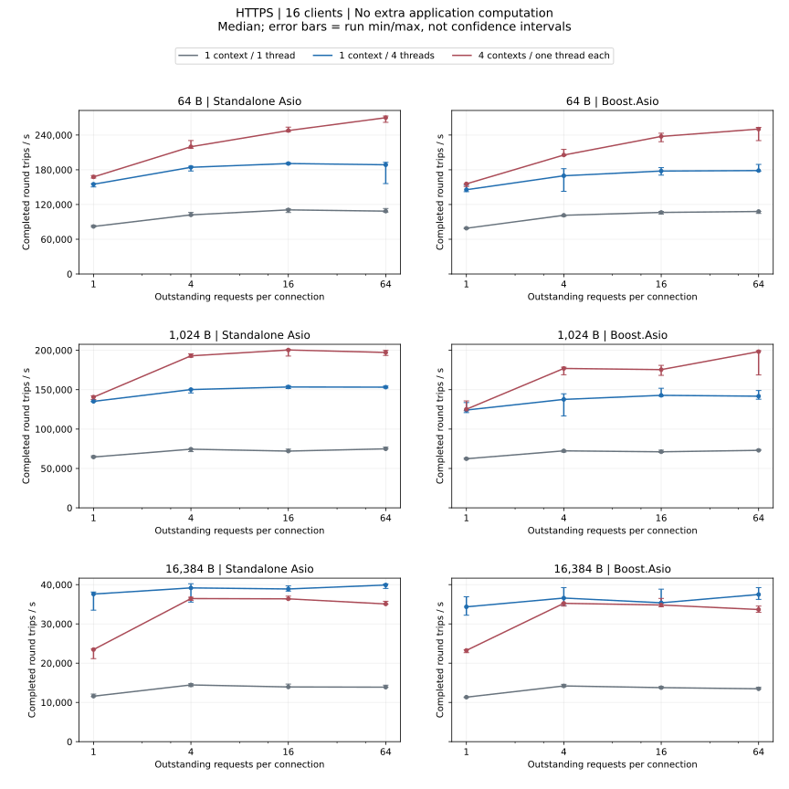
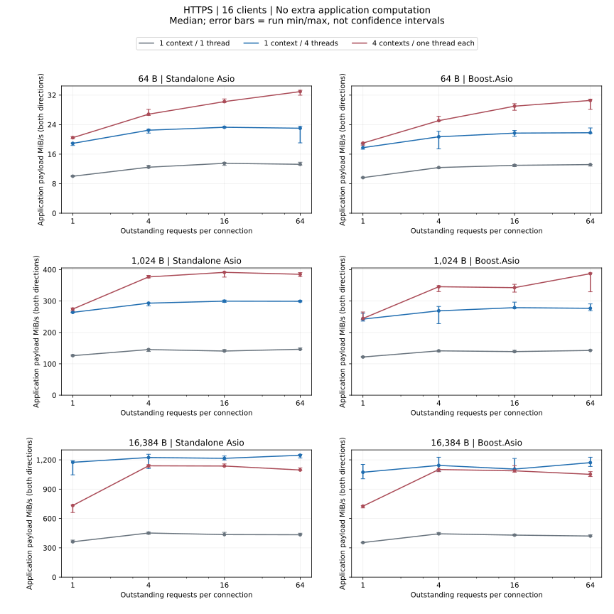
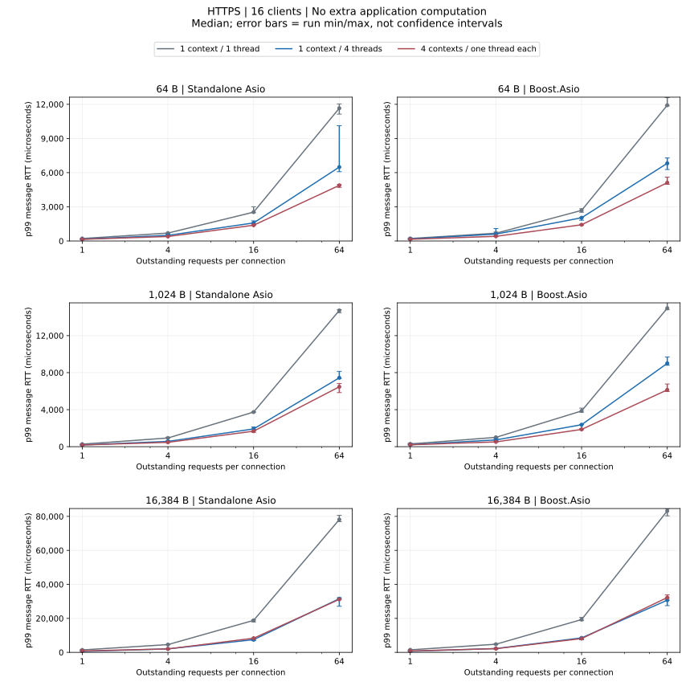

# HTTPS Load Comparison

16 clients; 64/1024/16384 bytes; windows 1/4/16/64; three runs/configuration.

## No extra application computation

- Standalone Asio, 1024 bytes: highest throughput median — 4 contexts / one thread each, window 16; lowest p99 median — 4 contexts / one thread each, window 1.
- Boost.Asio, 1024 bytes: highest throughput median — 4 contexts / one thread each, window 64; lowest p99 median — 4 contexts / one thread each, window 1.

[Complete numeric JSON (p95, run ranges and failures)](dimensions-summary.json ':ignore')

## Failed Profiles

No failed profiles.

<Aside type="caution" title="Failed profiles">

Any failed repetition excludes the profile’s three runs from rate, latency and matched-ratio summaries. Raw failures remain.

</Aside>

[Metrics, statistics and reproduction](methodology.md)
