# 原生 Asio TCP：回调与协程 负载对比

16 客户端；64/1024/16384 字节，窗口 1/4/16/64；每配置三次。

原生 Asio 回调／协程使用相同固定长度 TCP 批次：服务端读完整批、逐条执行相同计算，再整批回写。窗口 1 测单消息 RTT，更大窗口测批次 RTT；arknet 公开协程端点 API 仍为 TODO。

<Aside type="note" title="CPU">

进程 CPU 单核为 100%，多线程可超过 100%；标注估算值，三次采样不全记 N/A。 本机有 14 个逻辑核心，整机占比 = 进程 CPU% / 14，单核 100% 对应整机 7.14%。

</Aside>

## 无额外业务计算

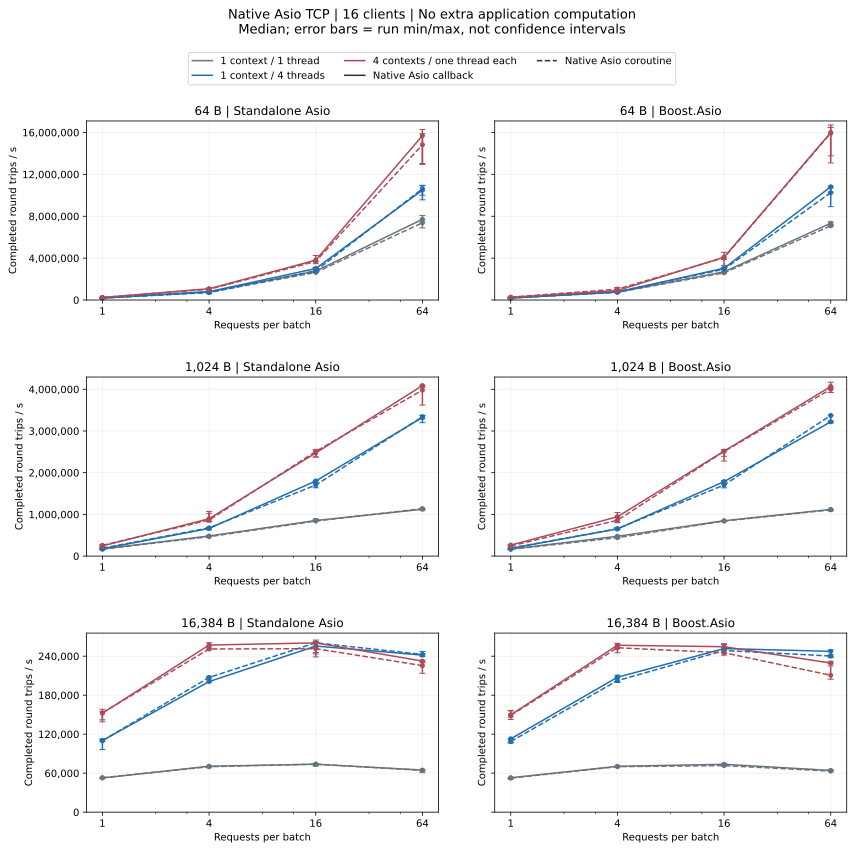

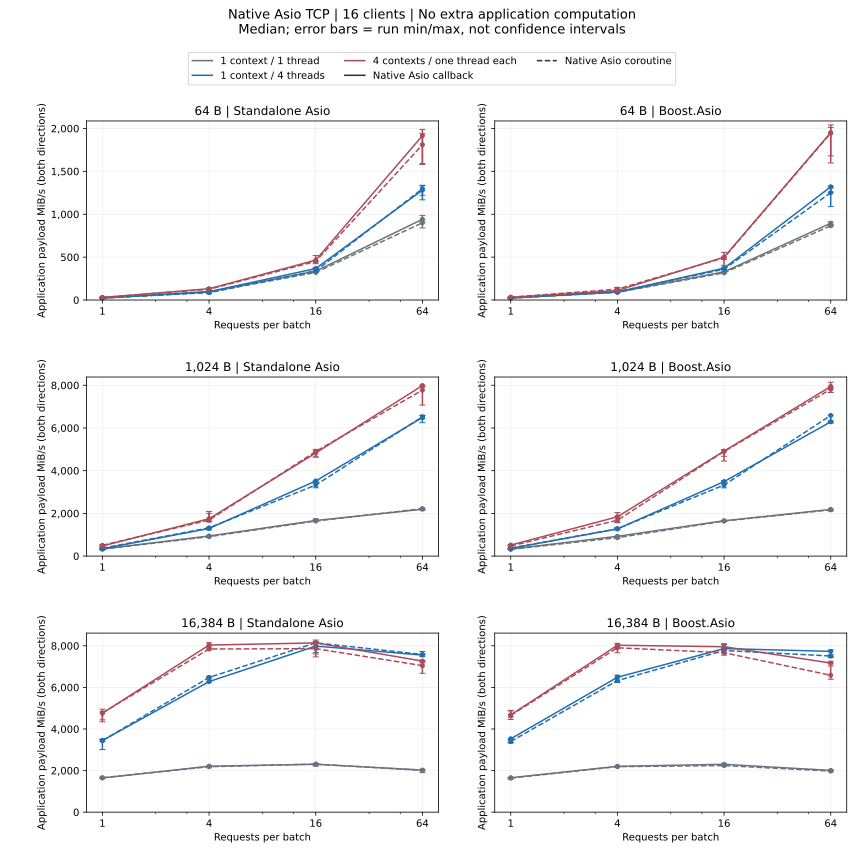

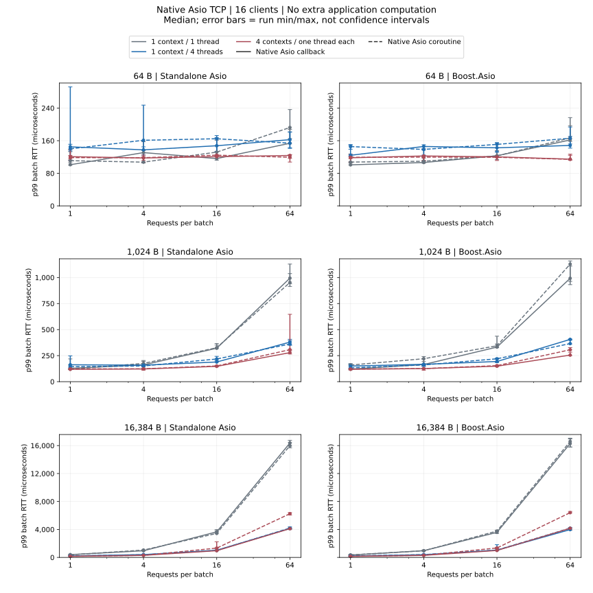

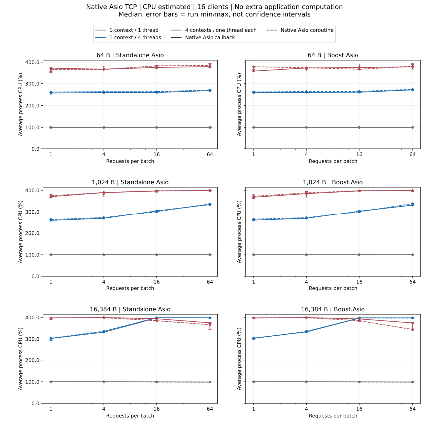

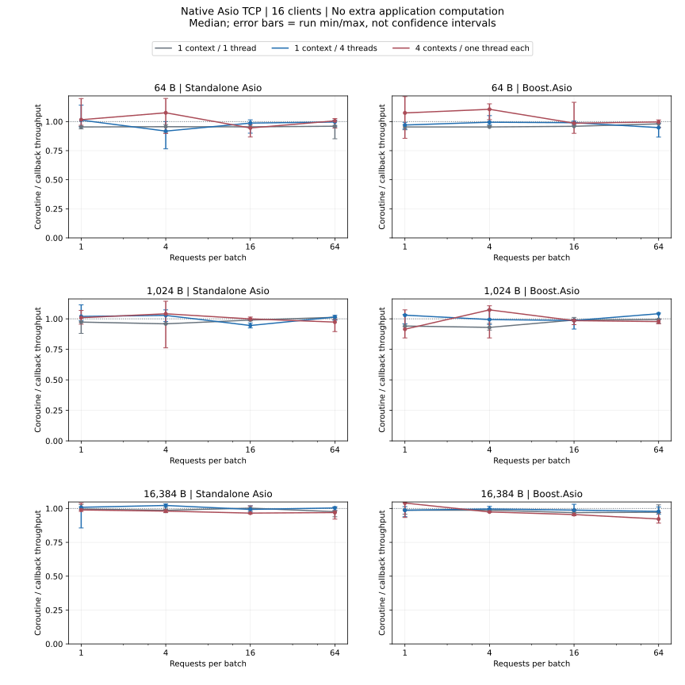

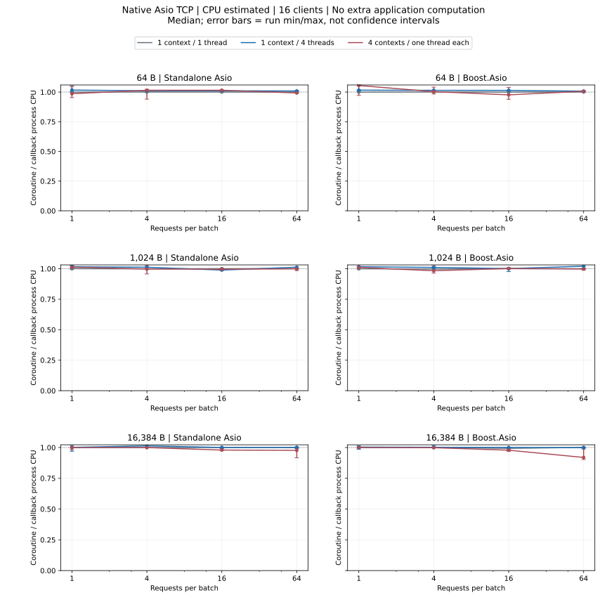

- Standalone Asio: 匹配协程／回调吞吐倍率中位数：0.92–1.08。
- Standalone Asio: 匹配协程／回调 CPU 倍率中位数：0.98–1.02；小于 1 表示更低的平均进程 CPU 占用，需结合吞吐倍率判断。
- Boost.Asio: 匹配协程／回调吞吐倍率中位数：0.92–1.11。
- Boost.Asio: 匹配协程／回调 CPU 倍率中位数：0.92–1.05；小于 1 表示更低的平均进程 CPU 占用，需结合吞吐倍率判断。

## 每次回显增加 10,000 次确定性运算

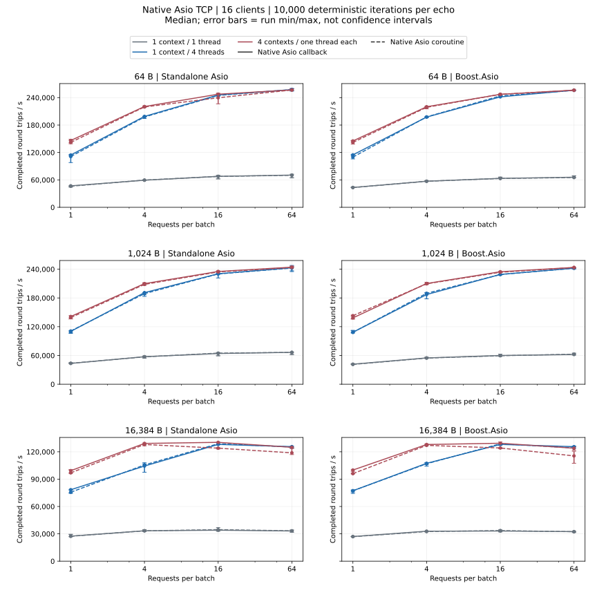

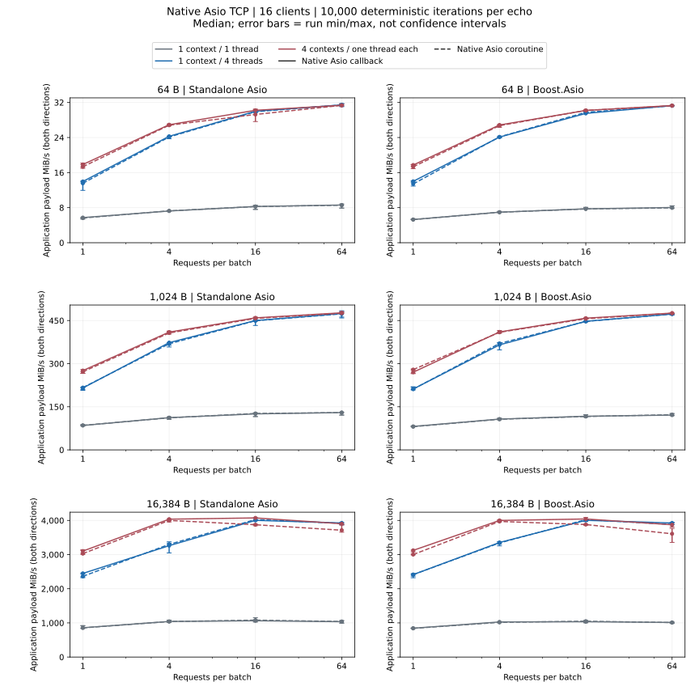

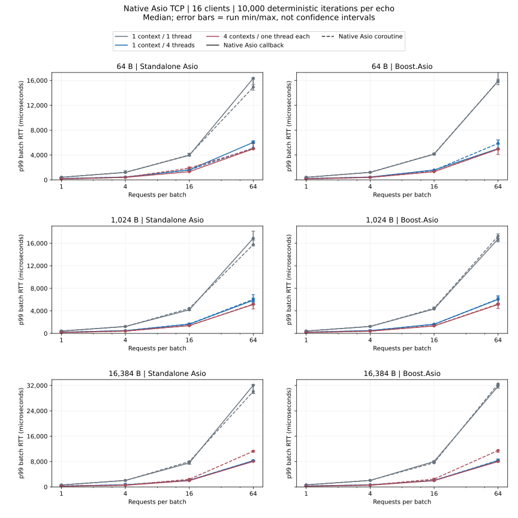

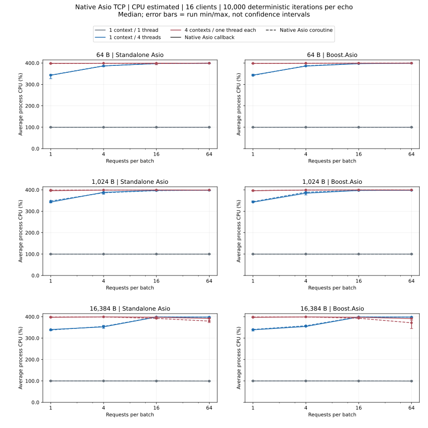

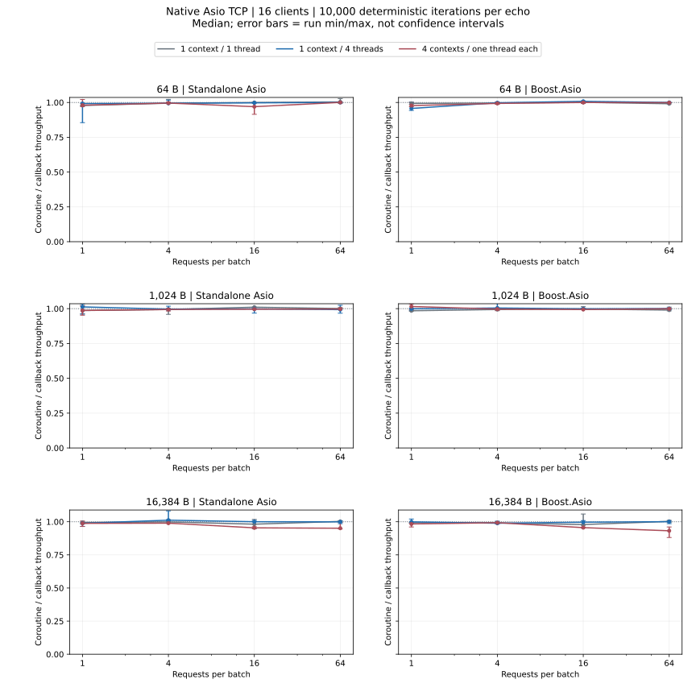

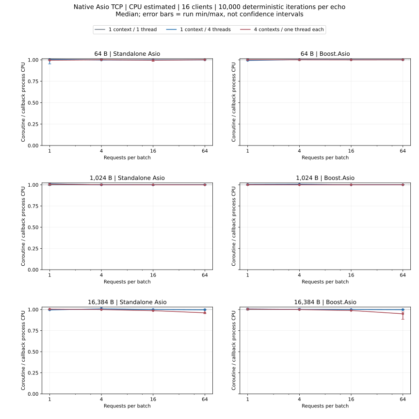

- Standalone Asio: 匹配协程／回调吞吐倍率中位数：0.95–1.01。
- Standalone Asio: 匹配协程／回调 CPU 倍率中位数：0.96–1.01；小于 1 表示更低的平均进程 CPU 占用，需结合吞吐倍率判断。
- Boost.Asio: 匹配协程／回调吞吐倍率中位数：0.93–1.02。
- Boost.Asio: 匹配协程／回调 CPU 倍率中位数：0.95–1.01；小于 1 表示更低的平均进程 CPU 占用，需结合吞吐倍率判断。

[完整数值 JSON（含 p95、运行范围与失败记录）](dimensions-summary.json ':ignore')

## 失败配置

没有失败配置。

<Aside type="caution" title="失败配置">

任一次重复失败，该配置三次测量均不计吞吐量、延迟或匹配倍率；原始失败记录保留。

</Aside>

<Aside type="caution" title="倍率与边界">

同依赖方案、消息、批次、线程模型和计算量逐次配对，再取吞吐／CPU 倍率中位数；1 表示相同。CPU 更低不一定处理更多请求，需结合吞吐。缺任一次 CPU 样本时，其统计与倍率为 N/A，吞吐可保留；不能推算 arknet 回调端点与未来协程 API 的速度差异。

</Aside>

[指标、统计口径与复现](methodology_CN.md)
