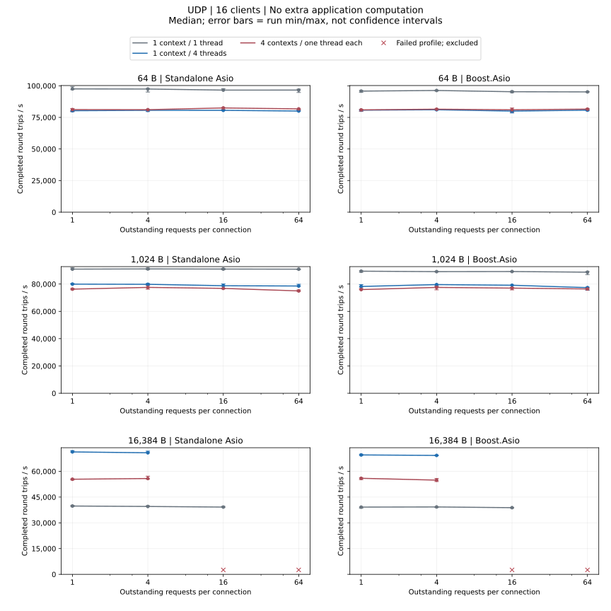
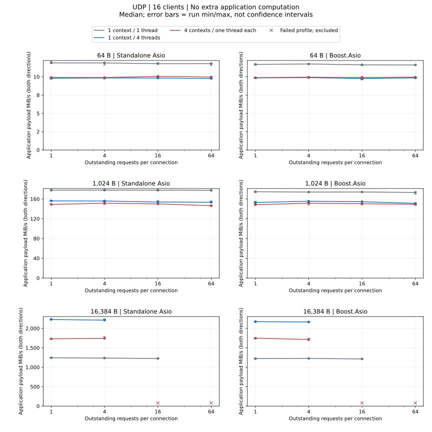
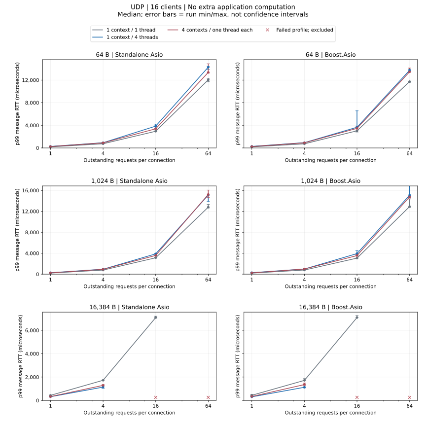

# UDP Load Comparison

Local measurements on 2026-10-12: 216 runs, 62 valid configurations and 10 failed configurations. [Machine, source and buffer diagnosis](udp-update.md).

16 clients; 64/1024/16384 bytes; windows 1/4/16/64; three runs/configuration.

## No extra application computation

- Standalone Asio, 1024 bytes: highest throughput median — 1 context / 1 thread, window 4; lowest p99 median — 1 context / 1 thread, window 1.
- Boost.Asio, 1024 bytes: highest throughput median — 1 context / 1 thread, window 1; lowest p99 median — 1 context / 1 thread, window 1.

[Complete numeric JSON (p95, run ranges and failures)](udp-dimensions-summary.json)

## Failed Profiles

| Dependency / execution | Payload bytes / window | Thread model | Application computation | Failure |
| --- | --- | --- | --- | --- |
| Boost.Asio / callback | 16384 / 16 | 4 contexts / one thread each | No extra application computation | #1: benchmark failed with exit code 1; UDP lost messages: 1, Drain timeouts: 1, Warmup errors: 2; #2: benchmark failed with exit code 1; UDP lost messages: 1, Drain timeouts: 1; #3: benchmark failed with exit code 1; UDP lost messages: 1, Drain timeouts: 1, Warmup errors: 2 |
| Boost.Asio / callback | 16384 / 16 | 1 context / 4 threads | No extra application computation | #1: benchmark failed with exit code 1; UDP lost messages: 1, Drain timeouts: 1, Warmup errors: 2; #2: benchmark failed with exit code 1; UDP lost messages: 1, Drain timeouts: 1; #3: benchmark failed with exit code 1; UDP lost messages: 1, Drain timeouts: 1 |
| Boost.Asio / callback | 16384 / 64 | 4 contexts / one thread each | No extra application computation | #1: benchmark failed with exit code 1; UDP lost messages: 769, Drain timeouts: 1, Warmup errors: 769; #2: benchmark failed with exit code 1; UDP lost messages: 769, Drain timeouts: 1, Warmup errors: 769; #3: benchmark failed with exit code 1; UDP lost messages: 769, Drain timeouts: 1, Warmup errors: 769 |
| Boost.Asio / callback | 16384 / 64 | 1 context / 1 thread | No extra application computation | #1: benchmark failed with exit code 1; UDP lost messages: 767, Drain timeouts: 1, Warmup errors: 768; #2: benchmark failed with exit code 1; UDP lost messages: 767, Drain timeouts: 1, Warmup errors: 768; #3: benchmark failed with exit code 1; UDP lost messages: 767, Drain timeouts: 1, Warmup errors: 768 |
| Boost.Asio / callback | 16384 / 64 | 1 context / 4 threads | No extra application computation | #1: benchmark failed with exit code 1; UDP lost messages: 769, Drain timeouts: 1, Warmup errors: 769; #2: benchmark failed with exit code 1; UDP lost messages: 769, Drain timeouts: 1, Warmup errors: 770; #3: benchmark failed with exit code 1; UDP lost messages: 769, Drain timeouts: 1, Warmup errors: 770 |
| Standalone Asio / callback | 16384 / 16 | 4 contexts / one thread each | No extra application computation | #1: benchmark failed with exit code 1; UDP lost messages: 1, Drain timeouts: 1, Warmup errors: 2; #2: benchmark failed with exit code 1; UDP lost messages: 1, Drain timeouts: 1, Warmup errors: 2; #3: benchmark failed with exit code 1; UDP lost messages: 1, Drain timeouts: 1 |
| Standalone Asio / callback | 16384 / 16 | 1 context / 4 threads | No extra application computation | #1: benchmark failed with exit code 1; UDP lost messages: 1, Drain timeouts: 1; #2: benchmark failed with exit code 1; Warmup errors: 2; #3: benchmark failed with exit code 1; UDP lost messages: 1, Drain timeouts: 1, Warmup errors: 2 |
| Standalone Asio / callback | 16384 / 64 | 4 contexts / one thread each | No extra application computation | #1: benchmark failed with exit code 1; UDP lost messages: 769, Drain timeouts: 1, Warmup errors: 770; #2: benchmark failed with exit code 1; UDP lost messages: 768, Drain timeouts: 1, Warmup errors: 770; #3: benchmark failed with exit code 1; UDP lost messages: 769, Drain timeouts: 1, Warmup errors: 770 |
| Standalone Asio / callback | 16384 / 64 | 1 context / 1 thread | No extra application computation | #1: benchmark failed with exit code 1; UDP lost messages: 767, Drain timeouts: 1, Warmup errors: 768; #2: benchmark failed with exit code 1; UDP lost messages: 767, Drain timeouts: 1, Warmup errors: 768; #3: benchmark failed with exit code 1; UDP lost messages: 767, Drain timeouts: 1, Warmup errors: 768 |
| Standalone Asio / callback | 16384 / 64 | 1 context / 4 threads | No extra application computation | #1: benchmark failed with exit code 1; UDP lost messages: 769, Drain timeouts: 1, Warmup errors: 770; #2: benchmark failed with exit code 1; UDP lost messages: 769, Drain timeouts: 1, Warmup errors: 769; #3: benchmark failed with exit code 1; UDP lost messages: 769, Drain timeouts: 1, Warmup errors: 770 |

<Aside type="caution" title="Failed profiles">

Any failed repetition excludes the profile’s three runs from rate, latency and matched-ratio summaries. Raw failures remain.

</Aside>

<Aside type="caution" title="UDP limits">

Larger UDP windows may lose traffic; such profiles are failed measurements, not capacity results. Server reception still uses one serialized socket.

</Aside>

[Metrics, statistics and reproduction](methodology.md)
