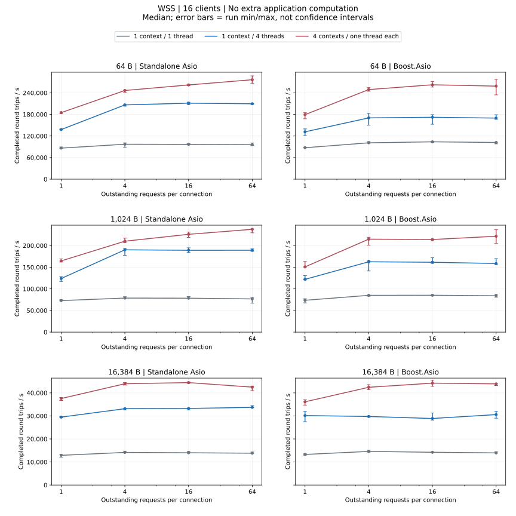
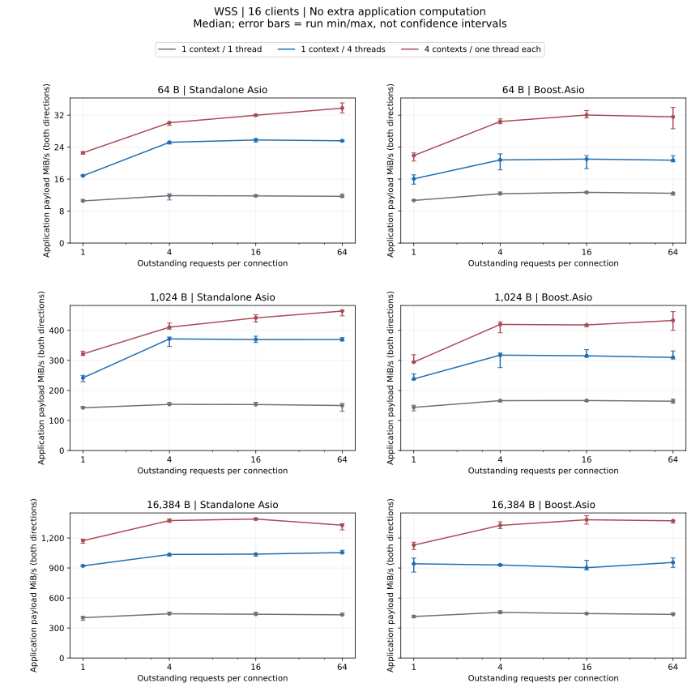
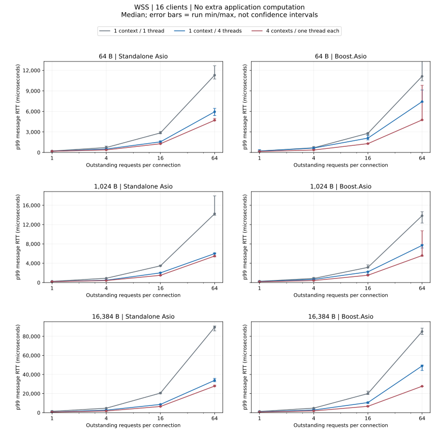

# WSS 负载对比

16 客户端；64/1024/16384 字节，窗口 1/4/16/64；每配置三次。

## 无额外业务计算

- Standalone Asio: 1024 字节：吞吐量中位数最高 4 个 io_context 各 1 个线程、窗口 64；p99 中位数最低 4 个 io_context 各 1 个线程、窗口 1。
- Boost.Asio: 1024 字节：吞吐量中位数最高 4 个 io_context 各 1 个线程、窗口 64；p99 中位数最低 4 个 io_context 各 1 个线程、窗口 1。

[完整数值 JSON（含 p95、运行范围与失败记录）](dimensions-summary.json ':ignore')

## 失败配置

没有失败配置。

<Aside type="caution" title="失败配置">

任一次重复失败，该配置三次测量均不计吞吐量、延迟或匹配倍率；原始失败记录保留。

</Aside>

[指标、统计口径与复现](methodology_CN.md)
