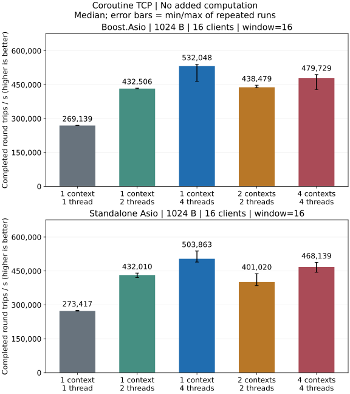
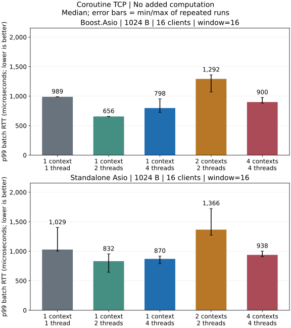
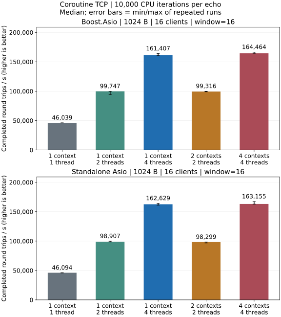
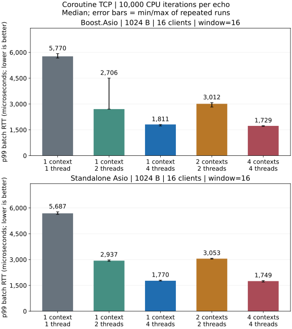

# IO Models and Coroutine Performance

## Native Asio Coroutine Baseline

Native Asio TCP coroutine Release local loopback: 1024-byte messages,
16 clients and window 16. Latency is batch RTT.

### No Extra Application Computation





- One context/four threads has the highest throughput median and one
  context/two threads the lowest batch p99 median for both dependency combinations.
- Standalone's batch p99 run ranges overlap between one context/two threads
  and one context/four threads, so these runs do not establish a consistent
  tail-latency advantage.

### 10,000 Deterministic Iterations Per Echo





- Four contexts/one thread each has the highest throughput median and lowest
  batch p99 median for both dependency combinations.
- Batch p99 run ranges overlap between one context/four threads and four
  contexts/one thread each for both dependency combinations.

[Complete coroutine baseline](coroutine.md) ·
[Payload, batch and execution comparisons](dimensions.md#native-tcp)

[Test environment](overview.md) · [Metrics and statistics](methodology.md) ·
[TCP callback results](tcp.md)

## Reproducing the Comparison

<Steps>

<Step title="Build and run">

`benchmarks/loopback.cpp` uses arknet callbacks; `benchmarks/coroutine.cpp` uses native Asio callbacks/coroutines. Each has an independent `main`. Build with CMake and run directly:

```sh
cmake -S . -B build-perf -DCMAKE_BUILD_TYPE=Release \
  -DARKNET_BUILD_BENCHMARKS=ON -DARKNET_ENABLE_SSL=OFF \
  -DARKNET_USE_BOOST_ASIO=OFF -DARKNET_ASIO_INCLUDE_DIR=/path/to/asio/include
cmake --build build-perf --target arknet_coroutine_benchmark --parallel 3
build-perf/benchmarks/arknet_coroutine_benchmark \
  --execution coroutine --protocol tcp --payload 1024 --clients 16 --window 16 \
  --io-model shared --io-threads 4 --work 0 --warmup 0.25 --seconds 1
```

</Step>

<Step title="Match configuration and RTT scope">

This example uses one context/four threads, 1024-byte messages, 16 clients and
window 16, writing JSON to standard output. Replace the Asio include argument
with `-DARKNET_USE_BOOST_ASIO=ON` for Boost. With Visual Studio, add
`--config Release` and run the `.exe` under `benchmarks/Release/`.

`--io-model shared` uses one context with multiple threads; `sharded` uses one context per thread. `--io-threads 1` selects one context/one thread. `--execution callback` selects matched native callbacks. `--work 10000` adds 10,000 deterministic iterations per echo; `0` adds none. This synthetic load does not represent a production parser or crypto algorithm.

<Aside type="caution" title="RTT comparison scope">

Compare topologies with the same program, dependency, payload, concurrency and computation. Native Asio sends/reads fixed batches: `--window` above one measures batch RTT. Arknet callbacks replenish a window and measure message RTT; these results cannot establish coroutine speedups.

</Aside>

The [matched comparison](dimensions.md#native-tcp) uses callback/coroutine modes of one native Asio TCP program: read a full batch, compute on each message, then echo the batch. Window 1 measures message RTT; larger windows measure batch RTT.

</Step>

<Step title="Repeat configurations">

Repeat configurations in fresh C++ processes, or use the maintainer's shell
matrix in [Testing](methodology.md#performance-matrix). Only that batch tool needs
`jq`, GNU `timeout` and `shasum`; direct C++ tests and single benchmarks do not.

<Aside type="caution" title="Scope">

[Testing and Performance](methodology.md) records raw results and commands. Short loopback runs cannot predict WAN latency or production capacity.

</Aside>

</Step>

</Steps>
