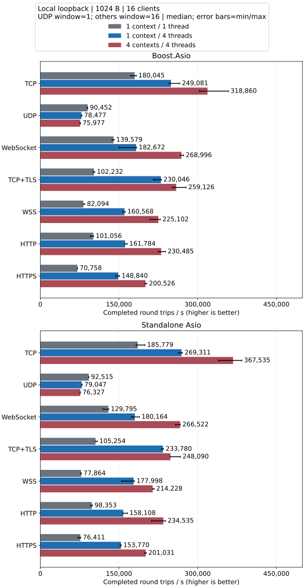
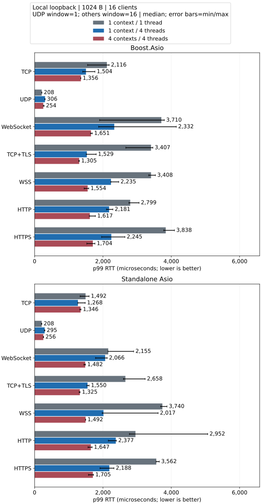

# 本地性能报告

本页汇总各协议的最终测量：UDP 测量于 2026-10-12，其他协议和原生 TCP 协程测量于 2026-10-10。各协议保留自己的源码哈希与原始记录。

本机完成 **1,620 次 IPv4 测量**，比较不同 Asio 依赖方案下的吞吐量、p99 延迟和 IO 模型。

## 测试条件

| 配置 | 实测机器 |
| --- | --- |
| 机器型号 | Mac16,11 |
| 处理器 | Apple M4 Pro |
| 架构 | arm64 |
| 物理 / 逻辑核心 | 14 / 14 |
| 内存 | 48 GiB |
| 操作系统 | macOS 27.0.1 (26A434) |
| 内核版本 | 27.0.0 |

Release 构建；测量 1.0 s，预热 0.25 s，重复 3 次。

主图：**1024 字节、16 个客户端、无额外业务计算**；每连接在途消息上限为 UDP 1 条、其他协议 16 条。客户端与服务端在同一进程内共享 IO 线程，使用本机回环网络。

<Aside type="note" title="CPU">

进程 CPU 单核为 100%，多线程可超过 100%；标注估算值，三次采样不全记 N/A。 本机有 14 个逻辑核心，整机占比 = 进程 CPU% / 14，单核 100% 对应整机 7.14%。

</Aside>

## 核心结果

- **TCP / Standalone Asio / 无额外业务计算**：本组吞吐量最高的模型为 4 个 io_context / 4 个线程，相对单线程为 1.98×；对应 p99 为 1,346.00 us，单线程为 1,491.79 us。
- **UDP / Standalone Asio / 无额外业务计算**：本组吞吐量中位数最高的模型为 1 个 io_context / 1 个线程，92,515 次往返/s，p99 RTT 为 207.79 us，进程 CPU 占用率为 99.4%。
- **协程 TCP / Standalone Asio / 无额外业务计算**：本组吞吐量最高的模型为 1 个 io_context / 4 个线程，相对单线程为 1.84×；对应 p99 为 870.46 us，单线程为 1,028.71 us。
- **协程 TCP / Standalone Asio / 每次回显执行 10,000 次 CPU 计算**：本组吞吐量最高的模型为 4 个 io_context / 4 个线程，相对单线程为 3.54×；对应 p99 为 1,749.29 us，单线程为 5,687.25 us。

最高中位数仅适用于对应负载；完整数据见协议报告。

## 吞吐量

## p99 往返延迟

99% 的采样往返在该时间内完成；1000 微秒 = 1 毫秒。

## 如何选择 IO 模型

| 模型 | 对应业务 | 需要注意 |
| --- | --- | --- |
| 1 个 io_context / 1 个线程 | 低并发、控制服务、较轻的状态处理 | 耗时回调会影响所有连接 |
| 1 个 io_context / 多线程 | 连接活跃程度不均衡、希望共享空闲线程 | 使用每连接 strand；共享调度有开销 |
| 多个 io_context / 各 1 个线程 | 分区会话、租户或负载分配稳定的服务 | 繁忙分片无法借用其他分片线程 |

[协程的 IO 与 CPU 负载比较](../concepts/io-models_CN.md).

## 各协议的详细结果

<CardGrid>
<LinkCard title="TCP" href="tcp_CN.md" />
<LinkCard title="UDP" href="udp_CN.md" />
<LinkCard title="WebSocket" href="websocket_CN.md" />
<LinkCard title="TCP+TLS" href="tcps_CN.md" />
<LinkCard title="WSS" href="wss_CN.md" />
<LinkCard title="HTTP" href="http_CN.md" />
<LinkCard title="HTTPS" href="https_CN.md" />
<LinkCard title="协程 TCP" href="coroutine_CN.md" />
</CardGrid>

详细页保留全部 64/1024/16384 字节、1/16 客户端数据；柱高中位数、误差线最小／最大值，非置信区间。

[全部数值（JSON）](summary.json ':ignore') | [包体、批量与执行方式对比](dimensions_CN.md)

<Aside type="caution" title="RTT 范围">

协程 window=16 测整批 RTT，回调测逐消息 RTT；不能据此判断协程加速比。

</Aside>

## 工具链与构建

Apple Clang 21.0.0; CMake 4.3.3; Ninja; Release -O3 -DNDEBUG -std=gnu++20 -arch arm64; TLS ON; sanitizers OFF. Standalone Asio 1.38.2 with BHO Beast based on Boost 1.84 (API 351); Boost 1.90.0 with Asio 1.38.0 and Beast API 359; OpenSSL 3.6.4. Mac mini on AC power, low power mode disabled, no CPU affinity.

<Aside type="caution" title="依赖版本">

两种方案的 Beast 版本不同，性能差异包含依赖版本影响，不能全部归因于 Asio。

</Aside>

## 指标定义

[吞吐量、RTT、CPU、RSS 和错误定义](../project/testing_CN.md).

## 原始数据与复现

- TCP、TLS、HTTP、WebSocket 和原生协程源码 SHA-256：`127a500ad7e2fbe4c831cc3ebacc63acac96013e2cb8bf3893d7997ca6ea7f56`
- UDP 源码 SHA-256：`0771574af8ca56f1914deb544b956079e0a2f24021953ded5f5d524e3df334b1`；[测试条件与原始记录](udp-update_CN.md)。
- [已完成测量]: 1620
- [复现命令与检查范围](methodology_CN.md)

- [macmini-m4pro-20261010-boost-coroutine.json](https://github.com/OpenArkStudio/arknet/blob/7685e241bebd086d50da403f2cf06a72bbef1085/benchmarks/results/macmini-m4pro-20261010-boost-coroutine.json): 180 measurements; 2026-10-10T06:22:06.443606+00:00; executable SHA-256 `14b22c5832f3d7731294a735d97ab5464cbf64c4efeb439f8f5f4b7576c70df4`
- [macmini-m4pro-20261010-boost-http.json](https://github.com/OpenArkStudio/arknet/blob/7685e241bebd086d50da403f2cf06a72bbef1085/benchmarks/results/macmini-m4pro-20261010-boost-http.json): 90 measurements; 2026-10-10T06:08:56.779694+00:00; executable SHA-256 `7b2989fd23e15a68a662899d1906f3b094138018b8ada5904309b4a90d96ea34`
- [macmini-m4pro-20261010-boost-https.json](https://github.com/OpenArkStudio/arknet/blob/7685e241bebd086d50da403f2cf06a72bbef1085/benchmarks/results/macmini-m4pro-20261010-boost-https.json): 90 measurements; 2026-10-10T06:16:12.072913+00:00; executable SHA-256 `7b2989fd23e15a68a662899d1906f3b094138018b8ada5904309b4a90d96ea34`
- [macmini-m4pro-20261010-boost-tcp.json](https://github.com/OpenArkStudio/arknet/blob/7685e241bebd086d50da403f2cf06a72bbef1085/benchmarks/results/macmini-m4pro-20261010-boost-tcp.json): 90 measurements; 2026-10-10T05:31:57.122216+00:00; executable SHA-256 `7b2989fd23e15a68a662899d1906f3b094138018b8ada5904309b4a90d96ea34`
- [macmini-m4pro-20261010-boost-tcps.json](https://github.com/OpenArkStudio/arknet/blob/7685e241bebd086d50da403f2cf06a72bbef1085/benchmarks/results/macmini-m4pro-20261010-boost-tcps.json): 90 measurements; 2026-10-10T05:56:20.110867+00:00; executable SHA-256 `7b2989fd23e15a68a662899d1906f3b094138018b8ada5904309b4a90d96ea34`
- [boost-io.json](https://github.com/OpenArkStudio/arknet/blob/7685e241bebd086d50da403f2cf06a72bbef1085/benchmarks/results/macmini-m4pro-20261012-udp/boost-io.json)：90 次 UDP 测量。
- [macmini-m4pro-20261010-boost-websocket.json](https://github.com/OpenArkStudio/arknet/blob/7685e241bebd086d50da403f2cf06a72bbef1085/benchmarks/results/macmini-m4pro-20261010-boost-websocket.json): 90 measurements; 2026-10-10T05:44:16.816290+00:00; executable SHA-256 `7b2989fd23e15a68a662899d1906f3b094138018b8ada5904309b4a90d96ea34`
- [macmini-m4pro-20261010-boost-wss.json](https://github.com/OpenArkStudio/arknet/blob/7685e241bebd086d50da403f2cf06a72bbef1085/benchmarks/results/macmini-m4pro-20261010-boost-wss.json): 90 measurements; 2026-10-10T06:02:39.046046+00:00; executable SHA-256 `7b2989fd23e15a68a662899d1906f3b094138018b8ada5904309b4a90d96ea34`
- [macmini-m4pro-20261010-standalone-coroutine.json](https://github.com/OpenArkStudio/arknet/blob/7685e241bebd086d50da403f2cf06a72bbef1085/benchmarks/results/macmini-m4pro-20261010-standalone-coroutine.json): 180 measurements; 2026-10-10T06:18:15.349061+00:00; executable SHA-256 `f2878cefe4ec4259114a9492fa7ac2235deecf797be63735ae51668d7a25b73f`
- [macmini-m4pro-20261010-standalone-http.json](https://github.com/OpenArkStudio/arknet/blob/7685e241bebd086d50da403f2cf06a72bbef1085/benchmarks/results/macmini-m4pro-20261010-standalone-http.json): 90 measurements; 2026-10-10T06:06:57.385745+00:00; executable SHA-256 `480122707b4b3ed592d1f580f5cf7092b8008ce52331f55f0e666e89c568be6b`
- [macmini-m4pro-20261010-standalone-https.json](https://github.com/OpenArkStudio/arknet/blob/7685e241bebd086d50da403f2cf06a72bbef1085/benchmarks/results/macmini-m4pro-20261010-standalone-https.json): 90 measurements; 2026-10-10T06:14:08.452400+00:00; executable SHA-256 `480122707b4b3ed592d1f580f5cf7092b8008ce52331f55f0e666e89c568be6b`
- [macmini-m4pro-20261010-standalone-tcp.json](https://github.com/OpenArkStudio/arknet/blob/7685e241bebd086d50da403f2cf06a72bbef1085/benchmarks/results/macmini-m4pro-20261010-standalone-tcp.json): 90 measurements; 2026-10-10T05:29:56.838785+00:00; executable SHA-256 `480122707b4b3ed592d1f580f5cf7092b8008ce52331f55f0e666e89c568be6b`
- [macmini-m4pro-20261010-standalone-tcps.json](https://github.com/OpenArkStudio/arknet/blob/7685e241bebd086d50da403f2cf06a72bbef1085/benchmarks/results/macmini-m4pro-20261010-standalone-tcps.json): 90 measurements; 2026-10-10T05:54:16.794729+00:00; executable SHA-256 `480122707b4b3ed592d1f580f5cf7092b8008ce52331f55f0e666e89c568be6b`
- [standalone-io.json](https://github.com/OpenArkStudio/arknet/blob/7685e241bebd086d50da403f2cf06a72bbef1085/benchmarks/results/macmini-m4pro-20261012-udp/standalone-io.json)：90 次 UDP 测量。
- [macmini-m4pro-20261010-standalone-websocket.json](https://github.com/OpenArkStudio/arknet/blob/7685e241bebd086d50da403f2cf06a72bbef1085/benchmarks/results/macmini-m4pro-20261010-standalone-websocket.json): 90 measurements; 2026-10-10T05:42:15.113877+00:00; executable SHA-256 `480122707b4b3ed592d1f580f5cf7092b8008ce52331f55f0e666e89c568be6b`
- [macmini-m4pro-20261010-standalone-wss.json](https://github.com/OpenArkStudio/arknet/blob/7685e241bebd086d50da403f2cf06a72bbef1085/benchmarks/results/macmini-m4pro-20261010-standalone-wss.json): 90 measurements; 2026-10-10T06:00:34.943293+00:00; executable SHA-256 `480122707b4b3ed592d1f580f5cf7092b8008ce52331f55f0e666e89c568be6b`

## 适用范围

<Aside type="caution" title="适用范围">

回环不证明跨主机或生产容量；短时测量、调度与温度可带来波动，部署前需测实际负载。

</Aside>
