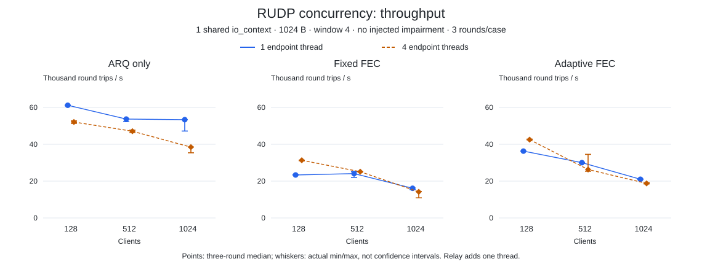
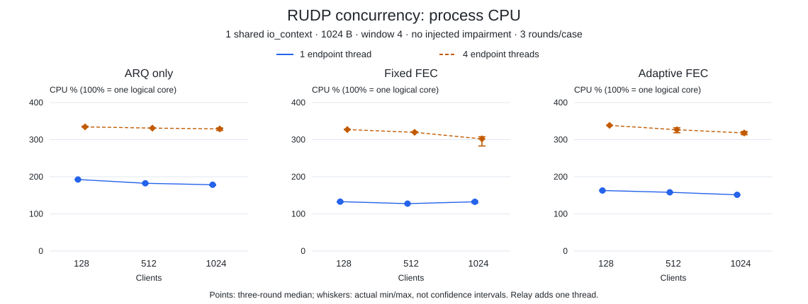
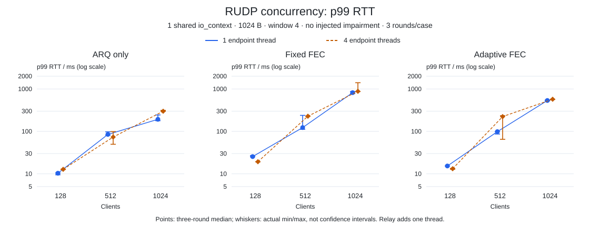

# RUDP concurrency

18 configurations and 54 rounds completed 5,692,552 message round trips, passing content, ordering, send-completion and drain checks.

<Aside type="caution" title="Concurrency regression">

Four endpoint threads gave no uniform gain: at 1,024 clients, all three policies had lower throughput and higher process CPU than one thread.

</Aside>

## Environment and method

| Item | Measured configuration |
| --- | --- |
| Date | 2026-10-20, 07:56–08:10 UTC |
| Host | Apple M4 Pro (Mac16,11); arm64; 14 logical CPUs; 48 GiB RAM; macOS 27.0.1 (26A434) |
| Build | Apple Clang 21.0.0 (clang-2100.3.34.2); Boost 1.90.0; C++20 Release `-O3 -DNDEBUG`; TLS off |
| Workload | Callback message echo; 128 / 512 / 1,024 clients; 1,024 B; four in-flight messages per client |
| Policies | ARQ only (`off`), fixed FEC and adaptive FEC; no injected loss, delay, duplication or reordering |
| Execution | One shared endpoint `io_context`, with 1 or 4 endpoint threads; relay adds one context and one thread |
| Repetition | 18 cases × 3 rounds; 2 s warmup and 3 s request generation per round; seeds 42 / 43 / 44 |

Source commit: `025eb361b614c6ba8d298f7b40a2b9a00f7d2e3c`.
The same binary and compile dependencies served both thread configurations.
Binary SHA-256: `30cdf295b62badb3a1797fdb9fe738ed4934168bc14d88a124de7800736645ec`.

Matched pairs change only `--io-threads 1` to `--io-threads 4`. Results confirm `io_contexts=1`, requested `io_threads`, and `relay_io_contexts=1, relay_io_threads=1`. Server sessions share a UDP socket and strand; four threads do not establish independent shards.

CPU includes clients, server, relay and sampling. **100% is one logical core**; usage can exceed 100%. Throughput and CPU use actual measurement-phase time including drain and IO barriers, rather than three seconds. Sampling: every 100 ms; RTT reservoir: up to 8,192 observations per round.

## Throughput, CPU and p99

Points are the three-round medians; whiskers are the actual minimum and maximum,
not confidence intervals. The p99 chart uses a logarithmic scale.







At 128 clients, fixed and adaptive FEC throughput increased by 34.26% and 17.19%,
with higher CPU. At 1,024 clients, ARQ-only/fixed/adaptive throughput changed from
53.36/16.11/21.01 to 38.46/14.17/18.76 thousand round trips/s. Corresponding p99
medians increased from 192.77/819.41/535.28 to 298.83/880.70/572.79 ms.
The four-thread fixed-FEC case had one round with p99 **1,405.13 ms**; its
three-round throughput range was 10.92–14.34 thousand round trips/s.
Correct final delivery does not establish an acceptable response-time budget.

## Process memory and protocol counters

RSS is the **whole-process high-water mark for each case**, including warmup,
all three rounds and cleanup. It is neither a three-round median nor FEC-only
memory. MiB uses 1,048,576 bytes.

| Clients | FEC | 1 endpoint thread / MiB | 4 endpoint threads / MiB |
| ---: | --- | ---: | ---: |
| 128 | off | 48.97 | 83.50 |
| 128 | fixed | 90.52 | 137.11 |
| 128 | adaptive | 89.75 | 89.61 |
| 512 | off | 322.72 | 331.16 |
| 512 | fixed | 350.33 | 346.67 |
| 512 | adaptive | 348.86 | 271.39 |
| 1,024 | off | 631.67 | 670.27 |
| 1,024 | fixed | 671.91 | 676.30 |
| 1,024 | adaptive | 659.77 | 650.45 |

Clean means no active impairment injection; it did not prevent ARQ retransmission.
At 1,024 clients, retransmissions as a share of ARQ transmissions were
6.17% → 11.73% for off, 14.09% → 19.52% for fixed, and 13.48% → 13.45% for adaptive
(one → four threads). These counters do not identify network loss or a kernel cause.
At 512 clients, adaptive FEC emitted 2,395 → 72,798 parity packets over the three
measured rounds, with 0 → 63 policy changes. Adaptive cannot be treated as off
under this clean workload.

Relay errors, queue overflows and injected impairments were zero; message counts matched and sends completed. The additional relay thread still copies, queues and forwards every datagram. Endpoint wire-byte overhead excludes IP/UDP headers and the second hop. Sequential endpoint/relay snapshots are not atomic; relay CPU was not measured separately.

At 1,024 clients the topology uses 3,073 UDP sockets, including two relay sockets
per client. Endpoint effective receive buffers were 4 MiB. These kernel capacity
requests are not preallocated RSS. The unchanged limits are 8 MiB / 8,192 queued
relay datagrams per route, 1 MiB FEC retention per endpoint, and the library's
ARQ/raw-send budgets. Sampled queue peaks can miss shorter peaks; a four-message
application window is not a whole-process memory limit.

## Reproduction and scope

<Steps>

<Step title="Build and run">

Build the native [benchmark](../../benchmarks/rudp.cpp) at the recorded commit. Use GNU `timeout` (`gtimeout` on some macOS installs):

```sh
cmake -S . -B build-rudp -G Ninja -DCMAKE_BUILD_TYPE=Release \
  -DARKNET_USE_BOOST_ASIO=ON -DARKNET_ENABLE_SSL=OFF \
  -DARKNET_BUILD_BENCHMARKS=ON -DARKNET_BUILD_TESTS=OFF -DARKNET_BUILD_EXAMPLES=OFF \
  -DCMAKE_PREFIX_PATH=/path/to/boost
cmake --build build-rudp --target arknet_rudp_benchmark --parallel 2
(ulimit -Sn 20000; timeout --kill-after=5s 120s \
  build-rudp/benchmarks/arknet_rudp_benchmark \
  --clients 1024 --fec off --payload 1024 --window 4 --io-model shared --io-threads 1 \
  --seconds 3 --warmup 2 --rounds 3 --profile clean --loss-percent 0 \
  --burst-count 0 --burst-period 100 --delay-ms 0 \
  --duplicate-percent 0 --reorder-percent 0 --seed 42)
```

</Step>

<Step title="Expand the matched matrix">

Use clients 128/512/1024, FEC off/fixed/adaptive and endpoint threads 1/4 for the
18 configurations. Collection kept existing native timeouts, a 120 s outer
limit, child-only soft FD 20,000, at least 6,000 conservatively free UDP ephemeral
ports and 16 GiB estimated free/reclaimable memory. Processes were cleaned up
between cases; no other local builds or load tests ran during measurement.

</Step>

<Step title="Check comparison scope">

<Aside type="caution" title="Order and scope">

One-thread cases ran first, without interleaving or randomization. OS/desktop activity and thermals may influence results. Short same-host IPv4 loopback runs establish neither production PCU, cross-host capacity, long-term stability nor the scaling cause.

</Aside>

[RUDP policy and impairment measurements](rudp.md) · [Performance reports](index.md)

</Step>

</Steps>
