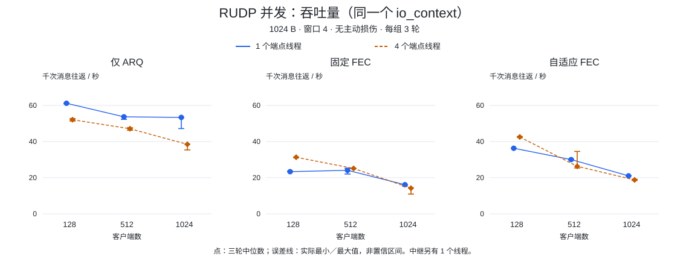
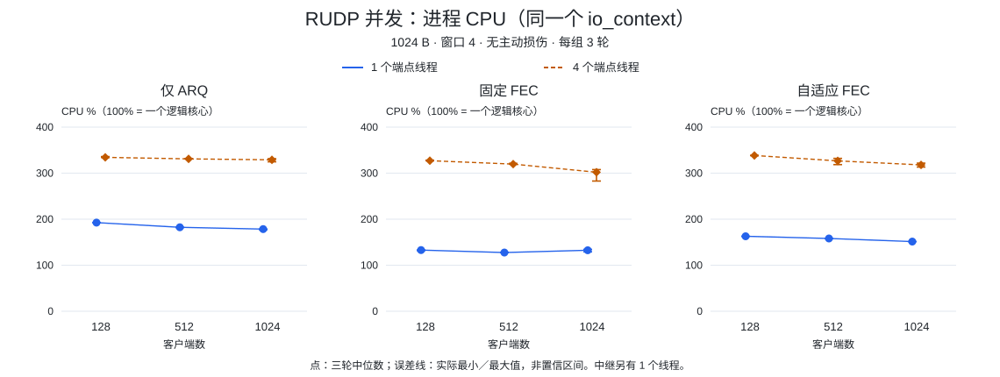
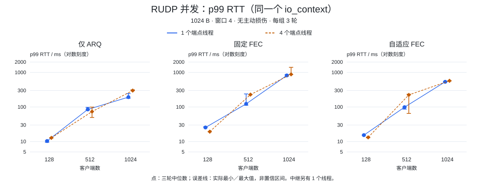

# RUDP 并发

18 组配置、54 轮完成 5,692,552 次消息往返，通过内容、顺序、发送完成与收尾检查。


<Aside type="caution" title="并发回归">

四个端点线程未带来一致收益：1024 客户端下，三种策略均比单线程吞吐量低、进程 CPU 高。

</Aside>

## 环境与方法

| 项目 | 实际配置 |
| --- | --- |
| 日期 | 2026-10-20，07:56–08:10 UTC |
| 机器 | Apple M4 Pro（Mac16,11）；arm64；14 个逻辑核心；48 GiB RAM；macOS 27.0.1（26A434） |
| 构建 | Apple Clang 21.0.0（clang-2100.3.34.2）；Boost 1.90.0；C++20 Release `-O3 -DNDEBUG`；关闭 TLS |
| 负载 | 回调消息回显；128／512／1024 个客户端；1024 B；每客户端 4 条在途消息 |
| 策略 | 仅 ARQ（`off`）、固定 FEC、自适应 FEC；不主动注入丢包、延迟、复制或乱序 |
| 执行方式 | 端点共享 1 个 `io_context`，使用 1 或 4 个端点线程；中继另有 1 个 context、1 个线程 |
| 重复次数 | 18 组 × 3 轮；每轮预热 2 s，生成请求 3 s；种子 42／43／44 |

源码提交：`025eb361b614c6ba8d298f7b40a2b9a00f7d2e3c`。
两种线程配置使用相同二进制与编译依赖。
二进制 SHA-256：`30cdf295b62badb3a1797fdb9fe738ed4934168bc14d88a124de7800736645ec`。

每对仅改变 `--io-threads 1`／`--io-threads 4`。结果确认 `io_contexts=1`、指定的 `io_threads`、`relay_io_contexts=1, relay_io_threads=1`。服务端共用 UDP socket 与 strand，四线程不证明独立分片。

CPU 含客户端、服务端、中继与采样线程；**100% 表示一个逻辑核心**，可超过 100%。吞吐量与 CPU 按测量阶段实际时长计算，含收尾与 IO 屏障，不固定除以 3 秒。每 100 ms 采样；每轮 RTT 最多 8192 个 reservoir 样本。

## 吞吐量、CPU 与 p99

点为三轮中位数，误差线为这三轮的实际最小值与最大值，不是置信区间。
p99 图使用对数刻度。







128 个客户端下，固定与自适应 FEC 吞吐量分别增加 34.26% 和 17.19%，CPU 也随之增加。
1024 个客户端下，仅 ARQ／固定／自适应的吞吐量从 53.36／16.11／21.01 降至
38.46／14.17／18.76 千次往返/s；p99 中位数从 192.77／819.41／535.28 升至
298.83／880.70／572.79 ms。四端点线程、固定 FEC 的一轮 p99 达到 **1405.13 ms**，
三轮吞吐量范围为 10.92–14.34 千次往返/s。最终消息交付正确不表示响应时间预算可接受。

## 进程内存与协议计数

RSS 是**每组整个进程的高水位**，包含预热、三轮测量及清理；既不是三轮中位数，
也不是 FEC 独占内存。1 MiB = 1048576 B。

| 客户端数 | FEC | 1 个端点线程／MiB | 4 个端点线程／MiB |
| ---: | --- | ---: | ---: |
| 128 | off | 48.97 | 83.50 |
| 128 | fixed | 90.52 | 137.11 |
| 128 | adaptive | 89.75 | 89.61 |
| 512 | off | 322.72 | 331.16 |
| 512 | fixed | 350.33 | 346.67 |
| 512 | adaptive | 348.86 | 271.39 |
| 1024 | off | 631.67 | 670.27 |
| 1024 | fixed | 671.91 | 676.30 |
| 1024 | adaptive | 659.77 | 650.45 |

clean 表示没有主动注入损伤，仍然出现了 ARQ 重传。1024 个客户端下，重传占 ARQ
发送的比例从单线程到四线程分别为：off 6.17% → 11.73%、fixed 14.09% → 19.52%、
adaptive 13.48% → 13.45%。这些计数不能定位网络丢包或内核原因。
512 个客户端下，自适应 FEC 三轮测量的校验包总数为 2395 → 72798，策略变化总数
为 0 → 63；不能将 clean 条件下的 adaptive 等同于 off。

中继错误、溢出、主动损伤计数为零，消息数守恒、发送回调均完成。中继额外线程仍复制、排队、转发每个报文。端点字节开销不含 IP／UDP 头与第二跳；端点／中继顺序快照不是原子统计区间，也未单测中继 CPU。

1024 个客户端的拓扑使用 3073 个 UDP socket，其中每客户端有两个中继 socket。
端点有效接收缓冲均为 4 MiB；这些内核容量请求不是预分配 RSS。限制保持不变：
每路由中继队列 8 MiB／8192 个报文、每端点 FEC 保留 1 MiB，以及库的 ARQ／原始
发送预算。队列采样可能漏掉更短峰值；每客户端 4 条在途消息不限制整个进程内存。

## 复现与范围

<Steps>

<Step title="编译并运行">

使用上述提交的原生[基准程序](../../benchmarks/rudp.cpp)与 GNU `timeout`（部分 macOS 为 `gtimeout`）：

```sh
cmake -S . -B build-rudp -G Ninja -DCMAKE_BUILD_TYPE=Release \
  -DARKNET_USE_BOOST_ASIO=ON -DARKNET_ENABLE_SSL=OFF \
  -DARKNET_BUILD_BENCHMARKS=ON -DARKNET_BUILD_TESTS=OFF -DARKNET_BUILD_EXAMPLES=OFF \
  -DCMAKE_PREFIX_PATH=/path/to/boost
cmake --build build-rudp --target arknet_rudp_benchmark --parallel 2
(ulimit -Sn 20000; timeout --kill-after=5s 120s \
  build-rudp/benchmarks/arknet_rudp_benchmark \
  --clients 1024 --fec off --payload 1024 --window 4 --io-model shared --io-threads 1 \
  --seconds 3 --warmup 2 --rounds 3 --profile clean --loss-percent 0 \
  --burst-count 0 --burst-period 100 --delay-ms 0 \
  --duplicate-percent 0 --reorder-percent 0 --seed 42)
```

</Step>

<Step title="展开匹配矩阵">

将客户端数设为 128／512／1024、FEC 设为 off／fixed／adaptive、端点线程数设为
1／4，组成 18 组配置。采集保留原生等待时限，外层上限 120 秒；仅对子进程设置
soft FD 20000，并要求保守空余 UDP 临时端口至少 6000、可用及可回收内存估计至少
16 GiB。各组之间完成进程清理；测量期间没有其他本地构建或负载测试。

</Step>

<Step title="核对比较范围">

<Aside type="caution" title="顺序与范围">

单线程组先执行，未交错或随机排序；系统／桌面活动与温度仍可能影响结果。同机 IPv4 短时回环不证明生产 PCU、跨主机容量、长期稳定性或并发变化的原因。

</Aside>

[RUDP 策略与损伤条件测量](rudp_CN.md) · [性能报告](index_CN.md)

</Step>

</Steps>
