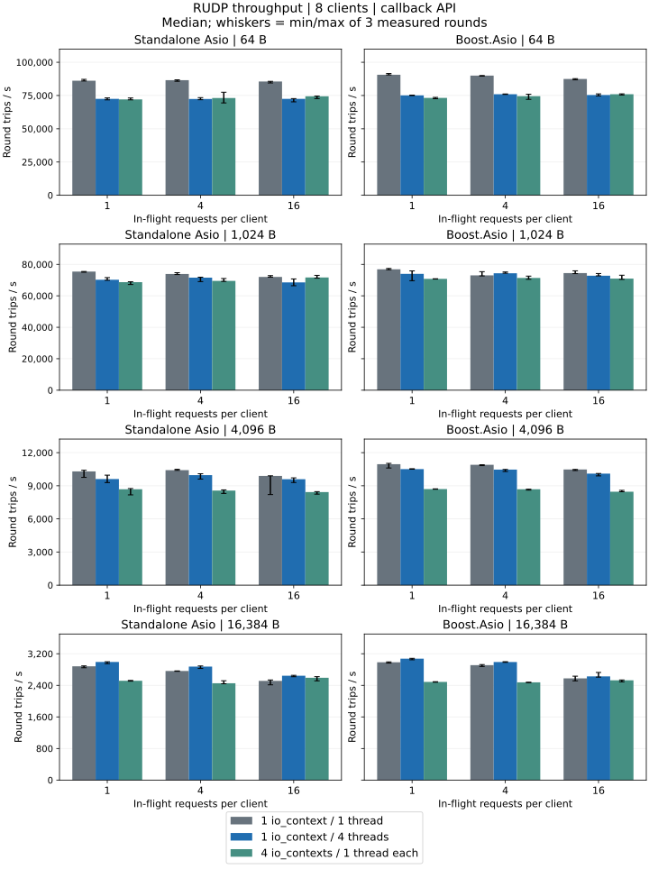
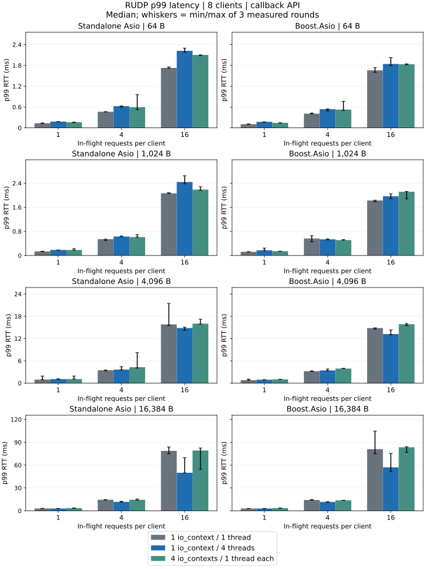
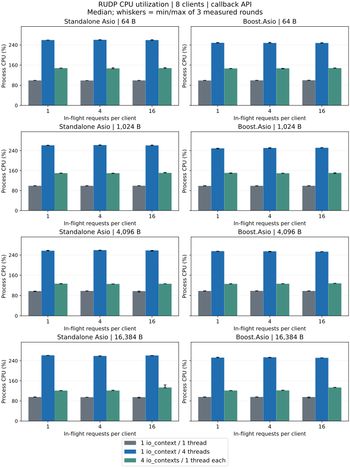

# RUDP Performance

All 72 configurations and 216 measured rounds passed, completing 8,847,130 message round trips with no missing messages, payload errors, ordering errors or drain timeouts.

## Test Environment

| Item | Recorded Value |
| --- | --- |
| Time (UTC) | 2026-10-12T10:38:20Z / 2026-10-12T10:44:57Z |
| Machine | Mac mini (Mac16,11), Apple M4 Pro, 14 logical CPUs, 48 GiB RAM |
| OS | macOS 27.0.1 (26A434), arm64 |
| Build | Apple clang version 21.0.0 (clang-2100.1.1.101); C++20 Release -O3 -DNDEBUG |
| Backends | Standalone Asio 1.38.2, Boost.Asio 1.90.0 |
| Traffic | 8 clients; IPv4 loopback; callback API |
| Measurement | 3 rounds per case; 0.25 s warmup and 1 s measured per round |
| Payload / request window | 64, 1024, 4096, 16384 B / 1, 4, 16 |
| ARQ Settings | MTU 1200 B; send / receive windows 128 / 512 segments; timer 10 ms; congestion control on |
| Receive buffers | Requested 4 MiB; effective server 4 MiB, clients 4 MiB |

All server sessions share one UDP socket and its strand; receive and ARQ processing remain serialized. The four-context configuration mainly distributes clients and does not demonstrate parallel server sharding.

Application messages are fragmented according to the ARQ MTU; 16 KiB is a message size, not the size of one UDP datagram.

## Round-Trip Throughput



## Round-Trip Latency



## CPU Utilization



CPU covers the client, server and every worker in one process. One logical CPU is 100%; divide by this host's 14 logical CPUs to obtain the machine share.

## 1024 B Results

| Backend / IO Model | In-Flight per Client | Round Trips / s | Payload Mbit/s, Both Directions | p50 RTT / ms | p99 RTT / ms | CPU / % |
| --- | ---: | ---: | ---: | ---: | ---: | ---: |
| Standalone Asio / 1 context / 1 thread | 1 | 75,391 | 1,235.2 | 0.105 | 0.136 | 99.4 |
| Standalone Asio / 1 context / 4 threads | 1 | 70,225 | 1,150.6 | 0.108 | 0.184 | 261.5 |
| Standalone Asio / 4 contexts / 4 threads | 1 | 68,667 | 1,125.0 | 0.114 | 0.183 | 150.1 |
| Standalone Asio / 1 context / 1 thread | 4 | 73,881 | 1,210.5 | 0.427 | 0.542 | 99.3 |
| Standalone Asio / 1 context / 4 threads | 4 | 71,556 | 1,172.4 | 0.436 | 0.630 | 262.5 |
| Standalone Asio / 4 contexts / 4 threads | 4 | 69,501 | 1,138.7 | 0.446 | 0.610 | 149.8 |
| Standalone Asio / 1 context / 1 thread | 16 | 72,014 | 1,179.9 | 1.759 | 2.065 | 99.6 |
| Standalone Asio / 1 context / 4 threads | 16 | 68,529 | 1,122.8 | 1.816 | 2.439 | 261.2 |
| Standalone Asio / 4 contexts / 4 threads | 16 | 71,681 | 1,174.4 | 1.764 | 2.187 | 151.2 |
| Boost.Asio / 1 context / 1 thread | 1 | 76,859 | 1,259.3 | 0.103 | 0.121 | 99.1 |
| Boost.Asio / 1 context / 4 threads | 1 | 73,956 | 1,211.7 | 0.106 | 0.172 | 249.3 |
| Boost.Asio / 4 contexts / 4 threads | 1 | 70,786 | 1,159.8 | 0.112 | 0.143 | 151.1 |
| Boost.Asio / 1 context / 1 thread | 4 | 73,006 | 1,196.1 | 0.426 | 0.562 | 99.3 |
| Boost.Asio / 1 context / 4 threads | 4 | 74,345 | 1,218.1 | 0.422 | 0.538 | 250.9 |
| Boost.Asio / 4 contexts / 4 threads | 4 | 71,367 | 1,169.3 | 0.444 | 0.513 | 149.5 |
| Boost.Asio / 1 context / 1 thread | 16 | 74,453 | 1,219.8 | 1.721 | 1.827 | 99.4 |
| Boost.Asio / 1 context / 4 threads | 16 | 72,762 | 1,192.1 | 1.735 | 1.967 | 251.7 |
| Boost.Asio / 4 contexts / 4 threads | 16 | 70,930 | 1,162.1 | 1.782 | 2.116 | 151.0 |

## Findings and Scope

- Standalone Asio: highest 1024 B throughput was 75,391 round trips/s at 99.4% CPU (1 context / 1 thread, window 1); lowest p99 was 0.136 ms (1 context / 1 thread, window 1).
- Boost.Asio: highest 1024 B throughput was 76,859 round trips/s at 99.1% CPU (1 context / 1 thread, window 1); lowest p99 was 0.121 ms (1 context / 1 thread, window 1).

Bars show the median across rounds; whiskers are the actual minimum/maximum, not confidence intervals. RTT summarizes each round's sampled percentile; throughput includes in-flight drain time, and payload bandwidth excludes protocol headers.

These are 1 s local IPv4 loopback measurements, not WAN throughput, latency or loss-resilience results. No coroutine API was measured.

## Reproduction and Raw Data

```sh
cmake -S . -B build-perf -DCMAKE_BUILD_TYPE=Release -DARKNET_BUILD_BENCHMARKS=ON \
  -DARKNET_USE_BOOST_ASIO=OFF -DARKNET_ASIO_INCLUDE_DIR=/path/to/asio/include
cmake --build build-perf --target arknet_rudp_benchmark
build-perf/benchmarks/arknet_rudp_benchmark --payload 1024 --clients 8 --window 16 \
  --io-model shared --io-threads 4 --seconds 1 --warmup 0.25 --rounds 3
```

Maintainers collect the matrix with shell; the standalone C++ executable does not require jq, Python or Ruby.

```sh
bash scripts/rudp_matrix.sh --build-dir build-perf --backend standalone \
  --backend-include /path/to/asio/include --output benchmarks/results/local-rudp
```

Configure Boost in a separate build directory with `-DARKNET_USE_BOOST_ASIO=ON`; collect with `--backend boost --backend-include /path/to/boost/include` and identical measurement settings.

[Full values and measurement metadata](rudp-summary.json)

[Project raw JSON, commands and host metadata](https://github.com/OpenArkStudio/arknet/tree/main/benchmarks/results/macmini-m4pro-20261012-rudp)
