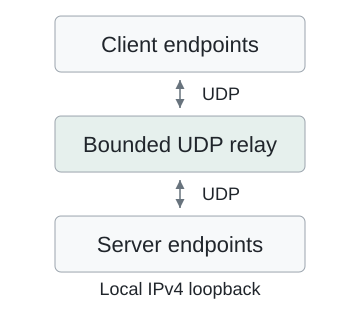
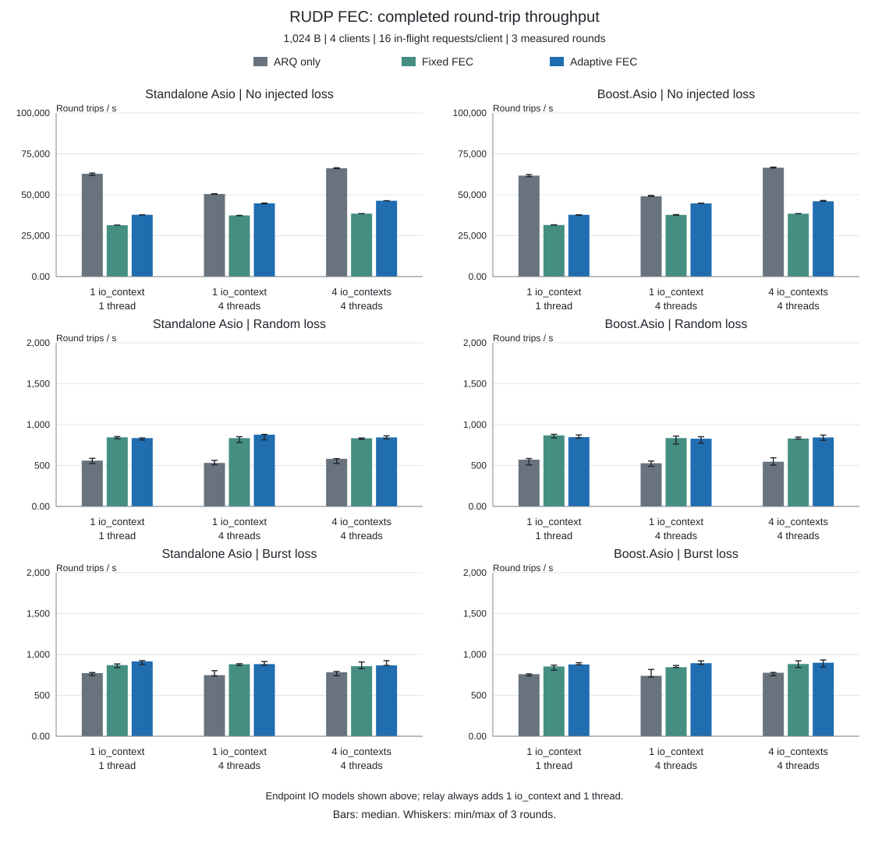
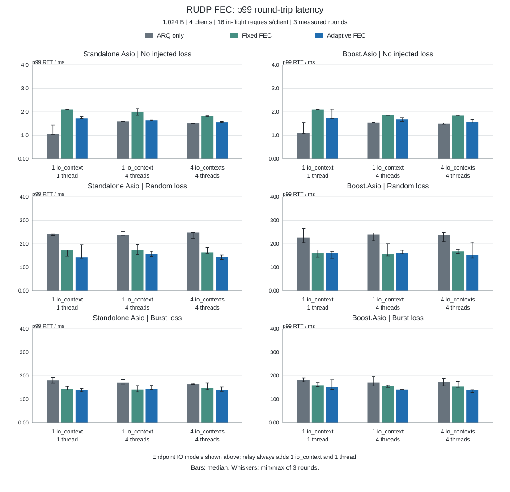
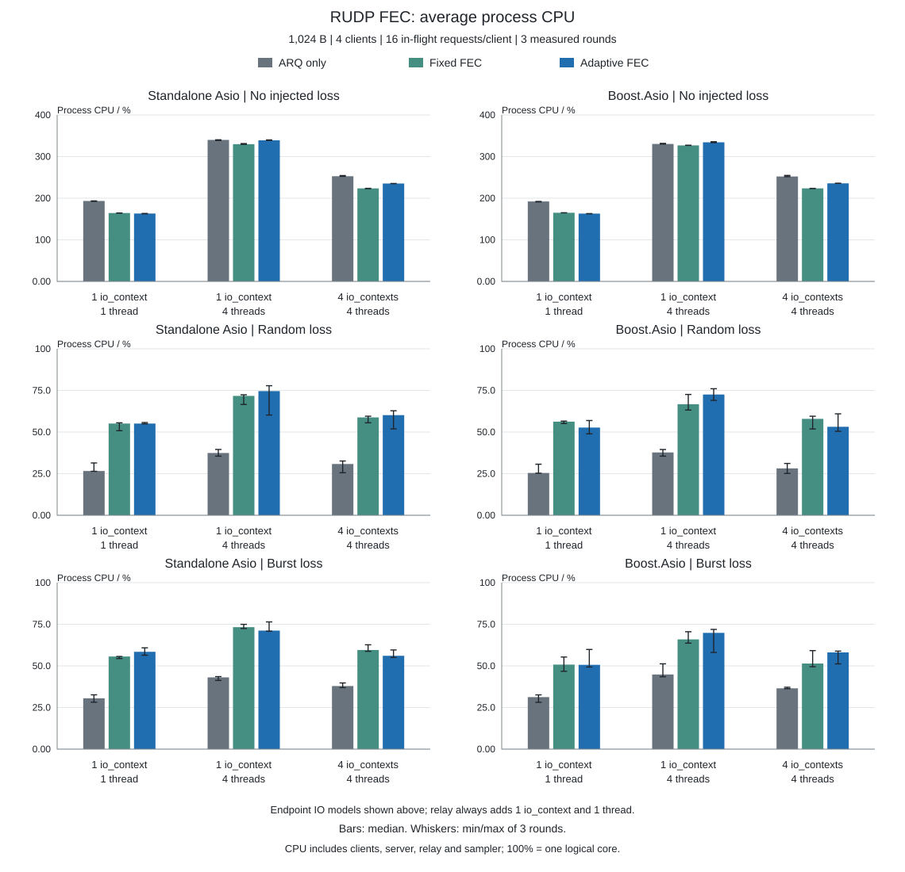
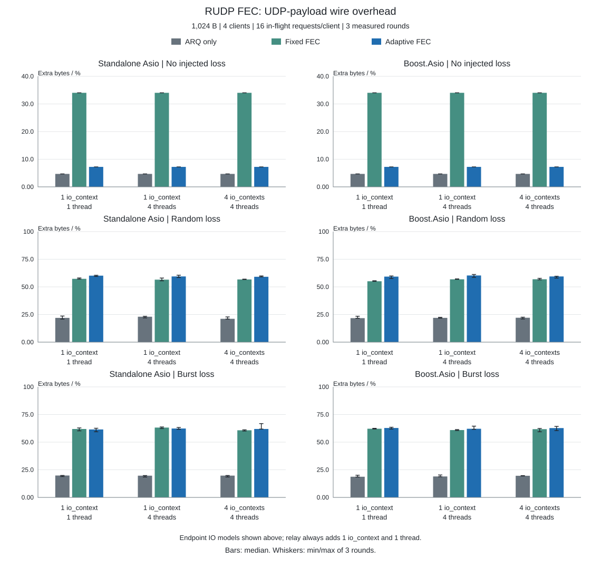
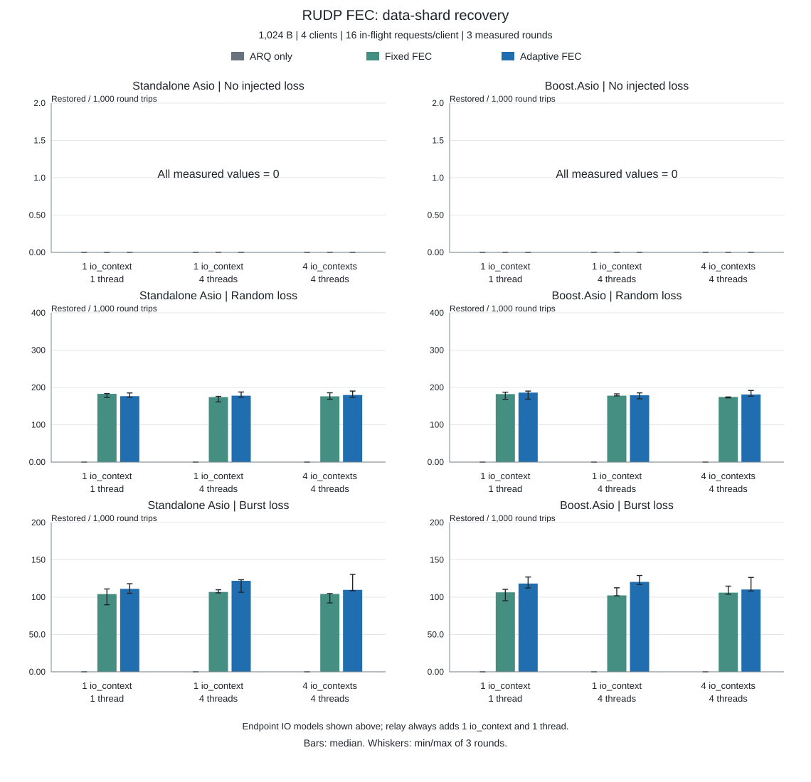
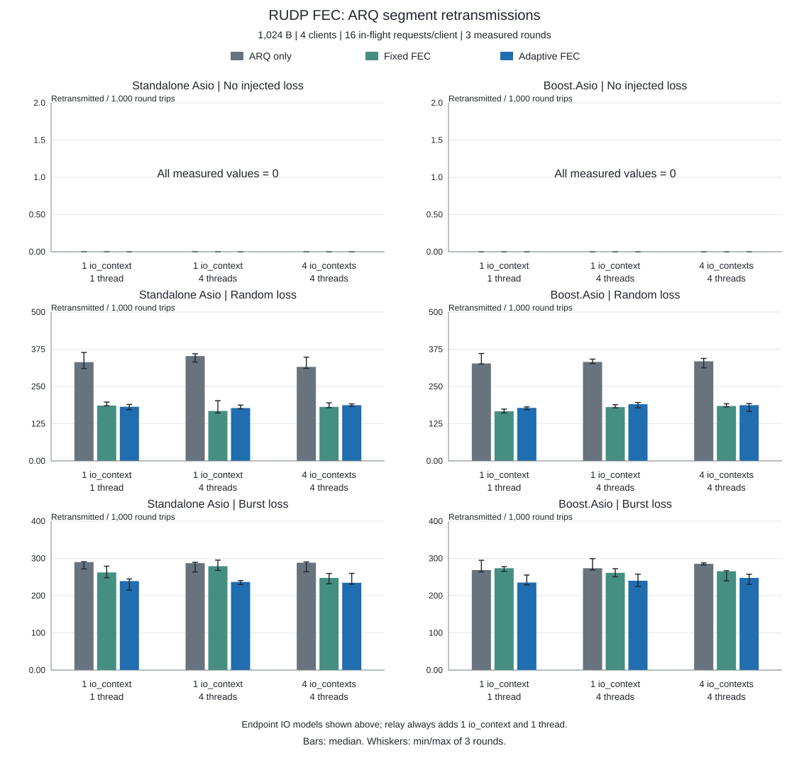
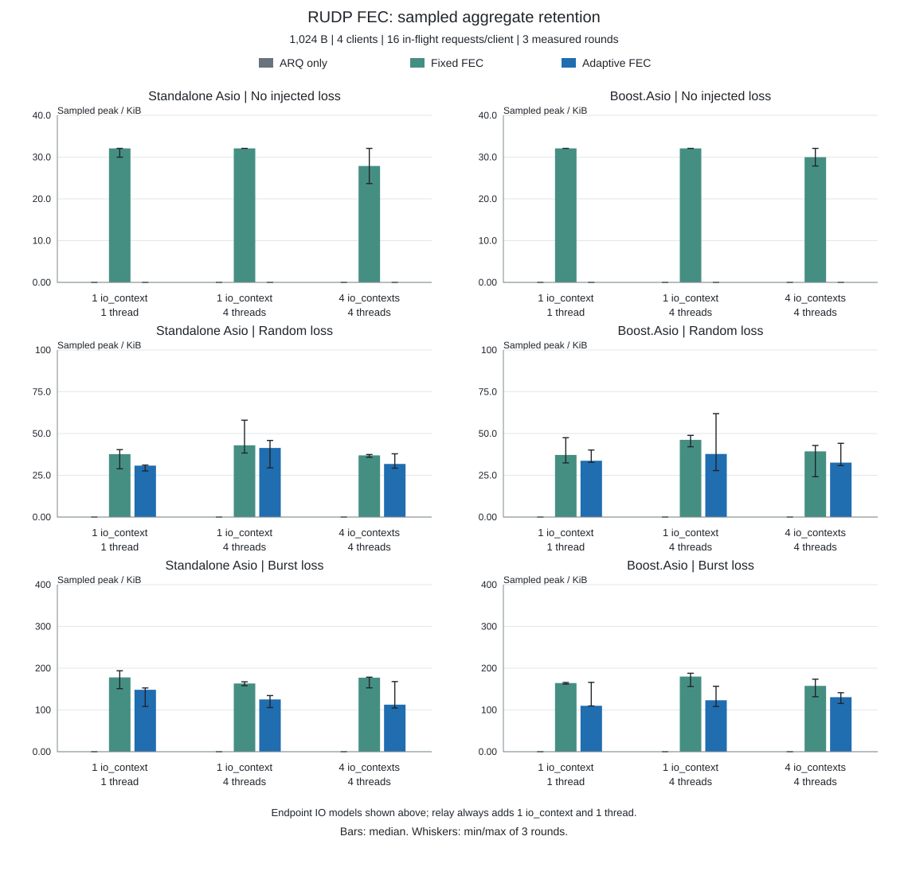

# RUDP 性能

本机 96 组配置、276 次测量全部通过，共完成 7,960,439 次消息往返。内容、顺序、发送完成和收尾检查均通过；中继错误和容量溢出均为零。

## 测试环境

| 项目 | 实际参数 |
| --- | --- |
| 时间（UTC） | 2026-10-13T03:20:31Z / 2026-10-13T04:00:27Z |
| 机器 | Mac mini (Mac16,11)；Apple M4 Pro；14 个逻辑核心；48 GiB RAM |
| 系统 | macOS 27.0.1 (26A434)；arm64 |
| 编译 | Apple clang version 21.0.0 (clang-2100.1.1.101)；C++20 Release `-O3 -DNDEBUG -std=gnu++20; no sanitizers`；CMake 4.3.3 |
| 依赖 | Standalone Asio 1.38.2；Boost 1.90.0；OpenSSL 3.6.4 |
| 端点负载 | 4 个客户端，完整消息回显，无额外业务计算；回调 API |
| 主比较 | 54 组，每组 3 轮；每轮预热 2 s，测量 3 s；1024 B，每连接在途 16 条 |
| 包体／窗口 | 36 组；64／4096／16384 B，窗口 1／64；随机丢包，1 个 io_context／1 个线程 |
| 持续测试 | 6 组，每组单次 120 s；4096 B，窗口 16；1 个 io_context／4 个线程 |
| 重复采样 | 主比较和维度测量使用 42／43／44；每条路由、每个方向使用独立序列 |
| socket 接收缓冲 | 端点实际 4 MiB |
| ARQ | UDP MTU 1200 B；发送／接收窗口 128／512 个分片；更新周期 10 ms；拥塞控制开启 |
| FEC 分组 | 最多 8 个数据分片；固定校验 2 个，自适应上限 4 个；分组等待设置 2 ms |
| FEC 预算 | 每端点保留 1 MiB；每组校验报文字节上限为数据报文字节的 50% |
| 中继容量 | 每路由 8 MiB／8192 个报文 |

源码 SHA-256：`15cb6ced6425d82086a083fd310f6d75016ac3a1018264856d41b460e4412d85`。

## 网络条件与测量口径

| 条件 | 丢包 | 单程延迟 | 重复／乱序 |
| --- | --- | ---: | --- |
| 无主动丢包 | 0 | 0 ms | 0 |
| 随机丢包 | 每个报文 5% | 10 ms | 1% 重复，5% 额外延迟 15 ms |
| 连续丢包 | 每方向、每 100 个报文连续丢 3 个 | 10 ms | 同上 |
| 持续测试 | 连续丢包，另对剩余报文随机丢 2% | 10 ms | 同上 |



这是同一进程、本机 IPv4 回环上的网络条件模拟，不是 WAN 实测。中继始终另用 1 个 io_context 和 1 个线程；统计采样另有线程。图中 IO 模型仅表示端点配置。

服务端会话共用 UDP socket 及其 strand。4 个 io_context 各 1 个线程主要分散客户端，不能据此推断服务端已并行分片。

RTT 包含模拟延迟、拥塞控制、FEC 组包等待和 ARQ 重传。吞吐量按完成的消息往返计算，分母包含收完在途请求的时长。柱高为三轮中位数，误差线为这三个实际结果的最小／最大值，不是置信区间。

## 吞吐量与 p99 RTT





## CPU 与网络开销



CPU 为整个进程的平均占用，包含客户端、服务端、中继和采样线程；单个逻辑核心为 100%，多线程可以超过 100%。本机整机占比为进程 CPU% / 14，完整数值同时保存这两种口径。



网络开销 =（端点发送的 UDP 载荷字节／双向应用消息字节 − 1）× 100%。它包含 ARQ 控制与重传、FEC 头部、校验和填充，不含 IP／UDP 头，也不重复计算中继再次转发的字节；不能把它直接当作 FEC 校验比例。

## 恢复、重传与保留内存





恢复数统计 FEC 还原的数据分片，重传数统计 ARQ 重发的协议分片；都按每 1000 次应用消息往返归一化，两者不是互为补数。



FEC 保留量是各端点统计之和，每 100 ms 采样一次，可能错过更短的峰值；不包含全部临时编解码空间。中继指标是各路由独立峰值之和，峰值可能出现在不同时间。RSS 是每组进程的最高值，包含预热及该组全部轮次，不是 FEC 独占内存。

### 随机丢包下的资源数值

1024 B、窗口 16、1 个 io_context／1 个端点线程；采样峰值使用三轮中位数。

| 依赖库／策略 | 恢复／1000 往返 | 重传／1000 往返 | FEC 保留／KiB | 中继路由峰值和／KiB | 进程 RSS／MiB | 观测最大校验数 |
| --- | ---: | ---: | ---: | ---: | ---: | ---: |
| Standalone Asio / 仅 ARQ | 0.0 | 331.7 | 0.0 | 50.5 | 6.8 | 0 |
| Standalone Asio / 固定 FEC | 182.8 | 185.9 | 37.7 | 84.3 | 7.1 | 2 |
| Standalone Asio / 自适应 FEC | 176.7 | 181.8 | 30.8 | 83.4 | 7.2 | 3 |
| Boost.Asio / 仅 ARQ | 0.0 | 327.3 | 0.0 | 52.4 | 7.0 | 0 |
| Boost.Asio / 固定 FEC | 182.2 | 166.5 | 37.2 | 87.1 | 7.3 | 2 |
| Boost.Asio / 自适应 FEC | 186.2 | 178.0 | 33.7 | 93.8 | 7.3 | 3 |

## 包体大小与批量请求

随机丢包条件、1 个 io_context／1 个端点线程。每格为「消息往返/s／p99 RTT 毫秒」，均为三轮中位数；CPU、网络开销和资源计数见完整 JSON。

### Standalone Asio

| 消息／B | 每连接在途 | 仅 ARQ | 固定 FEC | 自适应 FEC |
| ---: | ---: | ---: | ---: | ---: |
| 64 | 1 | 139 / 80.8 | 116 / 91.4 | 140 / 79.6 |
| 64 | 64 | 450 / 876.3 | 421 / 941.3 | 419 / 920.6 |
| 4,096 | 1 | 74 / 139.4 | 114 / 93.5 | 113 / 88.5 |
| 4,096 | 64 | 146 / 2,096.2 | 223 / 1,432.5 | 234 / 1,285.4 |
| 16,384 | 1 | 20 / 344.9 | 29 / 240.2 | 31 / 228.5 |
| 16,384 | 64 | 42 / 6,239.0 | 64 / 4,019.4 | 67 / 4,034.0 |

### Boost.Asio

| 消息／B | 每连接在途 | 仅 ARQ | 固定 FEC | 自适应 FEC |
| ---: | ---: | ---: | ---: | ---: |
| 64 | 1 | 138 / 81.9 | 117 / 96.8 | 142 / 78.4 |
| 64 | 64 | 435 / 853.7 | 446 / 895.7 | 406 / 998.8 |
| 4,096 | 1 | 75 / 141.5 | 119 / 93.5 | 115 / 95.5 |
| 4,096 | 64 | 142 / 2,108.6 | 228 / 1,342.6 | 232 / 1,247.0 |
| 16,384 | 1 | 21 / 383.5 | 30 / 235.1 | 31 / 264.8 |
| 16,384 | 64 | 41 / 6,212.4 | 63 / 4,157.4 | 66 / 4,102.8 |

应用消息按协议 MTU 分片；16 KiB 表示应用消息大小，不是一个 UDP 数据报。FEC 模式从 1200 B UDP 载荷上限中扣除 26 B 开销，ARQ 数据报上限为 1174 B。

## 120 秒持续测试

每组仅测一次，不绘制重复测量的误差线。所有消息校验通过；表中内存仍使用上文的统计口径，不能仅凭峰值宣称不存在长期泄漏。

| 依赖库／策略 | 消息往返数 | 往返/s | p99／ms | CPU／% | 网络开销／% | FEC 采样峰值／KiB |
| --- | ---: | ---: | ---: | ---: | ---: | ---: |
| Standalone Asio / 仅 ARQ | 20,734 | 172 | 599.6 | 48.6 | 24.2 | 0.0 |
| Standalone Asio / 固定 FEC | 27,622 | 229 | 448.3 | 82.1 | 66.2 | 232.6 |
| Standalone Asio / 自适应 FEC | 29,058 | 241 | 453.6 | 84.9 | 70.3 | 166.8 |
| Boost.Asio / 仅 ARQ | 20,870 | 173 | 606.4 | 50.3 | 23.9 | 0.0 |
| Boost.Asio / 固定 FEC | 27,666 | 230 | 453.8 | 80.2 | 66.4 | 242.6 |
| Boost.Asio / 自适应 FEC | 29,136 | 242 | 445.3 | 84.7 | 70.0 | 148.5 |

## 结果与选型

以下仅比较主矩阵的 1 个 io_context／1 个端点线程，避免把不同线程配置混成策略排名。

| 依赖库 | 网络条件 | 最高往返吞吐量 | 最低 p99 RTT |
| --- | --- | ---: | ---: |
| Standalone Asio | 无主动丢包 | 仅 ARQ 62,827 往返/s | 仅 ARQ 1.1 ms |
| Standalone Asio | 随机丢包 | 固定 FEC 844 往返/s | 自适应 FEC 142.5 ms |
| Standalone Asio | 连续丢包 | 自适应 FEC 914 往返/s | 自适应 FEC 139.5 ms |
| Boost.Asio | 无主动丢包 | 仅 ARQ 61,705 往返/s | 仅 ARQ 1.1 ms |
| Boost.Asio | 随机丢包 | 固定 FEC 869 往返/s | 固定 FEC 160.0 ms |
| Boost.Asio | 连续丢包 | 自适应 FEC 878 往返/s | 自适应 FEC 150.7 ms |

以下范围为两种依赖方案的三轮中位数范围：

- 无主动丢包：仅 ARQ 达到 61,705 - 62,827 往返/s，p99 为 1.06 - 1.09 ms；两种依赖方案的吞吐量和 p99 均优于本次测量的 FEC 策略。
- 随机丢包：FEC 的吞吐量为 835 - 869 往返/s，仅 ARQ 为 560 - 572。代价是进程 CPU 从 25.4 - 26.6% 升至 52.7 - 56.2%，网络额外字节比例从 21.7 - 21.9% 升至 55.1 - 60.1%。
- 随机丢包、64 B、每连接仅 1 条在途请求：固定 FEC 为 116 - 117 往返/s，低于仅 ARQ 的 138 - 139；小消息低并发场景也需要单独评估。

这些结果不构成通用赢家。策略选择需要同时考虑 p99、CPU、网络字节和内存预算；固定 FEC 的实际校验数仍受分组密度及字节预算约束，自适应 FEC 也需要足够样本和调整时间。完整数值保留实际丢包比例、观测校验数及策略变化次数。

本报告没有跨主机、真实 WAN、IPv6 压力或 RUDP 协程测量。RUDP 公开 API 当前使用回调，协程属于 TODO。仅 ARQ 与两个 FEC 策略使用相同中继拓扑，应在相同网络条件和端点 IO 模型下比较。

## 复现与完整数据

```sh
cmake -S . -B build-perf -DCMAKE_BUILD_TYPE=Release -DARKNET_BUILD_BENCHMARKS=ON \
  -DARKNET_USE_BOOST_ASIO=OFF -DARKNET_ASIO_INCLUDE_DIR=/path/to/asio/include
cmake --build build-perf --target arknet_rudp_benchmark
build-perf/benchmarks/arknet_rudp_benchmark --payload 1024 --clients 4 --window 16 \
  --io-model shared --io-threads 1 --fec adaptive --profile random \
  --loss-percent 5 --delay-ms 10 --duplicate-percent 1 --reorder-percent 5 \
  --seconds 3 --warmup 2 --rounds 3 --seed 42
```

Boost 在另一构建目录设置 `-DARKNET_USE_BOOST_ASIO=ON`。单项用例由 C++ 程序直接执行；维护者批量入口为 `bash benchmarks/run_rudp_fec.sh BUILD_DIR OUTPUT_DIR`，不需要 Python 或 Ruby。每组实际命令、退出码及错误输出均随原始数据保存。

可选离线报告工具只需要 Node，不参与网络测试启动：

```sh
node benchmarks/report_rudp_fec.mjs --self-check
node benchmarks/report_rudp_fec.mjs \
  --results benchmarks/results/macmini-m4pro-20261013/rudp-fec --output docs/performance
```

[完整指标与测量元数据](rudp-fec-summary.json)

[原始 JSON、实际命令与退出码](https://github.com/OpenArkStudio/arknet/tree/main/benchmarks/results/macmini-m4pro-20261013/rudp-fec)
