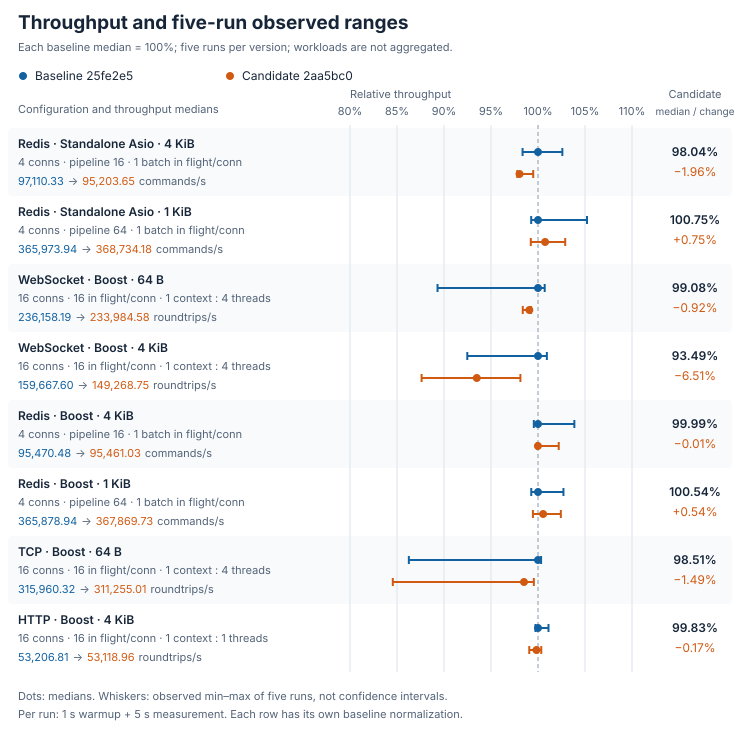

# Five-second workload comparison

The 4 KiB WebSocket case has 6.51% lower median throughput and 13.29% higher P99. Five-run throughput ranges overlap for every configuration; the cause of the differences is unconfirmed. The charts and tables show all other cases.

Each version/configuration uses five fresh processes, with 1 s warmup and 5 s measurement. Baseline and candidate run adjacently with alternating order. All 80 rows are complete, with zero failures, errors or timeouts. Tables show median [minimum–maximum]; ranges are five observations, not confidence intervals.

## Throughput and CPU

Redis throughput counts thousands of successful commands/s; TCP/HTTP/WebSocket count thousands of message roundtrips/s. Configurations are not added together. One full CPU core is 100%: Redis counts the client process; public endpoints count the colocated client/server process. CPU efficiency is throughput per CPU core, calculated per run before taking the median.

| Configuration | Baseline throughput, k/s | Candidate throughput, k/s | Change | CPU%, baseline → candidate | CPU efficiency change |
| --- | ---: | ---: | ---: | ---: | ---: |
| Redis · Standalone Asio · 4 KiB pipeline16 · window1 · 4 clients | 97.11 [95.52–99.63] | 95.20 [94.97–96.62] | −1.96% | 96.57 → 97.73 | −2.96% |
| Redis · Standalone Asio · 1 KiB pipeline64 · window1 · 4 clients | 365.97 [363.32–385.05] | 368.73 [363.17–376.57] | +0.75% | 102.34 → 103.23 | −0.88% |
| WebSocket · Boost · 64 B window16 · 4 workers · 16 clients | 236.16 [210.92–237.84] | 233.98 [232.33–234.42] | −0.92% | 366.14 → 368.33 | −1.55% |
| WebSocket · Boost · 4 KiB window16 · 4 workers · 16 clients | 159.67 [147.66–161.17] | 149.27 [139.90–156.68] | −6.51% | 372.05 → 369.21 | −5.79% |
| Redis · Boost · 4 KiB pipeline16 · window1 · 4 clients | 95.47 [95.05–99.16] | 95.46 [95.36–97.58] | −0.01% | 97.28 → 97.38 | −0.08% |
| Redis · Boost · 1 KiB pipeline64 · window1 · 4 clients | 365.88 [363.26–375.79] | 367.87 [363.90–374.77] | +0.54% | 102.30 → 102.76 | +0.18% |
| TCP · Boost · 64 B window16 · 4 workers · 16 clients | 315.96 [272.55–317.00] | 311.26 [267.16–314.56] | −1.49% | 359.25 → 361.72 | −1.98% |
| HTTP · Boost · 4 KiB window16 · 1 worker · 16 clients | 53.21 [53.06–53.80] | 53.12 [52.71–53.39] | −0.17% | 82.15 → 82.26 | −0.30% |

## Latency (µs)

Redis measures the entire pipeline batch; public endpoints measure a single message roundtrip.

| Configuration | Baseline P50 | Candidate P50 | Baseline P99 | Candidate P99 |
| --- | ---: | ---: | ---: | ---: |
| Redis · Standalone Asio · 4 KiB | 661.00 [638.50–669.96] | 671.96 [665.25–672.46] | 711.00 [707.17–722.63] | 715.92 [712.71–730.25] |
| Redis · Standalone Asio · 1 KiB | 699.67 [663.42–703.92] | 695.83 [674.38–704.46] | 749.67 [719.71–755.96] | 750.08 [743.58–754.58] |
| WebSocket · Boost · 64 B | 1086.79 [1080.71–1226.83] | 1097.04 [1095.58–1105.42] | 1310.71 [1299.83–1412.96] | 1316.29 [1297.46–1330.38] |
| WebSocket · Boost · 4 KiB | 1581.50 [1570.83–1713.96] | 1632.58 [1617.46–1811.17] | 1990.00 [1900.25–2232.42] | 2254.42 [1993.67–3181.96] |
| Redis · Boost · 4 KiB | 670.54 [640.75–673.13] | 670.79 [657.71–671.25] | 713.38 [706.63–716.67] | 711.92 [709.38–713.25] |
| Redis · Boost · 1 KiB | 700.38 [676.92–704.42] | 697.83 [681.42–703.00] | 750.42 [743.63–755.42] | 747.83 [744.00–750.38] |
| TCP · Boost · 64 B | 806.17 [804.25–952.71] | 820.88 [815.21–967.88] | 1124.96 [1115.63–1180.96] | 1131.50 [1094.21–1238.42] |
| HTTP · Boost · 4 KiB | 4779.29 [4738.50–4794.00] | 4804.46 [4786.33–4821.88] | 5082.04 [5053.21–5111.67] | 5124.08 [5079.75–5128.21] |

## Measurement environment

Apple M4 Pro (Mac16,11), 14 cores, 48 GiB; macOS 27.0.1 (26A434); Apple Clang 21, `-O3 -DNDEBUG -std=gnu++20`; Boost 1.90, Standalone Asio 1.38.2 and OpenSSL 3.6.4. All configurations use plaintext IPv4 loopback. The Redis-protocol server is Valkey 8.0.11. Interval: 2026-10-15 19:36:55–19:45:00 UTC.

Baseline `25fe2e5fac4e09edee597f312d58b0362b9e0681`, candidate `2aa5bc0ef7d383d8cfbc04520f3b952fa27c5fbd`, using identical formal C++ benchmark drivers. Redis uses four connections, one context/worker per connection and one in-flight batch. Public endpoints use 16 connections, window16 and one shared context, with four workers except HTTP (one). This comparison covers callbacks, not pools, coroutines, shutdown duration or deployment capacity.

## Reproduce

[Shared-driver build](../../benchmarks/comparison/README.md) · [Database configuration grid](database-comparison.md) · [Transport configuration grid](transport-comparison.md)
