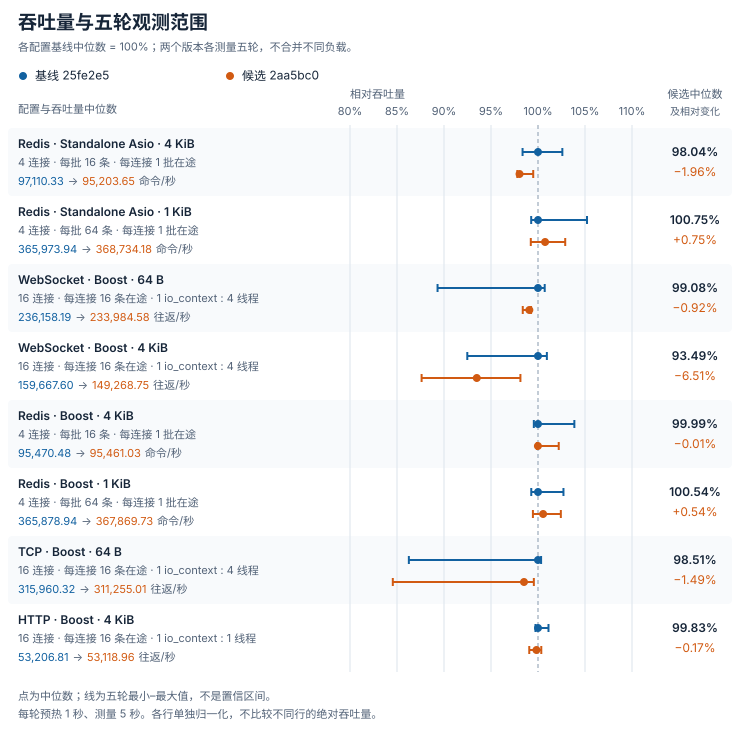

# 5 秒负载对照

<Aside type="caution" title="WebSocket 回归">

WebSocket 4 KiB 吞吐中位数下降 6.51%，P99 增加 13.29%；所有配置的两版本五轮吞吐范围均重叠，原因未确定。其他配置见图表。

</Aside>

每版本／配置用五个独立进程，预热 1 秒、测量 5 秒；基线与候选相邻运行、交替顺序。80 条数据完整，失败、错误、超时为零。表格为中位数 [最小值–最大值]，五次范围不是置信区间。

## 吞吐量与 CPU

Redis 为千条命令/秒，TCP/HTTP/WebSocket 为千次消息往返/秒；配置不相加。单核 CPU 为 100%；Redis 计客户端，其余计同机客户端／服务端。每轮 CPU 效率 = 吞吐量 /（CPU 占用率 / 100），再取五轮中位数。

| 配置 | 基线吞吐，千次/秒 | 候选吞吐，千次/秒 | 变化 | CPU%，基线 → 候选 | CPU 效率变化 |
| --- | ---: | ---: | ---: | ---: | ---: |
| Redis · Standalone Asio · 4 KiB 每批 16 条命令 · 每连接 1 批在途 · 4 个连接 | 97.11 [95.52–99.63] | 95.20 [94.97–96.62] | −1.96% | 96.57 → 97.73 | −2.96% |
| Redis · Standalone Asio · 1 KiB 每批 64 条命令 · 每连接 1 批在途 · 4 个连接 | 365.97 [363.32–385.05] | 368.73 [363.17–376.57] | +0.75% | 102.34 → 103.23 | −0.88% |
| WebSocket · Boost · 64 B 每连接 16 条在途 · 4 个线程 · 16 个连接 | 236.16 [210.92–237.84] | 233.98 [232.33–234.42] | −0.92% | 366.14 → 368.33 | −1.55% |
| WebSocket · Boost · 4 KiB 每连接 16 条在途 · 4 个线程 · 16 个连接 | 159.67 [147.66–161.17] | 149.27 [139.90–156.68] | −6.51% | 372.05 → 369.21 | −5.79% |
| Redis · Boost · 4 KiB 每批 16 条命令 · 每连接 1 批在途 · 4 个连接 | 95.47 [95.05–99.16] | 95.46 [95.36–97.58] | −0.01% | 97.28 → 97.38 | −0.08% |
| Redis · Boost · 1 KiB 每批 64 条命令 · 每连接 1 批在途 · 4 个连接 | 365.88 [363.26–375.79] | 367.87 [363.90–374.77] | +0.54% | 102.30 → 102.76 | +0.18% |
| TCP · Boost · 64 B 每连接 16 条在途 · 4 个线程 · 16 个连接 | 315.96 [272.55–317.00] | 311.26 [267.16–314.56] | −1.49% | 359.25 → 361.72 | −1.98% |
| HTTP · Boost · 4 KiB 每连接 16 条在途 · 1 个线程 · 16 个连接 | 53.21 [53.06–53.80] | 53.12 [52.71–53.39] | −0.17% | 82.15 → 82.26 | −0.30% |

## 延迟（µs）

Redis 为整批流水线请求的响应时间；TCP/HTTP/WebSocket 为单条消息往返时间。

| 配置 | 基线 P50 | 候选 P50 | 基线 P99 | 候选 P99 |
| --- | ---: | ---: | ---: | ---: |
| Redis · Standalone Asio · 4 KiB | 661.00 [638.50–669.96] | 671.96 [665.25–672.46] | 711.00 [707.17–722.63] | 715.92 [712.71–730.25] |
| Redis · Standalone Asio · 1 KiB | 699.67 [663.42–703.92] | 695.83 [674.38–704.46] | 749.67 [719.71–755.96] | 750.08 [743.58–754.58] |
| WebSocket · Boost · 64 B | 1086.79 [1080.71–1226.83] | 1097.04 [1095.58–1105.42] | 1310.71 [1299.83–1412.96] | 1316.29 [1297.46–1330.38] |
| WebSocket · Boost · 4 KiB | 1581.50 [1570.83–1713.96] | 1632.58 [1617.46–1811.17] | 1990.00 [1900.25–2232.42] | 2254.42 [1993.67–3181.96] |
| Redis · Boost · 4 KiB | 670.54 [640.75–673.13] | 670.79 [657.71–671.25] | 713.38 [706.63–716.67] | 711.92 [709.38–713.25] |
| Redis · Boost · 1 KiB | 700.38 [676.92–704.42] | 697.83 [681.42–703.00] | 750.42 [743.63–755.42] | 747.83 [744.00–750.38] |
| TCP · Boost · 64 B | 806.17 [804.25–952.71] | 820.88 [815.21–967.88] | 1124.96 [1115.63–1180.96] | 1131.50 [1094.21–1238.42] |
| HTTP · Boost · 4 KiB | 4779.29 [4738.50–4794.00] | 4804.46 [4786.33–4821.88] | 5082.04 [5053.21–5111.67] | 5124.08 [5079.75–5128.21] |

## 测量环境

Apple M4 Pro（Mac16,11），14 核，48 GiB；macOS 27.0.1（26A434）；Apple Clang 21，`-O3 -DNDEBUG -std=gnu++20`；Boost 1.90、Standalone Asio 1.38.2、OpenSSL 3.6.4。所有配置均使用 IPv4 本机回环、明文传输；Redis 协议服务端为 Valkey 8.0.11。测量区间：2026-10-15 19:36:55–19:45:00 UTC。

基线 `25fe2e5fac4e09edee597f312d58b0362b9e0681`，候选 `2aa5bc0ef7d383d8cfbc04520f3b952fa27c5fbd`，使用相同的正式 C++ benchmark 驱动。Redis 使用 4 个连接，每连接 1 个 io_context 和 1 个线程、1 批在途请求；TCP/HTTP/WebSocket 使用 16 个连接、每连接 16 条在途请求、1 个共享 io_context，除 HTTP 为 1 个线程，其余为 4 个线程。本组只比较回调接口，不代表连接池、协程、关闭耗时或生产容量。

## 复现

<CardGrid>
<LinkCard title="统一驱动构建" href="../../benchmarks/comparison/README_CN.md" />
<LinkCard title="数据库配置矩阵" href="database-comparison_CN.md" />
<LinkCard title="网络端点配置矩阵" href="transport-comparison_CN.md" />
</CardGrid>
