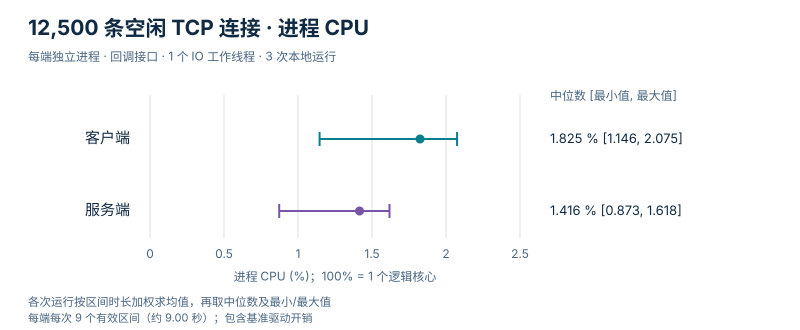
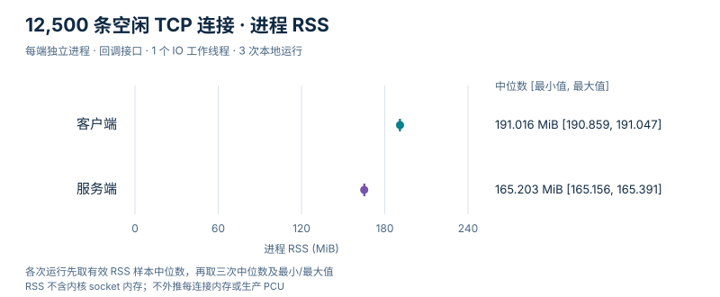
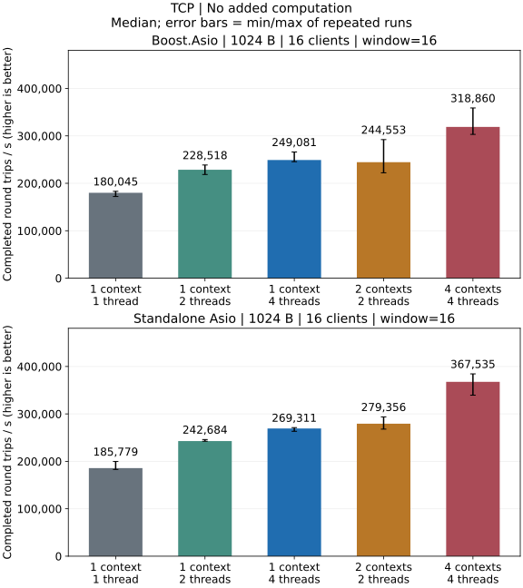
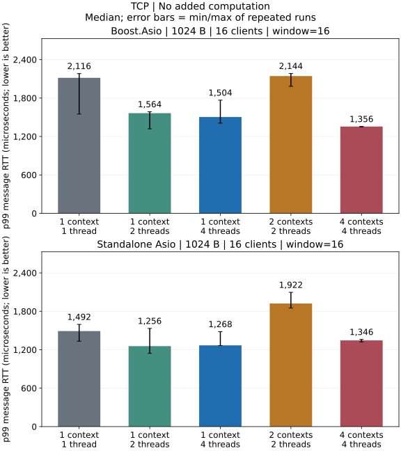

# TCP 本地性能

数据来自本机 Release 构建的独立回环进程，不来自 CI。

[指标定义与测量方法](methodology_CN.md).

平均进程 CPU 占用率以单核为 100%，多线程可超过 100%；估算值单独标注，三次 CPU 采样不完整时为 N/A。 本机有 14 个逻辑核心，整机占比 = 进程 CPU% / 14，单核 100% 对应整机 7.14%。

## 12,500 条空闲连接驻留

arknet 和原生 Asio 对照程序各完成三组独立的双进程运行，每组驻留 12,500 条空闲连接。
所有连接均完成且清理成功，报告的错误数和 DATA 帧数均为零。两者使用基准源码
`2852f603`，包含 v0.2.2 之外尚未发布的变更；原生运行记录的检出版本 `9ae08dd`
仅增加文档。

| 共同配置 | 值 |
| --- | --- |
| 主机 | Apple M4 Pro / Mac16,11；14 个物理核心、14 个逻辑核心；48 GiB；macOS 27.0.1（26A434） |
| 构建 | AppleClang 21.0.0，Release `-O3 -DNDEBUG`；Boost 1.90；关闭 TLS |
| 执行模型 | IPv4 回环、回调接口；每进程一个 `io_context`、一个 IO 工作线程 |
| 连接 / 驻留 | 12,500 条；请求驻留 10 秒；每种实现运行三次；arknet 记录的客户端实际驻留为 10.000–10.002 秒 |
| 建连 / 流量配置 | 每秒最多发起 1,000 次建连，并行 32；配置包体 1 KiB / 窗口 4，空闲期间无 DATA |
| 每进程限额 | 接收缓冲初始值 / 上限均为 4 KiB；待发送上限 64 MiB；缓冲预算 256 MiB；FD 限额 20,000；总期限 60 秒，额外清理 5 秒 |
| 采样 | 间隔 1 秒：arknet 使用 `--sample-ms 1000`；原生对照固定间隔，不传 `--sample-ms` |

| 实现 / 端点 | CPU %：中位数 [最小值, 最大值] | RSS MiB：中位数 [最小值, 最大值] | FD 中位数 | 总线程数中位数 |
| --- | ---: | ---: | ---: | ---: |
| arknet / 客户端 | 1.825 [1.146, 2.075] | 191.016 [190.859, 191.047] | 12,506 | 5 |
| 原生 Asio / 客户端 | 1.846 [1.815, 1.995] | 122.047 [121.859, 122.047] | 12,508 | 3 |
| arknet / 服务端 | 1.416 [0.873, 1.618] | 165.203 [165.156, 165.391] | 12,507 | 4 |
| 原生 Asio / 服务端 | 1.513 [1.504, 1.681] | 114.844 [114.656, 114.906] | 12,509 | 3 |

每端仅采用相邻两次均满足 `active=ready=started=12500`、
`finished=pending_send_bytes=0` 的采样区间。采样先读取 `started`，再查询资源，最后读取
`finished`。每次运行有九个有效 CPU 区间（约 9.00 秒）：用区间时长加权区间终点的 CPU
样本，再取三次运行均值的中位数及最小值、最大值。RSS、FD 和线程数先取每次运行十个有效
样本的中位数，再取三次中位数及范围。误差线表示最小值和最大值，不是置信区间。
CPU 包含基准驱动开销，单个逻辑核心为 100%。RSS 不含内核 socket 内存；总线程数包含
基准及辅助线程。原生程序的最终结果不单独报告驻留时长。

CPU 范围存在重叠。两个驱动的实现及辅助线程配置不同，因此不能据此单独归因库开销，
也不能判定 CPU 优胜。RSS 差异可作为进一步分析的线索，不外推单连接开销或 PCU。

批次预检使用 49152–65535 临时端口范围，每轮结束后约有 12,500 个 `TIME_WAIT` socket，
轮次之间最多等待 33 秒自然释放，未调整系统 socket 参数。另一个未等待端口余量的 arknet 连续
批次，第二轮建连达到 3,815 条时因 `EADDRNOTAVAIL` 失败；此处完成的运行不代表可以无间隔
连续达到相同连接目标。参见[连接基准的限制](../../benchmarks/CONNECTIONS_CN.md#参数与限制)。

空闲驻留不代表吞吐量、RTT 或生产 PCU 验收，也未解决已知的 5,000 条活动连接 Echo
响应超时问题；参见[生产验收](../project/production-readiness_CN.md)。

独立原生诊断对照提供 `--operation-trace on`，默认为 `off`，用于保留有界的组合读写操作
历史及一秒工作线程进度标记。失败清理时冻结历史，并输出最多 16 个会话；输出明确报告
缺失／被覆盖历史及 `low_level_operations: false`。它不观察单次底层 socket 读写，
也不确定超时根因。按需诊断不属于上述测量，5,000 条活动连接问题仍未解决。
原始轨迹保留本地，负载和期限保持原值；参见[操作历史](../../benchmarks/CONNECTIONS_CN.md#按需启用操作历史)。

## 无额外业务计算

### 全部测试负载

#### 64 B / 1 客户端 / window=1

| 依赖库 / 模型 | 往返 / s | MiB/s | p50 / us | p95 / us | p99 / us | CPU / % | RSS / MiB |
| --- | ---: | ---: | ---: | ---: | ---: | ---: | ---: |
| Boost.Asio / 2 个 io_context / 2 个线程 | 59,430 [59,390, 60,057] | 7.25 | 16.67 | 19.79 | 26.00 | 73.9（估算） | 7.06 |
| Boost.Asio / 4 个 io_context / 4 个线程 | 59,362 [59,244, 60,179] | 7.25 | 16.67 | 20.00 | 25.67 | 73.5（估算） | 7.12 |
| Boost.Asio / 1 个 io_context / 1 个线程 | 51,897 [44,622, 56,008] | 6.34 | 18.79 | 22.25 | 29.21 | 72.6（估算） | 7.00 |
| Boost.Asio / 1 个 io_context / 2 个线程 | 52,792 [51,693, 53,166] | 6.44 | 18.38 | 24.33 | 32.00 | 107.7（估算） | 7.02 |
| Boost.Asio / 1 个 io_context / 4 个线程 | 43,604 [43,604, 44,905] | 5.32 | 21.92 | 29.96 | 42.46 | 172.1（估算） | 7.06 |
| Standalone Asio / 2 个 io_context / 2 个线程 | 58,602 [58,445, 60,258] | 7.15 | 16.75 | 19.17 | 23.29 | 73.3（估算） | 7.47 |
| Standalone Asio / 4 个 io_context / 4 个线程 | 58,603 [56,473, 59,790] | 7.15 | 16.71 | 19.17 | 22.92 | 72.7（估算） | 7.48 |
| Standalone Asio / 1 个 io_context / 1 个线程 | 54,344 [54,173, 54,487] | 6.63 | 18.12 | 22.25 | 23.46 | 72.7（估算） | 7.42 |
| Standalone Asio / 1 个 io_context / 2 个线程 | 52,192 [52,156, 52,975] | 6.37 | 18.96 | 23.96 | 26.17 | 106.6（估算） | 7.39 |
| Standalone Asio / 1 个 io_context / 4 个线程 | 44,675 [42,729, 44,875] | 5.45 | 21.83 | 27.96 | 38.50 | 172.3（估算） | 7.48 |

#### 1024 B / 1 客户端 / window=1

| 依赖库 / 模型 | 往返 / s | MiB/s | p50 / us | p95 / us | p99 / us | CPU / % | RSS / MiB |
| --- | ---: | ---: | ---: | ---: | ---: | ---: | ---: |
| Boost.Asio / 2 个 io_context / 2 个线程 | 57,741 [56,127, 57,808] | 112.78 | 15.88 | 21.42 | 27.33 | 82.0（估算） | 7.03 |
| Boost.Asio / 4 个 io_context / 4 个线程 | 57,639 [56,429, 57,907] | 112.58 | 15.92 | 21.29 | 26.25 | 82.0（估算） | 7.14 |
| Boost.Asio / 1 个 io_context / 1 个线程 | 54,386 [53,166, 54,864] | 106.22 | 17.33 | 22.25 | 27.42 | 75.5（估算） | 7.03 |
| Boost.Asio / 1 个 io_context / 2 个线程 | 49,739 [47,909, 50,131] | 97.15 | 19.00 | 24.08 | 29.75 | 108.2（估算） | 7.05 |
| Boost.Asio / 1 个 io_context / 4 个线程 | 41,420 [41,121, 42,935] | 80.90 | 22.62 | 30.75 | 45.00 | 163.7（估算） | 7.06 |
| Standalone Asio / 2 个 io_context / 2 个线程 | 54,414 [54,006, 56,483] | 106.28 | 16.46 | 22.04 | 25.17 | 82.0（估算） | 7.41 |
| Standalone Asio / 4 个 io_context / 4 个线程 | 55,325 [54,331, 61,146] | 108.06 | 16.42 | 22.08 | 24.92 | 82.1（估算） | 7.52 |
| Standalone Asio / 1 个 io_context / 1 个线程 | 56,877 [55,526, 58,685] | 111.09 | 15.33 | 21.83 | 24.12 | 73.5（估算） | 7.44 |
| Standalone Asio / 1 个 io_context / 2 个线程 | 47,400 [46,566, 48,509] | 92.58 | 19.54 | 26.33 | 41.00 | 107.3（估算） | 7.48 |
| Standalone Asio / 1 个 io_context / 4 个线程 | 42,972 [42,858, 43,126] | 83.93 | 22.25 | 27.17 | 34.92 | 165.6（估算） | 7.48 |

#### 16384 B / 1 客户端 / window=1

| 依赖库 / 模型 | 往返 / s | MiB/s | p50 / us | p95 / us | p99 / us | CPU / % | RSS / MiB |
| --- | ---: | ---: | ---: | ---: | ---: | ---: | ---: |
| Boost.Asio / 2 个 io_context / 2 个线程 | 29,424 [29,363, 29,453] | 919.49 | 23.62 | 28.88 | 37.88 | 96.7（估算） | 7.20 |
| Boost.Asio / 4 个 io_context / 4 个线程 | 29,454 [29,289, 29,662] | 920.44 | 23.67 | 28.67 | 37.12 | 96.8（估算） | 7.25 |
| Boost.Asio / 1 个 io_context / 1 个线程 | 29,949 [29,805, 30,202] | 935.89 | 23.42 | 27.21 | 30.83 | 83.5（估算） | 7.14 |
| Boost.Asio / 1 个 io_context / 2 个线程 | 28,812 [26,266, 29,027] | 900.39 | 23.58 | 28.17 | 37.75 | 107.3（估算） | 7.19 |
| Boost.Asio / 1 个 io_context / 4 个线程 | 26,419 [26,413, 26,832] | 825.58 | 25.92 | 32.67 | 46.04 | 125.5（估算） | 7.25 |
| Standalone Asio / 2 个 io_context / 2 个线程 | 29,531 [29,444, 29,922] | 922.83 | 21.58 | 27.38 | 30.62 | 96.9（估算） | 7.64 |
| Standalone Asio / 4 个 io_context / 4 个线程 | 29,849 [29,647, 30,048] | 932.79 | 22.96 | 26.96 | 29.08 | 97.5（估算） | 7.69 |
| Standalone Asio / 1 个 io_context / 1 个线程 | 30,386 [30,376, 30,458] | 949.57 | 22.96 | 26.00 | 28.75 | 83.9（估算） | 7.59 |
| Standalone Asio / 1 个 io_context / 2 个线程 | 28,987 [28,353, 29,073] | 905.84 | 23.58 | 26.46 | 29.96 | 107.0（估算） | 7.61 |
| Standalone Asio / 1 个 io_context / 4 个线程 | 26,615 [26,448, 26,686] | 831.72 | 26.00 | 30.62 | 34.92 | 125.6（估算） | 7.69 |

#### 64 B / 16 客户端 / window=16

| 依赖库 / 模型 | 往返 / s | MiB/s | p50 / us | p95 / us | p99 / us | CPU / % | RSS / MiB |
| --- | ---: | ---: | ---: | ---: | ---: | ---: | ---: |
| Boost.Asio / 2 个 io_context / 2 个线程 | 353,751 [332,547, 385,945] | 43.18 | 630.50 | 1,386.21 | 1,645.96 | 198.3（估算） | 7.75 |
| Boost.Asio / 4 个 io_context / 4 个线程 | 337,371 [316,652, 378,249] | 41.18 | 723.42 | 1,175.12 | 1,306.62 | 386.7（估算） | 8.06 |
| Boost.Asio / 1 个 io_context / 1 个线程 | 206,555 [186,590, 220,080] | 25.21 | 1,143.38 | 1,292.00 | 1,400.50 | 92.6（估算） | 7.67 |
| Boost.Asio / 1 个 io_context / 2 个线程 | 269,589 [265,087, 279,678] | 32.91 | 924.92 | 1,115.54 | 1,247.21 | 190.4（估算） | 7.75 |
| Boost.Asio / 1 个 io_context / 4 个线程 | 270,820 [252,850, 278,262] | 33.06 | 937.71 | 1,198.58 | 1,373.25 | 347.6（估算） | 7.78 |
| Standalone Asio / 2 个 io_context / 2 个线程 | 394,247 [380,536, 405,659] | 48.13 | 628.96 | 707.25 | 829.88 | 198.7（估算） | 8.12 |
| Standalone Asio / 4 个 io_context / 4 个线程 | 366,652 [330,421, 386,971] | 44.76 | 603.96 | 1,024.42 | 1,288.08 | 388.5（估算） | 8.44 |
| Standalone Asio / 1 个 io_context / 1 个线程 | 217,308 [212,278, 219,504] | 26.53 | 1,156.62 | 1,274.71 | 1,315.58 | 93.6（估算） | 8.11 |
| Standalone Asio / 1 个 io_context / 2 个线程 | 285,174 [283,238, 288,514] | 34.81 | 883.83 | 947.75 | 1,121.67 | 193.7（估算） | 8.11 |
| Standalone Asio / 1 个 io_context / 4 个线程 | 288,163 [276,394, 293,016] | 35.18 | 873.54 | 1,088.08 | 1,160.21 | 350.3（估算） | 8.22 |

#### 1024 B / 16 客户端 / window=16

| 依赖库 / 模型 | 往返 / s | MiB/s | p50 / us | p95 / us | p99 / us | CPU / % | RSS / MiB |
| --- | ---: | ---: | ---: | ---: | ---: | ---: | ---: |
| Boost.Asio / 2 个 io_context / 2 个线程 | 244,553 [222,067, 292,123] | 477.64 | 880.25 | 1,998.96 | 2,143.50 | 198.0（估算） | 8.42 |
| Boost.Asio / 4 个 io_context / 4 个线程 | 318,860 [303,099, 358,789] | 622.77 | 780.79 | 1,296.62 | 1,355.54 | 386.1（估算） | 9.22 |
| Boost.Asio / 1 个 io_context / 1 个线程 | 180,045 [172,130, 183,104] | 351.65 | 1,383.71 | 1,869.00 | 2,115.67 | 98.3（估算） | 8.42 |
| Boost.Asio / 1 个 io_context / 2 个线程 | 228,518 [218,598, 238,567] | 446.32 | 1,084.58 | 1,354.42 | 1,563.54 | 192.1（估算） | 8.39 |
| Boost.Asio / 1 个 io_context / 4 个线程 | 249,081 [245,620, 266,010] | 486.49 | 996.83 | 1,317.00 | 1,503.62 | 356.9（估算） | 8.52 |
| Standalone Asio / 2 个 io_context / 2 个线程 | 279,356 [267,876, 293,718] | 545.62 | 866.33 | 1,225.62 | 1,921.58 | 198.9（估算） | 8.88 |
| Standalone Asio / 4 个 io_context / 4 个线程 | 367,535 [339,487, 384,398] | 717.84 | 555.17 | 1,248.25 | 1,346.00 | 383.4（估算） | 10.52 |
| Standalone Asio / 1 个 io_context / 1 个线程 | 185,779 [182,846, 199,625] | 362.85 | 1,357.42 | 1,470.71 | 1,491.79 | 97.2（估算） | 8.80 |
| Standalone Asio / 1 个 io_context / 2 个线程 | 242,684 [242,348, 246,017] | 473.99 | 1,033.83 | 1,113.62 | 1,255.75 | 195.7（估算） | 8.80 |
| Standalone Asio / 1 个 io_context / 4 个线程 | 269,311 [263,372, 271,047] | 526.00 | 904.92 | 1,218.21 | 1,268.12 | 360.5（估算） | 8.86 |

#### 16384 B / 16 客户端 / window=16

| 依赖库 / 模型 | 往返 / s | MiB/s | p50 / us | p95 / us | p99 / us | CPU / % | RSS / MiB |
| --- | ---: | ---: | ---: | ---: | ---: | ---: | ---: |
| Boost.Asio / 2 个 io_context / 2 个线程 | 96,161 [95,965, 104,362] | 3,005.03 | 2,482.12 | 3,397.50 | 3,679.67 | 198.2（估算） | 20.25 |
| Boost.Asio / 4 个 io_context / 4 个线程 | 148,025 [147,285, 148,683] | 4,625.78 | 1,717.62 | 2,070.46 | 2,115.83 | 395.6（估算） | 20.53 |
| Boost.Asio / 1 个 io_context / 1 个线程 | 48,945 [48,371, 49,648] | 1,529.53 | 5,209.58 | 5,369.21 | 5,476.25 | 96.4（估算） | 20.17 |
| Boost.Asio / 1 个 io_context / 2 个线程 | 94,887 [92,178, 101,487] | 2,965.21 | 2,605.42 | 3,078.71 | 3,396.25 | 197.2（估算） | 20.38 |
| Boost.Asio / 1 个 io_context / 4 个线程 | 146,104 [141,990, 159,259] | 4,565.75 | 1,662.62 | 2,231.62 | 2,517.04 | 386.1（估算） | 20.42 |
| Standalone Asio / 2 个 io_context / 2 个线程 | 103,133 [100,600, 103,868] | 3,222.89 | 2,426.38 | 2,545.00 | 3,439.38 | 198.3（估算） | 20.69 |
| Standalone Asio / 4 个 io_context / 4 个线程 | 152,527 [151,687, 153,073] | 4,766.46 | 1,596.12 | 2,085.83 | 2,140.21 | 393.9（估算） | 29.03 |
| Standalone Asio / 1 个 io_context / 1 个线程 | 51,629 [48,682, 51,653] | 1,613.40 | 4,953.25 | 5,028.42 | 5,122.96 | 100.0（估算） | 20.67 |
| Standalone Asio / 1 个 io_context / 2 个线程 | 100,397 [97,068, 101,140] | 3,137.40 | 2,511.00 | 2,765.21 | 3,189.75 | 197.7（估算） | 20.62 |
| Standalone Asio / 1 个 io_context / 4 个线程 | 154,490 [153,953, 160,717] | 4,827.80 | 1,583.00 | 2,191.58 | 2,474.79 | 389.5（估算） | 20.64 |

表格记录重复运行的中位数，吞吐量方括号为最小值和最大值；误差范围不是置信区间。延迟取各次采样分位数的中位数，不合并样本。
