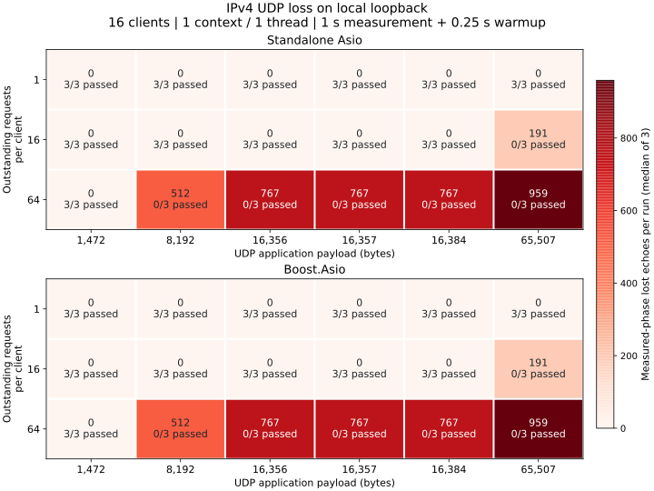

# UDP Datagram Size and Burst Loss

Measured on 2026-10-12. [Test machine and receive-buffer diagnosis](udp-update.md).

Mac mini M4 Pro Release IPv4 loopback: 16 clients, one context/thread, no added computation; 1 s measurement, 0.25 s warmup. Each dependency runs six payloads × three windows × three repetitions: **36 pass, 18 fail**.



Cells: lost echoes/run during measurement. Counts match across three repetitions and both dependencies. Raw JSON retains warmup errors; failed configurations are excluded from throughput comparisons.

- Every payload passes at window 1, including **65,507 bytes**. The 1,472-byte
  payload also passes at windows 16 and 64.
- At window 64, 8,192-byte messages lose 512 echoes per run;
  16,356/16,357/16,384-byte messages each lose 767. The 65,507-byte payload
  loses 191 at window 16 and 959 at window 64.

## Payload and MTU Limits

| Ordinary UDP payload | IPv4 | IPv6 |
| --- | ---: | ---: |
| Protocol maximum | 65,507 = 65,535 − 20 − 8 | 65,527 = 65,535 − 8 |
| Without fragmentation at MTU 1,500 | 1,472 = 1,500 − 20 − 8 | 1,452 = 1,500 − 40 − 8 |
| Mathematical budget at MTU 16,384 | 16,356 | 16,336 |

<Aside type="caution" title="MTU and validation scope">

Budgets assume a 20-byte IPv4 header or 40-byte IPv6 base header, plus 8-byte UDP header; options/extensions reduce payload. IPv6 jumbograms are excluded; IPv6 routers do not fragment. These IPv4-only diagnostics do not establish IPv6 load limits.

`lo0` MTU is 16,384, yet larger successful datagrams recorded zero IPv4 fragmentation/reassembly. The mathematical boundary is not an observed fragmentation threshold. Size cross-host payloads by actual path MTU.

</Aside>

## Kernel Evidence

| Dependency | Full socket buffers before → after | Increase | IPv4 fragmentation / reassembly increase |
| --- | ---: | ---: | ---: |
| Standalone Asio | 89,059 → 112,837 | 23,778 | 0 / 0 |
| Boost.Asio | 126,672 → 150,450 | 23,778 | 0 / 0 |

Each dependency lost 11,889 measured-phase echoes. System-wide kernel counts include warmup and record burst receive-buffer overflow; no recorded IPv4 fragmentation supports that explanation for the losses. Send admission/completion and content errors are zero.

Actual buffers: **64 KiB send / 4 MiB receive**. `net.inet.udp.maxdgram=9216` and `net.inet.udp.recvspace=786896` were unchanged; successful 65,507-byte echoes show 9,216 was not these sockets’ effective payload ceiling. At 16 KiB, window 16 passes and window 64 overflows: validity and burst capacity are separate.

## Reproduce

<Steps>

<Step title="Run an independent case">

Compile using [UDP build instructions](../features/udp/performance.md#build-and-run),
then run an independent C++ case:

```sh
build-perf/benchmarks/arknet_loopback_benchmark \
  --protocol udp --payload 65507 --clients 16 --window 1 \
  --io-model shared --io-threads 1 --work 0 --warmup 0.25 --seconds 1
```

</Step>

<Step title="Read archives and generate charts">

The archived [Standalone command and kernel snapshots](https://github.com/OpenArkStudio/arknet/tree/7685e241bebd086d50da403f2cf06a72bbef1085/benchmarks/results/macmini-m4pro-20261012-udp/limits)
also retain the complete shell matrix and the Boost command. The optional
offline chart tool needs the [report environment](methodology.md#metrics-and-charts):

```sh
build/report-venv/bin/python scripts/udp_limits_report.py \
  --input-dir /path/to/arknet-history/benchmarks/results/macmini-m4pro-20261012-udp/limits \
  --output docs/performance/assets/udp-limits-loss.svg
```

</Step>

<Step title="Check the offline tool">

Report-tool checks use a deterministic synthetic matrix to validate calculations
and reject malformed data; they do not load archived measurements or launch network tests:

```sh
python3 -m unittest discover -s scripts -p 'test_udp_limits_report.py' -v
```

[Standalone raw JSON](https://raw.githubusercontent.com/OpenArkStudio/arknet/7685e241bebd086d50da403f2cf06a72bbef1085/benchmarks/results/macmini-m4pro-20261012-udp/limits/standalone.json) ·
[Boost raw JSON](https://raw.githubusercontent.com/OpenArkStudio/arknet/7685e241bebd086d50da403f2cf06a72bbef1085/benchmarks/results/macmini-m4pro-20261012-udp/limits/boost.json) ·
[Numeric chart data](assets/udp-limits-loss.json ':ignore') ·
[Environment and measurement definitions](../project/testing.md)

Source SHA-256: `0771574af8ca56f1914deb544b956079e0a2f24021953ded5f5d524e3df334b1`.

See [Buffers and flow control](../guides/socket-buffers.md) for the overflow explanation and configuration.

</Step>

</Steps>
