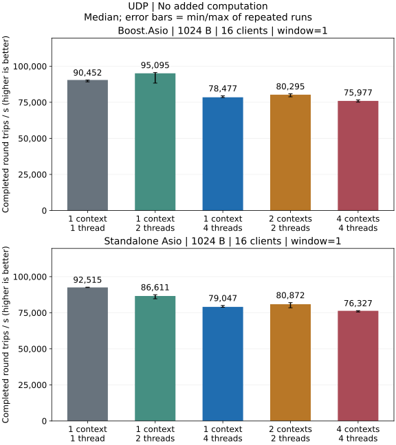
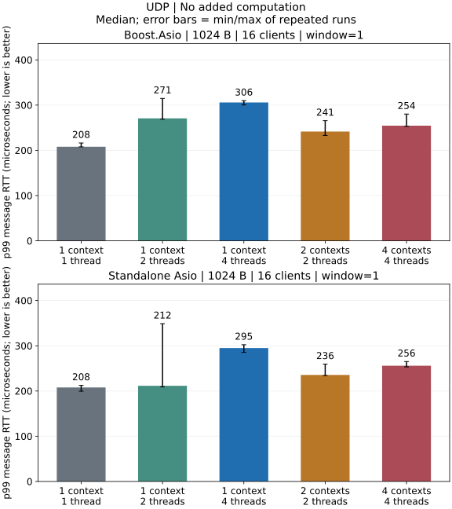

# UDP 性能报告

2026-10-12 本地 Release C++ 测量：504 次矩阵、21 次接收缓冲隔离实验，两种依赖各 60 秒持续测试；非 CI 数据。

## 测试条件

| 项目 | 配置 |
| --- | --- |
| 机器 | Mac mini Mac16,11，Apple M4 Pro，14 核（10 性能 + 4 能效），48 GiB |
| 系统 | macOS 27.0.1（26A434），arm64，接通电源，低电量模式关闭 |
| 工具链 | Apple Clang 21.0.0，CMake 4.3.3，Ninja，C++20，Release `-O3 -DNDEBUG` |
| 依赖 | Standalone Asio 1.38.2／Boost 1.90.0，OpenSSL 3.6.4；TLS 构建开启、Sanitizer 关闭 |
| 路径 | IPv4 回环；客户端与服务端同进程；不绑定 CPU 核心 |
| 测量 | 每组独立进程重复 3 次；1 秒测量、0.25 秒预热；隔离实验不预热 |
| socket 缓冲 | 发送 64 KiB／接收 4 MiB；隔离实验改变服务端接收容量 |

矩阵源码 SHA-256：`0771574af8ca56f1914deb544b956079e0a2f24021953ded5f5d524e3df334b1`。隔离实验增加服务端收包计数、可配置接收缓冲；归档保留补丁与程序哈希。

## 正确性与压力范围

| 组别 | Standalone | Boost | 结论 |
| --- | ---: | ---: | --- |
| 持续 UDP 测试 | 60 秒通过 | 60 秒通过 | 本次运行的数据与关闭检查通过 |
| IO 模型，3 档包体 × 2 档客户端 × 5 档模型 | 90 / 90 通过 | 90 / 90 通过 | 窗口 1 的性能基线 |
| 包体／批量，3 档包体 × 4 档窗口 × 3 档模型 | 93 / 108 通过 | 93 / 108 通过 | 合计 62 个有效配置、10 个失败配置 |
| 大小边界，6 档包体 × 3 档窗口 | 36 / 54 通过 | 36 / 54 通过 | 大突发超过接收缓冲容量 |

保留全部失败记录；任一次重复失败，该配置三次结果均不参与吞吐量排名。

## 吞吐量与延迟

1024 字节、16 个客户端、每客户端 1 条在途消息，无额外业务计算：





| 依赖方案 | io_context / 线程 | 往返 / s | p99 RTT / μs | 进程 CPU / % |
| --- | --- | ---: | ---: | ---: |
| Standalone | 1 / 1 | 92,515 | 207.79 | 99.4 |
| Standalone | 1 / 2 | 86,611 | 211.58 | 173.3 |
| Boost | 1 / 1 | 90,452 | 207.96 | 99.7 |
| Boost | 1 / 2 | 95,095 | 270.71 | 157.4 |

此负载下，Standalone 单线程吞吐中位数最高；Boost 双线程吞吐稍高，p99 与 CPU 也更高。

柱高中位数、误差线三次最小／最大值，非置信区间。CPU 含同进程客户端／服务端，单核 100%；整机占比 = 进程 CPU% / 14。

[全部 IO 数值](udp-summary.json) · [64／1024／16384 字节完整结果](udp_CN.md) · [包体与在途数量图表](dimensions-udp_CN.md)

## 接收缓冲隔离实验

16 个客户端、1 个 context／1 个线程；每组重复三次，无预热。表中丢失数量在三次运行中相同。

| 包体 / B | 每客户端在途数量 | 服务端实际接收缓冲 | 总在途包体预算 | 每次丢失 |
| --- | ---: | ---: | ---: | ---: |
| 16,384 | 64 | 1 MiB | 16 MiB | 959 |
| 16,384 | 64 | 2 MiB | 16 MiB | 895 |
| 16,384 | 64 | 4 MiB | 16 MiB | 767 |
| 16,384 | 16 | 4 MiB | 4 MiB | 0 |
| 16,384 | 1 | 4 MiB | 256 KiB | 0 |
| 1,472 | 64 | 4 MiB | 1.44 MiB | 0 |
| 1,024 | 1,024 | 4 MiB | 16 MiB | 12,411 |

全部运行满足：客户端发送数 − 服务端收到数 = 丢失数；服务端收到数 = 客户端回包数。内容和序号错误为零。4 MiB／16 KiB／窗口 64 的一轮中，内核 `dropped due to full socket buffers` 从 152,304 增至 153,071，增量恰好 767；IPv4 分片／重组增量为零。

<Aside type="caution" title="注意：接收队列溢出">

**丢失来自服务端接收队列溢出**，小包大突发同样复现。回环仍受有限队列约束；总在途预算不是瞬时队列长度或通用容量阈值。

</Aside>

[缓冲区与流量控制](../guides/socket-buffers_CN.md)说明配置及 TCP／UDP 区别。原生 UDP 数据报语义不变，不新增默认限速、切包或重传。

## 复现与原始证据

<Steps>

<Step title="编译并运行">

按 [UDP 构建说明](../features/udp/performance_CN.md#%E6%9E%84%E5%BB%BA%E4%B8%8E%E6%89%A7%E8%A1%8C)编译后，直接运行 C++ 用例：

```sh
build-perf/benchmarks/arknet_loopback_benchmark \
  --protocol udp --payload 16384 --clients 16 --window 64 \
  --io-model shared --io-threads 1 --seconds 1 --warmup 0 \
  --udp-server-receive-buffer 4194304
```

</Step>

<Step title="核对预期结果">

<Aside type="caution" title="预期结果">

溢出探测预计返回非零退出码；窗口改为 16，或包体改为 1472，可复现表中无丢失配置。

</Aside>

</Step>

<Step title="检查归档证据">

[完整原始记录、命令与机器信息](https://github.com/OpenArkStudio/arknet/tree/7685e241bebd086d50da403f2cf06a72bbef1085/benchmarks/results/macmini-m4pro-20261012-udp) · [逐次内核快照](https://github.com/OpenArkStudio/arknet/tree/7685e241bebd086d50da403f2cf06a72bbef1085/benchmarks/results/macmini-m4pro-20261012-udp/buffer-probes) · [大小边界图表](udp-limits_CN.md)

<Aside type="caution" title="适用范围">

仅覆盖该机短时 IPv4 回环，未测跨主机或 IPv6 压力容量。[RUDP 报告](rudp_CN.md)独立测量；原生 TCP 协程结果不适用于 UDP。

</Aside>

</Step>

</Steps>
